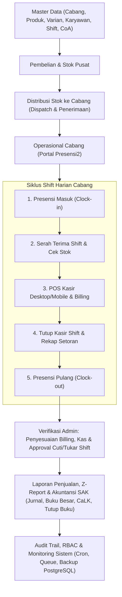
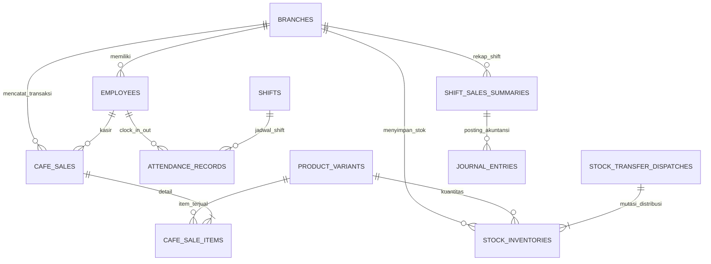

# Maya Graha Kencana — Sistem ERP, POS Kasir & Presensi Terpadu

Sistem manajemen operasional terintegrasi berbasis **Laravel 13** dan **PostgreSQL** untuk mengelola operasional multi-cabang **Maya Graha Kencana** (Presensi Karyawan, POS Kasir Desktop/Mobile, Distribusi & Stok, Billing Shift, Akuntansi SAK, serta Monitoring Sistem & Backup).

-777BB4?style=flat-square&logo=php&logoColor=white)


---

## Daftar Isi

- [1. Alur Diagram ERP](#1-alur-diagram-erp)
- [2. Alur Database](#2-alur-database)
- [3. Petunjuk di Dalam Dokumen (Modul & Navigasi)](#3-petunjuk-di-dalam-dokumen-modul--navigasi)
- [4. Cara Instalasi](#4-cara-instalasi)
- [5. Bio Pembuat Proyek](#5-bio-pembuat-proyek)

---

## 1. Alur Diagram ERP

Aplikasi ini menggabungkan arsitektur modular (`Modules/*`) dan domain-driven (`app/Domains/*`) untuk menghubungkan operasional cabang secara *real-time* ke pusat admin dan pembukuan akuntansi.



---

## 2. Alur Database

Data operasional disimpan secara terpusat di **PostgreSQL** dengan pemisahan relasi untuk SDM/Presensi, Inventaris/Distribusi, Transaksi POS, dan Akuntansi/Sistem.



### Ringkasan Struktur Modul & Domain

| Lokasi | Tanggung Jawab |
| :--- | :--- |
| `app/Domains/Attendance` | Presensi harian, koreksi absen, lembur, tukar shift, kehadiran kegiatan |
| `app/Domains/Employee` | Data shift & penjadwalan karyawan |
| `app/Domains/Leave` | Pengajuan dan persetujuan cuti/izin |
| `Modules/MasterData` | Cabang (`Branch`), Karyawan (`Employee`), Produk/Varian, Merk, Kategori, Supplier, Konsumen, Stok, Penjualan F&B (`CafeSale`) |
| `Modules/Pembelian` | Pengadaan & pembelian stok dari supplier |
| `Modules/Distribusi` | Pengiriman (`Dispatch`) & penerimaan stok antar gudang/cabang |
| `Modules/Penjualan` | Alur transaksi penjualan & POS |
| `Modules/Kas` | Manajemen kas & rekonsiliasi |
| `app/Http/Controllers/Admin` | Dashboard Admin, ERP Hub, Akuntansi SAK, RBAC, Audit Log, Backup & Cron Monitor |

---

## 3. Petunjuk di Dalam Dokumen (Modul & Navigasi)

### A. Portal Admin & ERP (`/admin` / `/bagus/admin`)

| Menu / Route | Fungsi Utama |
| :--- | :--- |
| **Dashboard Utama** (`/admin`) | Ringkasan operasional harian, status cabang, dan akses cepat modul |
| **ERP Hub** (`/admin/erp`) | Peta modul terpadu seluruh divisi beserta kontrol RBAC |
| **1. Data Terpadu** (`/admin/data`) | Profil cabang, manajemen karyawan, jadwal shift, data billing shift, dan rekap presensi |
| **2. Penerimaan Distribusi** (`/admin/distribusi`) | Konfirmasi penerimaan pengiriman stok dari pusat ke cabang |
| **3. Stok & Ketersediaan** (`/admin/stok`) | Pemantauan stok SKU per lokasi/cabang dan stok opname |
| **4. Laporan & Z-Report** (`/admin/laporan`) | Rekapitulasi penjualan harian, per shift, dan laporan kasir |
| **5. Akuntansi & Buku Besar** (`/admin/akuntansi/*`) | Bagan Akun (CoA), Jurnal Umum, Buku Besar, Neraca, Laba Rugi, CaLK, & Tutup Buku |
| **6. Penyesuaian Billing & Kas** (`/admin/penjualan/penyesuaian-billing`) | Otorisasi selisih kas, void/batal transaksi, dan verifikasi setoran shift |
| **7. Approval & Audit** (`/admin/presensi/*`) | Persetujuan cuti, tukar shift, reset password/PIN karyawan, dan Audit Trail |
| **8. Sistem & Backup** (`/admin/system/*`) | Monitoring Cron Scheduler, Queue Worker, dan Backup/Restore PostgreSQL |

### B. Portal Operasional Cabang (`/presensi2`)

- **Presensi Karyawan (`/presensi2`)**: Clock-in/clock-out berbasis validasi cabang, pengajuan izin/koreksi, dan tukar shift.
- **Serah Terima Shift (`/presensi2/serah-terima-v2`)**: Verifikasi saldo laci kasir dan kondisi operasional antar operator shift.
- **POS Kasir Desktop (`/presensi2/pos`)**: Antarmuka kasir desktop untuk transaksi F&B, layanan, cetak struk, serta tutup kasir shift.

---

## 4. Cara Instalasi

### Prasyarat Sistem
- **PHP** `>= 8.3` (direkomendasikan PHP 8.5) dengan ekstensi `pgsql`, `pdo_pgsql`, `mbstring`, `xml`, `curl`, `zip`, `gd`
- **Composer** `2.x`
- **Node.js** `>= 20.x` & **NPM**
- **PostgreSQL** `>= 15` (plus `pg_dump` & `gzip` untuk fitur backup otomatis)

### Langkah Instalasi

1. **Clone repository**
   ```bash
   git clone https://github.com/bagussatoto/baguspresensi.git
   cd baguspresensi
   ```

2. **Install dependensi PHP & JavaScript**
   ```bash
   composer install
   npm install
   ```

3. **Konfigurasi Environment (`.env`)**
   ```bash
   cp .env.example .env
   php artisan key:generate
   ```
   Sesuaikan konfigurasi database PostgreSQL pada file `.env`:
   ```env
   DB_CONNECTION=pgsql
   DB_HOST=127.0.0.1
   DB_PORT=5432
   DB_DATABASE=bagus
   DB_USERNAME=postgres
   DB_PASSWORD=your_password
   ```

4. **Migrasi Database & Build Aset Frontend**
   ```bash
   php artisan migrate
   npm run build
   ```

5. **Menjalankan Aplikasi (Development)**
   ```bash
   php artisan serve
   # atau jalankan bersama Vite dev server:
   composer run dev
   ```

6. **Pengujian & Standar Kode**
   ```bash
   # Jalankan seluruh test PHPUnit
   php artisan test

   # Format kode PHP sesuai standar Laravel Pint
   vendor/bin/pint --dirty
   ```

---

## 5. Bio Pembuat Proyek

| Informasi | Detail |
| :--- | :--- |
| **Nama** | Bagus Satoto |
| **Peran** | Project Owner & Lead Developer |
| **Organisasi** | Maya Graha Kencana / Mayanet |
| **Email** | [bagus@mayanet.com](mailto:bagus@mayanet.com) |
| **GitHub** | [github.com/bagussatoto/baguspresensi](https://github.com/bagussatoto/baguspresensi) |

---

> Dokumen ini dikelola sebagai panduan resmi pengembangan dan operasional sistem ERP **Maya Graha Kencana**.
