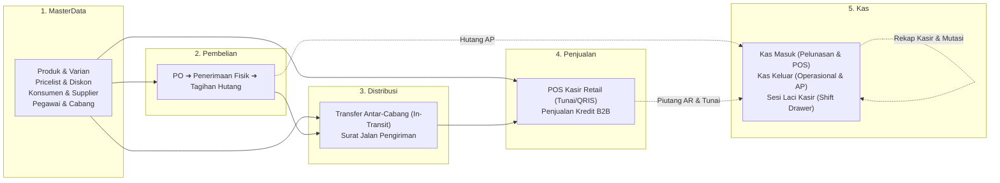

# 🎯 BLUEPRINT RAMPING: 5 MODUL UTAMA ERP DDD PRAGMATIS
## Arsitektur Fokus, Efisien, dan Siap Eksekusi: MasterData, Pembelian, Distribusi, Penjualan, dan Kas
**Versi:** 2.0.0-LEAN-ENTERPRISE  
**Target Framework:** Laravel 11 / 12 / 13 | PHP 8.3+ | PostgreSQL 16  
**Prinsip Utama:** *High Cohesion, Low Coupling, Zero Over-Engineering*  
**Rujukan:** ISO 9001, ISO 27001, PSAK 72, PSAK 14, DJP Coretax  
**DATABaSE POSTGRE 192.168.5.10 username:bagus, pass:123456
---

## 1. 🧭 RASIONALISASI PERAMPINGAN (LEAN ARCHITECTURE)

Memecah sistem menjadi 10 modul terpisah di tahap awal adalah bentuk *over-fragmentation* yang memperlambat rilis produk. Arsitektur dirampingkan secara presisi menjadi **5 Modul Inti yang Saling Mengunci**:



---

## 2. 🗂️ POHON STRUKTUR LENGKAP 5 MODUL (LEAN DIRECTORY TREE)

```
Modules/
├── MasterData/                        <-- Pusat Seluruh Entitas Rujukan
│   ├── app/
│   │   ├── Domain/
│   │   │   ├── Enums/
│   │   │   │   ├── TaxIdType.php                <-- NPWP 16 Digit, NIK KTP, Non-WP
│   │   │   │   ├── CustomerType.php             <-- Retail, Grosir, Reseller, Proyek
│   │   │   │   └── EmployeeRole.php             <-- Salesman, Driver, Kasir, Otorisator
│   │   │   ├── Models/
│   │   │   │   ├── Branch.php                   <-- Cabang Fisik & Pusat/DC
│   │   │   │   ├── Warehouse.php                <-- Gudang Penyimpanan & In-Transit
│   │   │   │   ├── Category.php                 <-- Kategori & Sub-Kategori Produk
│   │   │   │   ├── Brand.php                    <-- Merek Produk
│   │   │   │   ├── UnitOfMeasurement.php        <-- Satuan (Pcs, Box, Lusin, Kg)
│   │   │   │   ├── Product.php                  <-- Product Template (Parent)
│   │   │   │   ├── ProductAttribute.php         <-- Dimensi Varian (Warna, Ukuran)
│   │   │   │   ├── ProductAttributeValue.php    <-- Nilai Dimensi (Merah, Hitam, XL, L)
│   │   │   │   ├── ProductVariant.php           <-- Tangible SKU (Fisik, Barcode, Berat)
│   │   │   │   ├── Pricelist.php                <-- Header Daftar Harga (Grosir, Retail)
│   │   │   │   ├── PricelistItem.php            <-- Matrix Harga per Varian & Tier Qty
│   │   │   │   ├── Customer.php                 <-- Konsumen, Plafon Kredit, & NPWP 16 Digit
│   │   │   │   ├── Supplier.php                 <-- Pemasok, TOP Tenor, & Rekening Bank
│   │   │   │   └── Employee.php                 <-- Karyawan & Otorisator Diskon/Kredit
│   │   │   └── Services/
│   │   │       ├── PriceResolverEngine.php      <-- Selesaikan Harga (Customer-SKU-Qty-Cabang)
│   │   │       ├── PricingEngine.php            <-- Hitung Diskon Bertingkat, DPP, PPN 11%
│   │   │       └── CustomerCreditGuard.php      <-- Validasi Plafon & Piutang Jatuh Tempo
│   │   ├── Application/
│   │   │   ├── Http/Controllers/
│   │   │   │   ├── ProductVariantController.php
│   │   │   │   ├── PricelistController.php
│   │   │   │   ├── CustomerController.php
│   │   │   │   └── SupplierController.php
│   │   │   └── Requests/
│   │   └── Providers/MasterDataServiceProvider.php
│   └── database/migrations/
│
├── Pembelian/                         <-- Pengadaan & Penerimaan Barang
│   ├── app/
│   │   ├── Domain/
│   │   │   ├── Contexts/
│   │   │   │   ├── PurchaseOrderContext.php
│   │   │   │   └── GoodsReceiptContext.php
│   │   │   ├── Enums/
│   │   │   │   ├── PurchaseOrderStatus.php      <-- Draft, Approved, Partial, Closed
│   │   │   │   └── PurchaseBillStatus.php       <-- Unpaid, Partial, Paid
│   │   │   ├── Models/
│   │   │   │   ├── PurchaseOrder.php            <-- Aggregate Root PO
│   │   │   │   ├── PurchaseOrderItem.php
│   │   │   │   ├── GoodsReceipt.php             <-- Bukti Penerimaan Barang Fisik di Gudang
│   │   │   │   ├── GoodsReceiptItem.php
│   │   │   │   ├── PurchaseBill.php             <-- Tagihan Hutang Pembelian (AP)
│   │   │   │   └── PurchaseBillItem.php
│   │   │   ├── Pipelines/
│   │   │   │   ├── ValidatePurchaseOrderPipe.php
│   │   │   │   ├── IncrementWarehouseStockPipe.php  <-- Tambah Stok Fisik
│   │   │   │   └── RecalculateMovingAverageHppPipe.php <-- Update HPP Bergerak
│   │   │   └── Services/
│   │   │       └── PurchaseOrderOrchestrator.php
│   │   ├── Application/
│   │   │   ├── Http/Controllers/
│   │   │   │   ├── PurchaseOrderController.php
│   │   │   │   ├── GoodsReceiptController.php
│   │   │   │   └── PurchaseBillController.php
│   │   │   └── Requests/
│   │   ├── Events/
│   │   │   ├── GoodsReceivedEvent.php           <-- Trigger Stok Masuk & Jurnal Akrual
│   │   │   └── PurchaseBillIssuedEvent.php      <-- Trigger Hutang AP ke Modul Kas
│   │   └── Providers/PembelianServiceProvider.php
│   └── database/migrations/
│
├── Distribusi/                        <-- Mutasi Antar-Cabang & Logistik
│   ├── app/
│   │   ├── Domain/
│   │   │   ├── Contexts/
│   │   │   │   ├── StockTransferDispatchContext.php
│   │   │   │   └── StockTransferReceiveContext.php
│   │   │   ├── Enums/
│   │   │   │   └── TransferStatus.php           <-- Draft, In-Transit, Received, Selisih
│   │   │   ├── Models/
│   │   │   │   ├── StockTransfer.php            <-- Aggregate Root Mutasi Antar-Cabang
│   │   │   │   ├── StockTransferItem.php
│   │   │   │   ├── DeliveryOrder.php            <-- Surat Jalan Pengiriman ke Konsumen
│   │   │   │   └── DeliveryOrderItem.php
│   │   │   ├── Pipelines/
│   │   │   │   ├── DispatchProcessing/          <-- Potong Fisik Asal ➔ Masuk In-Transit
│   │   │   │   │   ├── DeductSourceStockPipe.php
│   │   │   │   │   └── AddInTransitStockPipe.php
│   │   │   │   └── ReceiveProcessing/           <-- Potong In-Transit ➔ Tambah Fisik Tujuan
│   │   │   │       ├── DeductInTransitStockPipe.php
│   │   │   │       └── AddDestinationStockPipe.php
│   │   │   └── Services/
│   │   │       └── StockTransferService.php
│   │   ├── Application/
│   │   │   ├── Http/Controllers/
│   │   │   │   ├── StockTransferController.php
│   │   │   │   └── DeliveryOrderController.php
│   │   │   └── Requests/
│   │   ├── Events/
│   │   │   ├── TransferDispatchedEvent.php      <-- Barang Berangkat (In-Transit)
│   │   │   ├── TransferReceivedEvent.php        <-- Barang Tiba & Divalidasi
│   │   │   └── DeliveryDispatchedEvent.php      <-- Serah Terima Konsumen (PSAK 72)
│   │   └── Providers/DistribusiServiceProvider.php
│   └── database/migrations/
│
├── Penjualan/                         <-- POS Kasir Retail & Penjualan B2B Kredit
│   ├── app/
│   │   ├── Domain/
│   │   │   ├── Contexts/
│   │   │   │   ├── PosCheckoutContext.php       <-- DTO Kasir Cepat
│   │   │   │   ├── PosShiftContext.php          <-- DTO Buka/Tutup Kasir Laci
│   │   │   │   └── SalesOrderContext.php        <-- DTO Order Kredit B2B
│   │   │   ├── Enums/
│   │   │   │   ├── ShiftStatus.php              <-- Open, Closed, Reconciled
│   │   │   │   └── SalesOrderStatus.php         <-- Draft, Confirmed, Shipped, Invoiced, Cancelled
│   │   │   ├── Models/
│   │   │   │   ├── PosShift.php                 <-- Sesi Kasir & Blind Count Kas Laci
│   │   │   │   ├── PosOrder.php                 <-- Nota POS Kasir Selesai Lunas
│   │   │   │   ├── PosOrderItem.php
│   │   │   │   ├── SalesOrder.php               <-- Pesanan Penjualan B2B Kredit
│   │   │   │   ├── SalesOrderItem.php
│   │   │   │   ├── SalesInvoice.php             <-- Faktur Penjualan B2B
│   │   │   │   └── SalesInvoiceItem.php
│   │   │   ├── Pipelines/
│   │   │   │   ├── ValidateCustomerCreditPipe.php
│   │   │   │   ├── ValidateStockAvailabilityPipe.php
│   │   │   │   ├── CalculatePricingAndTaxPipe.php
│   │   │   │   ├── GenerateAtomicInvoiceNumberPipe.php <-- lockForUpdate
│   │   │   │   └── FreezeJsonbSnapshotPipe.php         <-- ISO 27001 Immutability
│   │   │   └── Services/
│   │   │       ├── PosShiftService.php          <-- Rekonsiliasi Selisih Kasir
│   │   │       └── SalesOrderOrchestrator.php
│   │   ├── Application/
│   │   │   ├── Http/Controllers/
│   │   │   │   ├── PosCheckoutController.php
│   │   │   │   ├── PosShiftController.php
│   │   │   │   └── SalesOrderController.php
│   │   │   └── Requests/
│   │   ├── Events/
│   │   │   ├── PosOrderCompletedEvent.php       <-- Trigger Kas Masuk Otomatis ke Modul Kas
│   │   │   └── SalesInvoiceIssuedEvent.php      <-- Trigger Piutang AR Terbuka
│   │   └── Providers/PenjualanServiceProvider.php
│   └── database/migrations/
│
└── Kas/                               <-- HANDLING KAS MASUK & KAS KELUAR
    ├── app/
    │   ├── Domain/
    │   │   ├── Contexts/
    │   │   │   ├── KasMasukContext.php          <-- DTO Penerimaan Uang
    │   │   │   ├── KasKeluarContext.php         <-- DTO Pengeluaran Uang
    │   │   │   └── KasMutasiContext.php         <-- DTO Pindah Kas/Bank
    │   │   ├── Enums/
    │   │   │   ├── KasAccountType.php           <-- Kasir Toko, Kas Operasional, Bank
    │   │   │   ├── PaymentMethodType.php        <-- Tunai, Bank Transfer, QRIS, EDC
    │   │   │   └── KasTransactionType.php       <-- Masuk (In), Keluar (Out), Mutasi (Transfer)
    │   │   ├── Models/
    │   │   │   ├── KasAccount.php               <-- Master Akun Kas & Bank
    │   │   │   ├── KasTransaction.php           <-- Transaksi Kas Masuk / Kas Keluar
    │   │   │   ├── KasTransactionLine.php       <-- Alokasi Faktur (Pelunasan AR/AP)
    │   │   │   └── KasTransfer.php              <-- Mutasi Antar Akun Kas/Bank
    │   │   ├── Services/
    │   │   │   ├── KasMasukService.php          <-- Terima Uang, Tutup Piutang, Pulihkan Plafon
    │   │   │   ├── KasKeluarService.php         <-- Bayar Biaya/Hutang Supplier, Kurangi Saldo
    │   │   │   └── KasMutasiService.php         <-- Pindah Dana Antar Kas/Bank
    │   │   └── Exceptions/
    │   │       ├── InsufficientCashBalanceException.php
    │   │       └── ClosedShiftException.php
    │   ├── Application/
    │   │   ├── Http/Controllers/
    │   │   │   ├── KasAccountController.php
    │   │   │   ├── KasMasukController.php
    │   │   │   ├── KasKeluarController.php
    │   │   │   └── KasMutasiController.php
    │   │   └── Requests/
    │   │       ├── StoreKasMasukRequest.php
    │   │       ├── StoreKasKeluarRequest.php
    │   │       └── StoreKasMutasiRequest.php
    │   ├── Listeners/
    │   │   ├── HandlePosCashInOnOrderCompleted.php  <-- Terima Uang Kas Masuk dari POS
    │   │   └── AutoReleaseCreditLimitOnArSettled.php <-- Pulihkan Plafon Kredit Customer
    │   └── Providers/KasServiceProvider.php
    └── database/migrations/
```

---

## 3. 🔍 DETAIL SPESIFIKASI MODUL KAS (HANDLING KAS MASUK & KELUAR)

Modul **Kas** dirancang sangat praktis untuk menyelesaikan seluruh urusan moneter harian perusahaan tanpa terjebak dalam kerumitan modul akuntansi teoritis:

### 3.1. Kas Masuk (Cash-In Engine)
Menangani 3 jenis penerimaan uang:
1. **Penerimaan dari POS Kasir**: Otomatis tercipta saat kasir menyelesaikan transaksi POS (Tunai, QRIS, EDC) via event listener `HandlePosCashInOnOrderCompleted`.
2. **Pelunasan Piutang Konsumen (AR Settlement)**:
   * Konsumen membayar nota penjualan kredit (bisa lunas sebagian / *partial*, atau borongan banyak nota).
   * Nilai piutang pada `SalesInvoice` berkurang, dan secara atomik `CustomerCreditGuard` **memulihkan plafon kredit konsumen** sebesar nilai yang dibayar.
3. **Penerimaan Lain-Lain**: Pendapatan bunga bank, setoran modal pemilik, atau pengembalian lebih bayar.

### 3.2. Kas Keluar (Cash-Out Engine)
Menangani 3 jenis pengeluaran uang:
1. **Pelunasan Utang Pemasok (AP Settlement)**:
   * Membayar faktur tagihan pembelian (`PurchaseBill`) dari modul Pembelian.
   * Mengurangi saldo akun kas/bank yang dipilih.
   * Mencegah pengeluaran jika saldo kas tidak mencukupi (`InsufficientCashBalanceException`).
2. **Beban Operasional Harian**:
   * Pengeluaran kas kecil (*Petty Cash*) untuk biaya listrik, bensin, konsumsi, ATK, atau biaya pengiriman logistik.
3. **Pengeluaran Lain-Lain**: Penarikan prive pemilik atau pengembalian dana (*refund* konsumen).

### 3.3. Mutasi Kas/Bank (Inter-Account Transfer)
* Menangani perpindahan uang antar akun internal:
  * Setor uang tunai dari **Kasir Toko** ke **Rekening Bank Mandiri Operasional**.
  * Tarik tunai dari **Bank BCA** ke **Kas Operasional Kantor**.
* Menggunakan transaksi atomik: Akun asal berkurang, akun tujuan bertambah pada detik yang sama.

---

## 4. ⚖️ KEPATUHAN AUDIT & INTEGRITAS DATA DALAM 5 MODUL

| Kategori Evaluasi | Titik Kritis Operasional | Mitigasi Ketat DDD Pragmatis |
| :--- | :--- | :--- |
| **Pencegahan Fraud Kas** | Kasir mematikan komputer atau membawa lari uang tunai tanpa pertanggungjawaban. | **Sesi Shift Drawer Kasir**: Kasir wajib melakukan *Blind Count* (menghitung fisik uang tunai tanpa melihat angka sistem). Selisih kas otomatis tercatat pada `selisih_kas`. |
| **Integritas Stok Fisik** | Barang hilang saat pengiriman antar cabang. | **Two-Step Logistics Handshake**: Stok yang keluar dari Cabang Asal masuk ke akun **In-Transit**. Stok Cabang Tujuan hanya bertambah saat petugas penerima memvalidasi fisik barang. |
| **Integritas Piutang & Plafon** | Salesman nakal membuatkan nota kredit untuk konsumen yang sudah macet bayar. | **Credit Limit Gatekeeper**: Pipa `ValidateCustomerCreditPipe` memeriksa `plafon_kredit` dan faktur tertunggak. Jika batas terlampaui, transaksi **terkunci otomatis**. |
| **Kepatuhan Pajak DJP Coretax** | Faktur pajak salah identitas atau selisih pembulatan PPN. | Di `MasterData`, NIK/NPWP 16 digit divalidasi dengan algoritma resmi DJP. Di `Penjualan`, PPN 11% dihitung per baris menggunakan pembulatan ke bawah (*floor*) sesuai aturan Coretax. |
| **Audit Trail (ISO 27001)** | Perubahan harga master merusak nota masa lalu. | Saat transaksi disahkan, seluruh metadata produk, varian, dan konsumen dibekukan ke kolom `snapshot_payload` (JSONB) di PostgreSQL. |

---

## 5. 🚀 URUTAN IMPLEMENTASI TAHAP DEMI TAHAP (EXECUTION ORDER)

Dengan fokus ramping pada 5 modul, tim pengembang dapat menyelesaikan implementasi dengan kecepatan tinggi:

1. **Tahap 1: `MasterData` (Pondasi Utama)**
   * DDL Migrasi: `branches`, `warehouses`, `categories`, `products`, `product_variants`, `pricelists`, `customers`, `suppliers`, `employees`.
   * Logika Inti: `PricingEngine.php` dan `PriceResolverEngine.php`.
2. **Tahap 2: `Kas` (Fondasi Moneter)**
   * DDL Migrasi: `kas_accounts`, `kas_transactions`, `kas_transfers`.
   * Logika Inti: `KasMasukService.php`, `KasKeluarService.php`, dan `KasMutasiService.php`.
3. **Tahap 3: `Pembelian` (Pengadaan Barang Masuk)**
   * DDL Migrasi: `purchase_orders`, `goods_receipts`, `purchase_bills`.
   * Integrasi: Tambah stok fisik gudang dan catat tagihan utang AP ke modul `Kas`.
4. **Tahap 4: `Distribusi` (Pergerakan Barang)**
   * DDL Migrasi: `stock_transfers`, `delivery_orders`.
   * Logika Inti: Alur *Two-Step Handshake* (Cabang Pengirim $\rightarrow$ In-Transit $\rightarrow$ Cabang Penerima).
5. **Tahap 5: `Penjualan` (Kasir POS & Kredit B2B)**
   * DDL Migrasi: `pos_shifts`, `pos_orders`, `sales_orders`, `sales_invoices`.
   * Integrasi: POS memicu kas masuk di modul `Kas`; SO memotong stok fisik dan menerbitkan piutang AR.

---
*Blueprint Ramping 5 Modul ini adalah spesifikasi resmi pengembangan Everest ERP. Sederhana, fokus pada nilai bisnis nyata, dan 100% aman audit.*
