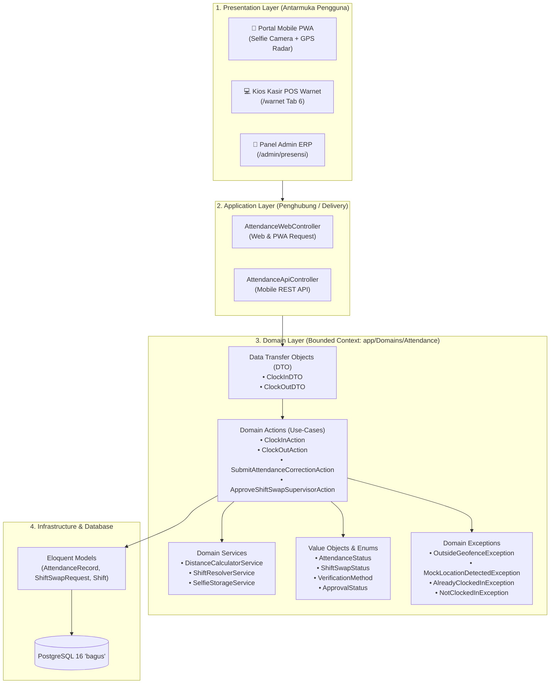

# 🏛️ Arsitektur Pragmatic Domain-Driven Design (DDD) Sistem Presensi PWA

**Organisasi:** Maya Graha Kencana (MGK)  
**Dokumen:** Spesifikasi Arsitektur Domain-Driven Design (DDD)  
**Versi:** 1.0 (Produksi)  
**Stack Teknis:** Laravel 12 / PHP 8.4+ | PostgreSQL 16 | PWA Mobile-First  

---

## 🎯 1. Filosofi & Prinsip Desain

Sistem Presensi PWA dirancang dengan pendekatan **Pragmatic Domain-Driven Design (DDD)**. Pendekatan ini memisahkan secara tegas antara **Aturan Bisnis Inti (Domain Business Rules)** dengan **Mekanisme Pengiriman (Application & Delivery Layer)**.

### Prinsip Utama:
1. **Thin Controller (Controller Ramping):** Controller HTTP hanya bertugas menerima request, validasi otentikasi sesi, memanggil Action Domain melalui DTO, dan mengembalikan response JSON/View.
2. **Rich Domain (Domain Kaya Logika):** Seluruh kalkulasi radius GPS (Haversine), penentuan shift lintas hari (*overnight*), toleransi keterlambatan (*grace period*), dan deteksi *anti-fraud* berada murni di dalam `app/Domains/Attendance`.
3. **Pemberdayaan Ulang Bebas Ketergantungan (High Reusability):** Domain Action yang sama dapat digunakan bersama oleh **PWA Smartphone**, **Kios Kasir POS Warnet**, maupun **REST API Mobile Apps** tanpa menduplikasi kode.

---

## 📐 2. Diagram Alur Layer Arsitektur



---

## 🗂️ 3. Struktur Bounded Context & Direktori

```text
app/
├── Domains/
│   ├── Attendance/                               <-- BOUNDED CONTEXT: PRESENSI & GEOFENCING
│   │   ├── Actions/                              <-- Use-Cases (Single Responsibility)
│   │   │   ├── ClockInAction.php                 <-- Eksekusi clock-in & evaluasi toleransi
│   │   │   ├── ClockOutAction.php                <-- Eksekusi clock-out & kalkulasi lembur
│   │   │   ├── SubmitAttendanceCorrectionAction.php
│   │   │   ├── ApproveAttendanceCorrectionAction.php
│   │   │   ├── RejectAttendanceCorrectionAction.php
│   │   │   ├── SubmitShiftSwapAction.php         <-- Pengajuan tukar shift rekan
│   │   │   ├── RespondShiftSwapPeerAction.php    <-- Respon rekan kerja (Tahap 1)
│   │   │   ├── ApproveShiftSwapSupervisorAction.php <-- Verifikasi supervisor (Tahap 2)
│   │   │   └── RejectShiftSwapSupervisorAction.php
│   │   ├── DataTransferObjects/                  <-- Data Transfer Objects (Strictly Typed)
│   │   │   ├── ClockInDTO.php
│   │   │   └── ClockOutDTO.php
│   │   ├── Enums/                                <-- Value Objects & State Enums
│   │   │   ├── AttendanceStatus.php              <-- Present, Late, Absent, OnLeave
│   │   │   ├── ShiftSwapStatus.php               <-- PendingPeer, PendingSupervisor, Approved
│   │   │   ├── VerificationMethod.php            <-- GpsSelfie, WebKiosk, AdminManual
│   │   │   ├── CorrectionType.php                <-- ClockIn, ClockOut, Both
│   │   │   └── ApprovalStatus.php                <-- Pending, Approved, Rejected
│   │   ├── Exceptions/                           <-- Domain Business Exceptions
│   │   │   ├── OutsideGeofenceException.php      <-- Di luar radius kantor (>100m)
│   │   │   ├── MockLocationDetectedException.php <-- Terdeteksi Fake GPS
│   │   │   ├── AlreadyClockedInException.php     <-- Sudah presensi pada shift ini
│   │   │   └── NotClockedInException.php         <-- Pulang tanpa clock-in
│   │   ├── Models/                               <-- Entities & Aggregate Roots
│   │   │   ├── AttendanceRecord.php              <-- Rekaman kehadiran harian
│   │   │   ├── AttendanceCorrection.php          <-- Pengajuan koreksi
│   │   │   └── ShiftSwapRequest.php              <-- Permohonan tukar shift
│   │   └── Services/                             <-- Pure Domain Calculation Services
│   │       ├── DistanceCalculatorService.php     <-- Formula Haversine geodetik
│   │       ├── ShiftResolverService.php          <-- Logika shift 24 jam & lintas malam
│   │       └── SelfieStorageService.php          <-- Anti-tamper penyimpanan foto
│   │
│   ├── Employee/                                 <-- BOUNDED CONTEXT: SHIFT & JADWAL
│   │   └── Models/
│   │       └── Shift.php                         <-- Master template shift (Shift 1 s/d 4 & BO)
│   │
│   └── Leave/                                    <-- BOUNDED CONTEXT: CUTI & IZIN RESMI
│       ├── Enums/LeaveType.php                   <-- Annual, Sick, Permission, Emergency
│       └── Models/LeaveRequest.php               <-- Permohonan cuti karyawan
```

---

## 🔬 4. Rincian Komponen Arsitektur DDD

### 4.1 Domain Actions (Use-Cases)
Setiap proses bisnis dienkapsulasi ke dalam satu class terisolasi yang menerapkan metode `execute()`:
* **[ClockInAction.php](file:///var/www/laravel_apps/bagus/app/Domains/Attendance/Actions/ClockInAction.php):**
  * Memvalidasi koordinat GPS terhadap koordinat cabang melalui `DistanceCalculatorService`.
  * Memeriksa keberadaan aplikasi Fake GPS (`isMockLocation`).
  * Mengevaluasi toleransi keterlambatan 15 menit dari jam shift kerja.
  * Mencatat status: `Present` (Tepat Waktu) atau `Late` (Terlambat beserta kalkulasi menit).
* **[ClockOutAction.php](file:///var/www/laravel_apps/bagus/app/Domains/Attendance/Actions/ClockOutAction.php):**
  * Memastikan karyawan telah melakukan clock-in sebelumnya.
  * Menghitung total durasi kerja riil (dalam menit).
  * Menghitung jam lembur (*overtime*) jika karyawan bekerja melebihi batas waktu akhir shift (+ toleransi 15 menit).

### 4.2 Data Transfer Objects (DTO)
Mencegah penggunaan raw array `$request->all()` yang rentan inkonsistensi tipe data:
* **[ClockInDTO.php](file:///var/www/laravel_apps/bagus/app/Domains/Attendance/DataTransferObjects/ClockInDTO.php):**
  ```php
  public function __construct(
      public int $employeeId,
      public int $branchId,
      public float $latitude,
      public float $longitude,
      public ?int $shiftId,
      public ?string $photoPath,
      public VerificationMethod $verificationMethod,
      public ?array $deviceInfo = null,
      public ?string $ipAddress = null,
      public bool $isMockLocation = false,
      public ?string $notes = null,
  ) {}
  ```

### 4.3 Domain Services (Pure Computation)
* **`DistanceCalculatorService`:** Menghitung jarak bumi menggunakan formula trigonometri Haversine:
  $$d = 2r \arcsin\left(\sqrt{\sin^2\left(\frac{\Delta \phi}{2}\right) + \cos(\phi_1)\cos(\phi_2)\sin^2\left(\frac{\Delta \lambda}{2}\right)}\right)$$
  Menghasilkan toleransi jarak presisi tinggi dalam satuan meter.
* **`ShiftResolverService`:** Menyelesaikan masalah rotasi shift warnet 24 jam. Pada **Shift 4 (Malam Lintas Hari 19:00 - 01:00 WIB)**, jam pulang pukul 01:00 dini hari tetap diikat pada tanggal operasional (*operational work date*) hari sebelumnya, sehingga terhindar dari anomali alpa.

### 4.4 Thin Controller (Presentation Layer)
Controller [AttendanceWebController.php](file:///var/www/laravel_apps/bagus/app/Http/Controllers/AttendanceWebController.php) hanya berfungsi sebagai *orchestrator*:
```php
// Contoh implementasi Thin Controller di AttendanceWebController:
$dto = new ClockInDTO(
    employeeId: $employee->id,
    branchId: $branchId,
    latitude: (float) $request->input('latitude'),
    longitude: (float) $request->input('longitude'),
    shiftId: $request->filled('shift_id') ? (int) $request->input('shift_id') : null,
    photoPath: $request->input('photo'),
    verificationMethod: VerificationMethod::GpsSelfie,
);

// Delegasi langsung ke domain action:
$record = $this->clockInAction->execute($dto);
```

---

## 🏆 5. Keuntungan Nyata Arsitektur Ini untuk Bisnis MGK

| Aspek | Tanpa DDD (Legacy Monolith) | Dengan Pragmatic DDD (Saat Ini) |
|---|---|---|
| **Multi-Platform** | Logika presensi harus ditulis ulang jika membuat aplikasi kasir atau mobile app. | `ClockInAction` yang sama dipakai oleh PWA, Kios Kasir Warnet, dan API Mobile. |
| **Keamanan & Anti-Fraud** | Pengecekan GPS tersebar di controller view, mudah dibypass. | Terpusat di Domain Action & Exception, menolak Fake GPS di level inti bisnis. |
| **Shift 24 Jam Warnet** | Jam 01:00 dini hari sering dianggap hari baru / alpa. | Ditangani otomatis oleh `ShiftResolverService` via *Operational Work Date*. |
| **Kemudahan Pengujian** | Sulit diuji otomatis karena logika terikat dengan session browser. | 100% unit testable via Feature/Unit Test (`AttendanceActionsTest`, dll). |
| **Skalabilitas** | Menambah cabang baru berisiko merusak modul lain. | Isolasi Bounded Context menjamin stabilitas master data lainnya. |
