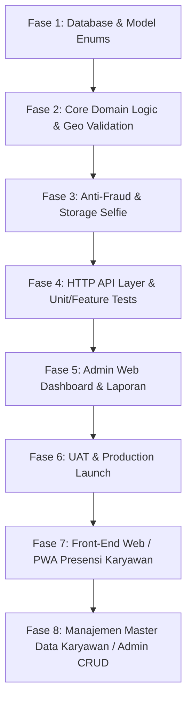

# Roadmap & Blueprint Arsitektur Sistem Presensi Karyawan
**Organisasi:** Maya Graha Kencana (MGK)  
**Stack Teknis:** Laravel 12 / PHP 8.4+ | PostgreSQL | Pragmatic Domain-Driven Design (DDD)  
**Status Dokumen:** Approved (Disetujui untuk Implementasi)

---

## 🎯 1. Filosofi & Pendekatan: Pragmatic DDD
Pendekatan **Pragmatic DDD** memisahkan logika bisnis (*Domain Business Rules*) dari lapisan penyampaian (*HTTP/API Delivery Layer*).
1. **Tipis di Controller**: Controller hanya bertugas memvalidasi request HTTP (via `FormRequest`), mendelegasikan ke `Action` domain, lalu memformat respons (via `ApiResource`).
2. **Kaya di Domain**: Logika verifikasi kredensial aman, penentuan shift lintas hari (*overnight*), perhitungan menit keterlambatan, dan pencatatan audit trail berada sepenuhnya di dalam `app/Domains/Attendance`.
3. **No Redundancy**: Menggunakan entitas data master yang sudah ada di `Modules/MasterData` (`Employee` & `Branch`), tanpa membuat duplikasi model karyawan.
4. **Kebijakan Operasional MGK**: Murni berbasis verifikasi kredensial akun/PIN (tanpa kewajiban GPS dan tanpa foto selfie), serta tidak mengenal sistem lembur (*no overtime*).

---

## 📐 2. Struktur Direktori Arsitektur

```text
app/
├── Domains/
│   ├── Attendance/                         <-- Bounded Context: Presensi & Geofencing
│   │   ├── Actions/
│   │   │   ├── ClockInAction.php           <-- Menangani proses clock-in & validasi shift
│   │   │   ├── ClockOutAction.php          <-- Menangani clock-out & kalkulasi lembur/durasi
│   │   │   └── CalculateOvertimeAction.php <-- Kalkulasi lembur setelah toleransi shift
│   │   ├── DataTransferObjects/
│   │   │   ├── ClockInDTO.php
│   │   │   └── ClockOutDTO.php
│   │   ├── Enums/
│   │   │   ├── AttendanceStatus.php        <-- Present, Late, Absent, HalfDay, OnLeave
│   │   │   ├── VerificationMethod.php      <-- GPS_Selfie, Biometric, AdminManual
│   │   │   └── ApprovalStatus.php          <-- Pending, Approved, Rejected
│   │   ├── Exceptions/
│   │   │   ├── OutsideGeofenceException.php
│   │   │   ├── AlreadyClockedInException.php
│   │   │   ├── NotClockedInException.php
│   │   │   ├── ShiftNotAssignedException.php
│   │   │   └── InvalidCoordinateException.php
│   │   ├── Models/
│   │   │   ├── AttendanceRecord.php        <-- Log presensi karyawan
│   │   │   └── OvertimeClaim.php           <-- Pengajuan klaim lembur
│   │   ├── Services/
│   │   │   ├── GeoValidationService.php    <-- Formula Haversine kalkulasi jarak meter
│   │   │   └── ShiftResolverService.php    <-- Resolver penentuan shift (termasuk lintas malam)
│   │   └── ValueObjects/
│   │       └── Coordinate.php              <-- Latitude & Longitude terenkapsulasi
│   │
│   ├── Employee/                           <-- Bounded Context: Shift & Penugasan
│   │   ├── Models/
│   │   │   └── Shift.php                   <-- Master template shift (Shift 1, 2, 3, 4, BO)
│   │   └── Services/
│   │       └── ShiftAssignmentService.php  <-- Mapping jadwal karyawan (EmployeeSchedule)
│   │
│   └── Leave/                              <-- Bounded Context: Izin, Sakit, & Cuti
│       ├── Actions/
│       │   ├── RequestLeaveAction.php      <-- Pengajuan izin/cuti
│       │   └── ApproveLeaveAction.php      <-- Approval oleh manajer/admin
│       ├── Enums/
│       │   └── LeaveType.php               <-- Annual, Sick, Permission, Emergency
│       └── Models/
│           └── LeaveRequest.php            <-- Rekaman permohonan cuti
│
├── Http/
│   ├── Controllers/
│   │   ├── Admin/                          <-- Panel Admin Web (Monitoring, Approval & Master Data)
│   │   │   ├── AttendanceAdminController.php
│   │   │   └── EmployeeAdminController.php <-- CRUD Master Karyawan, Cabang & Kredensial
│   │   └── Api/
│   │       └── V1/                         <-- RESTful API untuk Mobile/Client Apps
│   │           ├── AttendanceController.php
│   │           ├── LeaveController.php
│   │           └── ShiftController.php
│   ├── Requests/
│   │   ├── Admin/                          <-- Validasi Form Admin Master Data
│   │   │   ├── StoreEmployeeRequest.php    <-- Validasi NIK unik, PIN 6-digit, cabang
│   │   │   └── UpdateEmployeeRequest.php   <-- Validasi update profil & reset PIN/password
│   │   └── Api/
│   │       └── V1/
│   │           ├── ClockInRequest.php      <-- Validasi lat, lng, image selfie, mock gps flag
│   │           ├── ClockOutRequest.php
│   │           └── StoreLeaveRequest.php
│   └── Resources/
│       └── Api/
│           └── V1/
│               ├── AttendanceResource.php  <-- Format seragam respons presensi
│               └── LeaveResource.php
│
├── resources/views/admin/
│   ├── presensi/                           <-- Monitoring, Rekap Bulanan, Approval Izin
│   └── karyawan/                           <-- UI Master Data Karyawan (Index, Create, Edit)
│
└── Modules/MasterData/                     <-- Modul Terpasang (Existing)
    └── app/Domain/Models/
        ├── Branch.php                      <-- Dilengkapi lat, lng, radius_meters kantor
        ├── Employee.php                    <-- Relasi ke Branch & AttendanceRecord
        └── EmployeeSchedule.php            <-- Jadwal shift operasional
```

---

## 🗄️ 3. Desain Skema Database

### 3.1 Penambahan Geofencing pada `branches`
```sql
ALTER TABLE branches ADD COLUMN IF NOT EXISTS latitude NUMERIC(10, 8);
ALTER TABLE branches ADD COLUMN IF NOT EXISTS longitude NUMERIC(11, 8);
ALTER TABLE branches ADD COLUMN IF NOT EXISTS radius_meters INTEGER DEFAULT 100;
```

### 3.2 Master Template `shifts`
Mengakomodasi ritme operasional 24 jam warnet & kantor Maya Graha Kencana:
- **Shift 1 (Dini Hari):** `01:00 - 07:00`
- **Shift 2 (Pagi):** `07:00 - 13:00`
- **Shift 3 (Siang/Sore):** `13:00 - 19:00`
- **Shift 4 (Malam - Lintas Hari):** `19:00 - 01:00` (*is_overnight = true*)
- **Shift BO (Back Office):** `08:30 - 17:30`

```sql
CREATE TABLE shifts (
    id BIGSERIAL PRIMARY KEY,
    code VARCHAR(20) UNIQUE NOT NULL,
    name VARCHAR(100) NOT NULL,
    start_time TIME NOT NULL,
    end_time TIME NOT NULL,
    is_overnight BOOLEAN DEFAULT FALSE,
    grace_period_minutes INTEGER DEFAULT 15,
    is_active BOOLEAN DEFAULT TRUE,
    created_at TIMESTAMP,
    updated_at TIMESTAMP
);
```

### 3.3 Transaksi Presensi `attendance_records`
```sql
CREATE TABLE attendance_records (
    id BIGSERIAL PRIMARY KEY,
    employee_id BIGINT NOT NULL REFERENCES employees(id) ON DELETE CASCADE,
    branch_id BIGINT NOT NULL REFERENCES branches(id) ON DELETE CASCADE,
    shift_id BIGINT REFERENCES shifts(id) ON DELETE SET NULL,
    work_date DATE NOT NULL,               -- Tanggal kerja operasional (kunci shift lintas malam)
    
    -- Clock In
    clock_in_at TIMESTAMP WITH TIME ZONE,
    clock_in_lat NUMERIC(10, 8),
    clock_in_lng NUMERIC(11, 8),
    clock_in_distance_meters NUMERIC(8, 2),
    clock_in_photo_path VARCHAR(255),
    
    -- Clock Out
    clock_out_at TIMESTAMP WITH TIME ZONE,
    clock_out_lat NUMERIC(10, 8),
    clock_out_lng NUMERIC(11, 8),
    clock_out_distance_meters NUMERIC(8, 2),
    clock_out_photo_path VARCHAR(255),
    
    -- Status & Kalkulasi
    status VARCHAR(30) NOT NULL DEFAULT 'present',     -- present, late, absent, on_leave
    late_minutes INTEGER DEFAULT 0,
    early_leave_minutes INTEGER DEFAULT 0,
    overtime_minutes INTEGER DEFAULT 0,                -- Bernilai 0 (Kebijakan MGK: Tidak mengenal overtime)
    duration_minutes INTEGER DEFAULT 0,
    
    -- Autentikasi & Security
    verification_method VARCHAR(30) DEFAULT 'password',-- Verifikasi utama: Password / PIN akun
    device_info JSONB,                                 -- User agent, brand HP, app version
    ip_address VARCHAR(45),
    is_mock_location_detected BOOLEAN DEFAULT FALSE,
    notes TEXT,
    
    created_at TIMESTAMP,
    updated_at TIMESTAMP,
    CONSTRAINT uq_employee_work_date_shift UNIQUE (employee_id, work_date, shift_id)
);
```

### 3.4 Manajemen Izin & Cuti `leave_requests`
```sql
CREATE TABLE leave_requests (
    id BIGSERIAL PRIMARY KEY,
    employee_id BIGINT NOT NULL REFERENCES employees(id) ON DELETE CASCADE,
    leave_type VARCHAR(30) NOT NULL,                   -- annual, sick, permission, emergency
    start_date DATE NOT NULL,
    end_date DATE NOT NULL,
    total_days INTEGER NOT NULL DEFAULT 1,
    reason TEXT NOT NULL,
    attachment_path VARCHAR(255),                      -- Surat dokter / bukti izin
    status VARCHAR(30) NOT NULL DEFAULT 'pending',     -- pending, approved, rejected
    approved_by BIGINT REFERENCES employees(id),
    approved_at TIMESTAMP,
    rejection_note TEXT,
    created_at TIMESTAMP,
    updated_at TIMESTAMP
);
```

---

## 🛡️ 4. Komponen Kunci & Aturan Bisnis (Domain Logic)

### 4.1 Logika Shift Lintas Hari (*Overnight Shift*)
Operator yang berdinas di Shift 4 (`19:00 - 01:00`):
- Masuk kerja: `10 Oktober 18:50` -> `work_date = 2026-10-10`.
- Pulang kerja: `11 Oktober 01:10` -> Tetap dicocokkan ke record `work_date = 2026-10-10` dengan shift 4.
- Resolver `ShiftResolverService` mendeteksi rentang jendela waktu (misal: `-60 menit` sebelum mulai s/d `+120 menit` setelah selesai shift) untuk memastikan tidak terjadi duplikasi hari kerja.

### 4.2 Kebijakan Presensi: Kredensial Akun (Tanpa GPS & Tanpa Selfie)
Sistem presensi MGK disederhanakan untuk kecepatan akses dan kepraktisan di semua perangkat:
- **Tanpa GPS**: Tidak mewajibkan izin lokasi browser, tidak ada kalkulasi radius geofencing, karyawan dapat langsung presensi tanpa menunggu locking GPS.
- **Tanpa Foto Selfie**: Tidak ada kewajiban menyalakan kamera depan, mempercepat alur presensi menjadi 1–2 detik saja.
- **Verifikasi Kredensial**: Validasi kehadiran dilakukan menggunakan **Password Akun atau PIN 6-digit** karyawan.

### 4.3 Kebijakan Lembur: Tidak Menerapkan Overtime
- Manajemen operasional MGK **tidak mengenal sistem lembur (overtime)**.
- Jam pulang yang melewati jadwal shift tidak dikalkulasikan sebagai jam lembur (`overtime_minutes` selalu 0).
- Sistem tetap mencatat jam masuk, jam pulang aktual, keterlambatan (`late_minutes`), dan total durasi kerja bersih (`duration_minutes`).

### 4.4 Domain Exceptions Terstandar
| Exception | HTTP Code | Keterangan |
|---|---|---|
| `AlreadyClockedInException` | `409 Conflict` | Karyawan sudah melakukan clock-in untuk shift hari ini |
| `NotClockedInException` | `400 Bad Request` | Melakukan clock-out sebelum melakukan clock-in |
| `ShiftNotAssignedException` | `404 Not Found` | Karyawan tidak terdaftar pada jadwal shift yang diminta |
| `OutsideGeofenceException` | `422 Unprocessable` | Jarak GPS di luar batas (jika mode geofence diaktifkan) |

---

## 📡 5. Spesifikasi Kontrak API (V1)

| Metode | Endpoint | Deskripsi |
|---|---|---|
| `POST` | `/api/v1/attendance/clock-in` | Presensi masuk dengan verifikasi kredensial akun / PIN |
| `POST` | `/api/v1/attendance/clock-out` | Presensi pulang dengan verifikasi kredensial akun / PIN |
| `GET`  | `/api/v1/attendance/today` | Status presensi hari ini (jam masuk, shift, status) |
| `GET`  | `/api/v1/attendance/history` | Riwayat presensi bulanan karyawan |
| `POST` | `/api/v1/leave/request` | Pengajuan cuti/izin/sakit dengan lampiran bukti |
| `GET`  | `/api/v1/leave/history` | Riwayat status pengajuan izin/cuti |

---

## 🗺️ 6. Rencana Tahapan Eksekusi (Implementation Milestones)

> 📌 **Tracker Eksekusi Detail:** Untuk pelacakan eksekusi langkah demi langkah per-task, status pengerjaan, dan audit trail, lihat dokumen terpisah:  
> 👉 [doc/rencana_implementasi_presensi.md](file:///var/www/laravel_apps/grace/doc/rencana_implementasi_presensi.md)



### ✅ Fase 1: Database & Model Enums
1. Migration update kolom GPS pada tabel `branches`.
2. Migration tabel `shifts`, `attendance_records`, dan `leave_requests`.
3. Model Enums PHP 8.4: `AttendanceStatus`, `VerificationMethod`, `LeaveType`, `ApprovalStatus`.
4. Seeder shift template standar Maya Graha Kencana (Shift 1–4, BO).

### ✅ Fase 2: Core Domain Logic
1. Implementasi Value Object `Coordinate` & `GeoValidationService` (Haversine).
2. Domain Exceptions (`OutsideGeofenceException`, `AlreadyClockedInException`, dll).
3. DTO `ClockInDTO` & `ClockOutDTO`.
4. `ClockInAction` & `ClockOutAction` dengan toleransi *grace period* dan logika *overnight shift*.

### ✅ Fase 3: Anti-Fraud & File Handling
1. Validasi gambar selfie (kompresi aman, resolusi, penyimpanan di storage).
2. Pemeriksaan flag Mock Location & logging IP / perangkat.

### ✅ Fase 4: HTTP API Layer & Automated Testing
1. `ClockInRequest`, `ClockOutRequest`, `StoreLeaveRequest`.
2. `AttendanceController` & `LeaveController`.
3. `AttendanceResource` & `LeaveResource`.
4. Unit tests untuk `GeoValidationService` & Feature tests untuk alur Clock-In/Clock-Out.

### ✅ Fase 5: Admin Panel & Rekapitulasi Presensi
1. Layar monitoring kehadiran operator di admin ERP (`/admin/presensi`).
2. Rekapitulasi bulanan, telat (menit), dan approval cuti/lembur.
3. Sinkronisasi dengan tabel `employee_schedules` yang telah ada.

### ✅ Fase 6: UAT & Final Production Launch
1. Code formatting Pint (`vendor/bin/pint --format agent`).
2. Full automated test suite verification.
3. Verifikasi performa PostgreSQL indexes & foreign keys.

### ✅ Fase 7: Front-End Web / PWA Presensi Karyawan (Self-Service Mobile)
1. Shell Layout Mobile-First & PWA Support (`resources/views/layouts/presensi.blade.php`, `manifest.json`, `sw.js`).
2. Autentikasi / Identifikasi Karyawan Mobile (`/presensi/login`, Session Guard presensi mandiri).
3. Dashboard Beranda Portal Karyawan (`/presensi` - info shift aktif hari ini & status presensi).
4. Layar Mobile Clock-In & Clock-Out (`/presensi/scan` - Live Camera Selfie, Client Canvas Compress, GPS Radar Geofencing).
5. Layar Pengajuan Izin & Cuti Mandiri (`/presensi/izin` - Form permohonan, upload dokumen bukti, daftar riwayat & status approval).
6. Layar Riwayat & Log Presensi Pribadi Karyawan (`/presensi/riwayat` - filter bulanan, kartu detail harian, foto selfie log).
7. Automated Testing, UI Regression, & Code Quality (`tests/Feature/AttendanceWebPortalTest.php`, 38 tests passed 100%, Pint clean).

### ⏳ Fase 8: Manajemen Master Data Karyawan (Admin Panel CRUD)
1. Antarmuka daftar karyawan lengkap (`/admin/presensi/karyawan`) dengan filter cabang, status aktif, dan fitur pencarian.
2. Registrasi karyawan baru (`/admin/presensi/karyawan/create`) dengan hashing Bcrypt kata sandi akun & PIN presensi 6-digit.
3. Pembaruan data karyawan & mutasi penempatan cabang (`/admin/presensi/karyawan/{id}/edit`).
4. Fitur Reset Password & Reset PIN mandiri oleh Administrator.
5. Quick toggle aktivasi / deaktivasi status karyawan (`is_active`).
6. Proteksi integritas relasional (mencegah penghapusan fisik jika telah memiliki rekam jejak presensi/cuti).
7. Form Requests validasi `StoreEmployeeRequest` & `UpdateEmployeeRequest`.
8. Automated Feature Tests master karyawan (`tests/Feature/Admin/EmployeeAdminTest.php`).

---

## 📱 7. Spesifikasi Detail Panel Login & Portal Presensi Karyawan (Mobile-First / PWA)

### 7.1 Skema Autentikasi Karyawan (`Guard: employee`)
- **Pemisahan Sesi Guard:** Menggunakan multi-guard Laravel (`config/auth.php`) dengan guard `employee` (model `Employee`) yang terpisah dari guard admin web bawaan (`web` / model `User`). Hal ini memastikan karyawan tidak dapat mengakses halaman manajemen admin, dan sebaliknya.
- **Kredensial:** NIK / Kode Karyawan & Password / PIN 6 digit.
- **Persistent Session:** Dukungan remember token cookie agar karyawan di ponsel masing-masing tidak perlu berulang kali login setiap pergantian shift.
- **Endpoint Rute:**
  - `GET /presensi/login` -> Tampilan form login karyawan (`resources/views/presensi/login.blade.php`).
  - `POST /presensi/login` -> Proses autentikasi & inisialisasi sesi presensi.
  - `POST /presensi/logout` -> Pembersihan sesi karyawan.

### 7.2 Antarmuka Dasbor Utama Karyawan (`/presensi`)
- **Header Profil:** Avatar/Foto profil, Nama Karyawan, Cabang Penempatan (nama kantor cabang MGK), dan tanggal hari ini.
- **Kartu Shift Operasional Hari Ini:**
  - Menampilkan Nama Shift (Shift 1, 2, 3, 4, atau BO) dan rentang jam kerja.
  - Status Realtime: *Belum Masuk*, *Hadir Tepat Waktu*, *Terlambat (X menit)*, atau *Sudah Pulang*.
- **Tombol Aksi Dinamis (CTA):**
  - Jika belum presensi masuk: Tombol hijau besar **"Presensi Masuk (Clock In)"** mengarah ke `/presensi/scan?mode=in`.
  - Jika sudah masuk tapi belum pulang: Tombol oranye/merah **"Presensi Pulang (Clock Out)"** mengarah ke `/presensi/scan?mode=out`.
- **Navigasi Cepat:** Menu bawah (*Bottom Navigation Bar*) menuju Beranda (`/presensi`), Riwayat Presensi (`/presensi/riwayat`), dan Pengajuan Izin (`/presensi/izin`).

### 7.3 Layar Presensi Mandiri: Verifikasi Kredensial Langsung (`/presensi/scan`)
- **Verifikasi Kredensial Cepat (Password / PIN 6-Digit):**
  - Karyawan cukup memasukkan Password atau PIN 6-digit akun karyawan untuk konfirmasi Clock-In / Clock-Out.
  - Dilengkapi tombol toggle lihat kata sandi (👁️) untuk mempermudah pengecekan ketikan.
- **Tanpa GPS & Tanpa Kamera:**
  - Tidak meminta izin kamera (`navigator.mediaDevices.getUserMedia`) dan tidak meminta izin lokasi (`navigator.geolocation`).
  - Proses presensi selesai instan dalam 1–2 detik tanpa lag/freeze di smartphone apa pun.
- **Audit Trail & Keamanan Jaringan:**
  - Pencatatan alamat IP jaringan, informasi user-agent perangkat, dan sinkronisasi waktu presensi akurat server (*NTP sync*).

### 7.4 Layar Riwayat & Pengajuan Izin Mandiri
- **`/presensi/riwayat`:** Filter berdasarkan bulan dan tahun. Menampilkan kartu riwayat per hari kerja, status (Tepat Waktu, Telat), jam clock-in/out aktual, dan durasi kerja nyata (tanpa kalkulasi lembur).
- **`/presensi/izin`:** Formulir pengajuan izin/sakit/cuti tahunan, tanggal mulai - selesai, alasan, dan upload lampiran foto bukti surat dokter.

---

## 👥 8. Spesifikasi Detail Modul Manajemen Master Data Karyawan (Admin Panel CRUD)

Modul ini memberikan kendali penuh kepada Administrator untuk mengelola seluruh data pegawai, penempatan cabang kantor MGK, pengaturan kredensial awal, hingga status keaktifan tanpa harus menyentuh database secara langsung.

### 8.1 Arsitektur & Keamanan Role Admin (`Guard: web`)
- **Proteksi Akses:** Rute berada di bawah prefix `/admin/presensi/karyawan` dan dilindungi middleware `auth` (hanya Administrator terautentikasi yang dapat mengakses).
- **Enkripsi Kredensial:** Password akun dan PIN 6-digit di-hash secara aman menggunakan algoritma `Hash::make()` (Bcrypt).
- **Integritas Relasional:** Penghapusan data fisik dilarang (*integrity constraint*) jika karyawan telah memiliki riwayat kehadiran di tabel `attendance_records` atau permohonan di `leave_requests`. Sistem mewajibkan penggunaan fitur deaktivasi status (`is_active = false`).

### 8.2 Antarmuka & Alur Kerja Pengguna

#### A. Layar Indeks Karyawan (`GET /admin/presensi/karyawan`)
- **Tabel Data Karyawan:** Menampilkan NIK, Nama Lengkap, Cabang Penempatan (Badge warna cabang), Kontak (Email & No. HP), Status Akun (Aktif/Nonaktif), dan Tombol Tindakan.
- **Filter & Pencarian Instan:**
  - Input pencarian berbasis teks (NIK, Nama, Email).
  - Dropdown filter per Cabang MGK (Semua Cabang, Kantor Pusat, Cabang Warnet, dll).
  - Filter status (Semua, Aktif Saja, Nonaktif Saja).
- **Tombol Tambah Karyawan:** Tombol navigasi mencolok untuk membuka form registrasi karyawan baru.
- **Aksi Cepat per Baris:**
  - Tombol **Edit** (ikon pensil).
  - Tombol **Toggle Status** (Aktifkan / Nonaktifkan) dengan konfirmasi SweetAlert2.
  - Tombol **Hapus** (dilengkapi validasi relasi).

#### B. Layar Registrasi Karyawan Baru (`GET/POST /admin/presensi/karyawan/create`)
- **Form Input Terstruktur:**
  1. **NIK / ID Karyawan:** Wajib diisi, format teks (contoh: `MGK-004`), wajib unik di tabel `employees`.
  2. **Nama Lengkap:** Wajib diisi, minimal 3 karakter.
  3. **Cabang Penempatan:** Dropdown pilihan dari tabel `branches` yang aktif.
  4. **Email:** Opsional/Wajib, format email valid, unik jika diisi.
  5. **Nomor Telepon / WhatsApp:** Opsional, format nomor telepon seluler.
  6. **Kata Sandi Akun:** Wajib diisi (minimal 6 karakter) untuk login ke portal presensi/web.
  7. **PIN Presensi 6-Digit:** Wajib diisi, tepat 6 digit numerik (contoh: `123456`) untuk verifikasi cepat di mesin presensi / mobile app.
- **Otomatisasi:** Mengatur `is_active = true` secara default dan mengasosiasikan shift kerja default operasional.

#### C. Layar Edit Data & Reset Kredensial (`GET/PUT /admin/presensi/karyawan/{id}/edit`)
- Mengubah profil karyawan (Nama, Cabang Penempatan, Kontak).
- Fitur **Reset Password & PIN**: Kolom kata sandi dan PIN baru dibuat opsional; jika dikosongkan, kredensial lama tidak akan diubah. Jika diisi, sistem otomatis meng-hash nilai baru.

#### D. Quick Toggle Status Keaktifan (`POST /admin/presensi/karyawan/{id}/toggle-status`)
- Mengubah status aktif `is_active` menjadi sebaliknya (aktif $\leftrightarrow$ nonaktif).
- Karyawan dengan status nonaktif akan langsung ditolak saat mencoba login di portal presensi dengan notifikasi: *"Akun karyawan tidak aktif. Hubungi administrator."*

### 8.3 Skema Validasi Form (*Validation Matrix*)

| Field | Tipe | Aturan Validasi (Rules) | Keterangan Error |
|---|---|---|---|
| `nik` | String | `required`, `string`, `max:30`, `unique:employees,nik,{id}` | NIK wajib unik dan tidak boleh melebihi 30 karakter |
| `name` | String | `required`, `string`, `min:3`, `max:100` | Nama minimal 3 karakter dan maksimal 100 karakter |
| `branch_id` | Integer | `required`, `exists:branches,id` | Cabang penempatan harus terdaftar di sistem |
| `email` | String | `nullable`, `email`, `max:100`, `unique:employees,email,{id}` | Format email harus valid dan unik jika diisi |
| `phone` | String | `nullable`, `string`, `max:25` | Nomor telepon maksimal 25 karakter |
| `password` | String | *Create:* `required`, `min:6` <br> *Update:* `nullable`, `min:6` | Kata sandi minimal 6 karakter |
| `pin` | String | *Create:* `required`, `digits:6` <br> *Update:* `nullable`, `digits:6` | PIN presensi wajib tepat 6 digit angka |

### 8.4 Standar Keamanan & ISO 27001 Compliance
1. **Access Control (ISO 27001 A.9):** Hanya pengguna dengan sesi admin (`auth`) yang memiliki otorisasi melakukan perubahan data karyawan (*Principle of Least Privilege*).
2. **Cryptographic Protection (ISO 27001 A.10):** PIN dan Password tidak pernah disimpan dalam bentuk teks polos (*plain text*), selalu melalui Bcrypt hashing.
3. **Data Integrity (ISO 27001 A.12):** Menolak penghapusan data master karyawan yang telah tercatat dalam riwayat presensi/keuangan untuk menjamin ketertelusuran log (*non-repudiation*).


