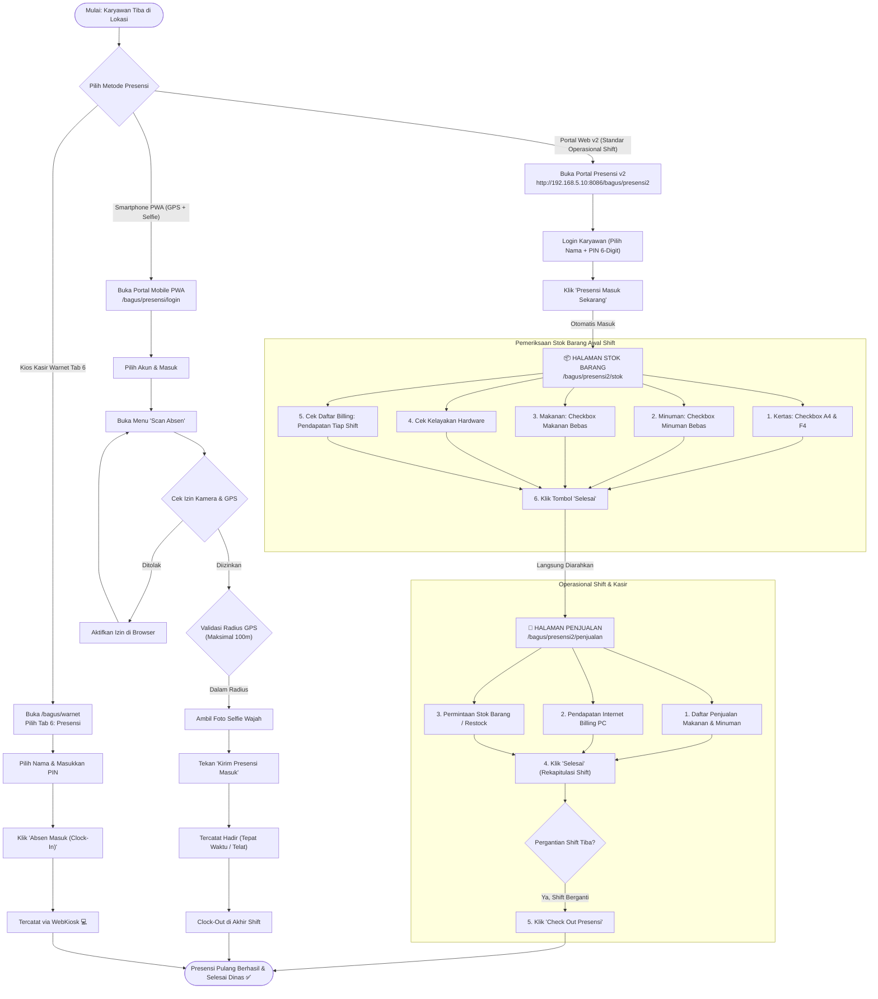
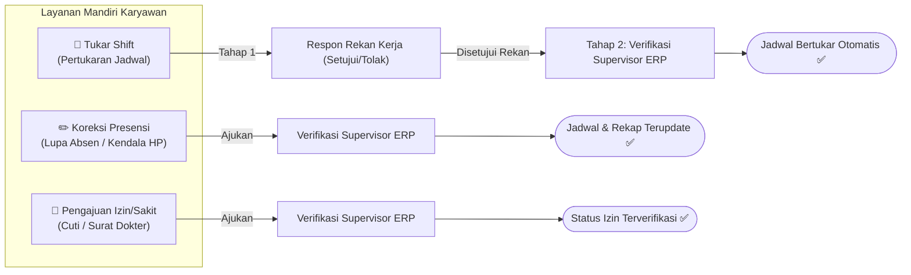

# 📋 Alur & Panduan Cara Presensi Karyawan

**Sistem Presensi Maya Graha Kencana (MGK)**  
Dokumen ini merangkum seluruh langkah operasional cara melakukan presensi masuk, alur serah terima stok barang, halaman penjualan kasir, presensi pulang, kios kasir, koreksi, serta tukar shift secara terstruktur.

---

## 🗺️ 1. Diagram Alur Utama Presensi & Operasional Shift

---

## 🌟 2. Alur Standar Operasional: Presensi v2, Stok Barang & Penjualan

Akses URL Utama: **[http://192.168.5.10:8086/bagus/presensi2](http://192.168.5.10:8086/bagus/presensi2)**

Alur ini dirancang khusus untuk staf operasional dan kasir warnet agar seluruh inventaris kertas, makanan, minuman bebas, perangkat keras, dan saldo kas billing tercatat rapi sebelum memulai transaksi jualan.

### Tahap 1: Login & Presensi Masuk
1. Buka browser di URL `http://192.168.5.10:8086/bagus/presensi2`.
2. Pilih akun nama karyawan Anda dari daftar atau ketik NIK/Username.
3. Masukkan **PIN 6-digit** atau **Password**.
4. Klik tombol **"Presensi Masuk Sekarang"** (atau konfirmasi di halaman scan).
5. Sistem memvalidasi kehadiran masuk dan **secara otomatis langsung mengarahkan Anda ke Halaman Stok Barang**.

---

### Tahap 2: Halaman Stok Barang (`/presensi2/stok`)
Pada halaman serah terima awal shift ini, staf melakukan checklist fisik:

1. **Kertas Print**:
   - Beri tanda centang pada checkbox **A4** (Kertas HVS A4 70gsm, cek stok di loker kasir).
   - Beri tanda centang pada checkbox **F4** (Kertas HVS F4/Folio 70gsm, cek stok di loker kasir).
   - Masukkan estimasi lembar/rim yang tersedia.
2. **Minuman**:
   - Beri tanda centang pada checkbox **Minuman Bebas** (jatah konsumsi staf shift berjalan).
   - Periksa dan centang daftar minuman yang tersedia di showcase/kulkas (Es Kopi Susu Aren, Es Teh Jumbo, Le Minerale, Good Day, Kopi Tubruk).
   - Tuliskan catatan fisik minuman jika ada yang habis.
3. **Makanan**:
   - Beri tanda centang pada checkbox **Makanan Bebas** (jatah konsumsi staf shift berjalan).
   - Periksa dan centang daftar makanan & snack yang tersedia (Indomie Goreng, Nasi Magelangan, Nasi Ayam Geprek, Roti Bakar, Chitato).
   - Tuliskan catatan fisik makanan jika ada yang menipis.
4. **Cek Hardware**:
   - Pilih status kelayakan: `🟢 Semua Normal & Berfungsi` atau `🟡 Ada Kendala Ringan`.
   - Centang checklist perangkat:
     - 15 Unit PC Client (Monitor, CPU, Keyboard, Mouse, Headset).
     - PC Server Billing & Komputer Kasir Utama.
     - Printer Kasir Thermal Struk EPSON.
     - Printer HVS Epson L3210 (A4 & F4).
     - Kabel LAN, Switch Gigabit & WiFi Router.
     - CCTV 8-Channel & AC Ruangan Kasir.
   - Tulis catatan kendala hardware jika ditemukan (misal: "PC-04 headset kiri kurang jelas").
5. **Cek Daftar Billing (Pendapatan Setiap Shift)**:
   - Periksa rincian pendapatan billing internet untuk masing-masing shift:
     - **Shift 1 (Pagi):** 01:00 - 07:00 WIB
     - **Shift 2 (Siang):** 07:00 - 13:00 WIB
     - **Shift 3 (Sore):** 13:00 - 19:00 WIB
     - **Shift 4 (Malam):** 19:00 - 01:00 WIB
   - Beri tanda centang pada checkbox **Verifikasi Saldo Laci Kasir**: *"Saya telah memverifikasi saldo laci kasir dan serah terima kas billing shift sebelumnya telah sesuai."*
6. **Tombol "Selesai"**:
   - Tekan tombol **"6. Selesai & Lanjut ke Halaman Penjualan"**.
   - Sistem menyimpan checklist ke database dan **langsung mengarahkan Anda ke Halaman Penjualan**.
   - *Penting:* Check out presensi kepulangan belum dilakukan di sini, melainkan nanti di Halaman Penjualan saat pergantian shift tiba.

---

### Tahap 3: Halaman Penjualan & Kasir Shift (`/presensi2/penjualan`)
Halaman ini adalah dashboard kasir selama jam kerja shift berjalan:

1. **Daftar Penjualan Makanan dan Minuman**:
   - Klik **"➕ Tambah Penjualan F&B"** untuk mencatat transaksi jualan makanan & minuman.
   - Pilih menu, isi jumlah (qty), dan pilih metode bayar (Tunai, QRIS, Transfer).
   - Transaksi otomatis memotong stok barang di kasir dan muncul pada tabel riwayat penjualan.
2. **Pendapatan Internet**:
   - Pantau status 15 unit PC Station (PC-01 s/d PC-15).
   - Klik **"➕ Tambah Billing Internet"** untuk mencatat paket bermain pelanggan (1 jam, 2 jam, 3 jam paket, paket begadang, dsb.).
   - Omset billing internet shift berjalan terhitung secara otomatis.
3. **Permintaan Stok Barang (Restock Request)**:
   - Jika stok kertas A4/F4, makanan, atau minuman menipis selama shift, klik **"➕ Buat Permintaan Stok"**.
   - Pilih kategori (Kertas / Minuman / Makanan / Hardware), isi nama barang, jumlah, satuan (Rim/Dus/Pack), dan urgensi.
   - Permintaan langsung tercatat ke sistem gudang/logistik dengan status *Pending*.
4. **Tombol "Selesai" (Rekap Tutup Shift)**:
   - Ketika giliran kerja Anda mendekati akhir, klik tombol **"4. Selesai (Rekap Shift)"**.
   - Buka formulir rekapitulasi, periksa total omset F&B dan Internet, masukkan nominal uang fisik yang ada di laci kasir, serta tulis catatan serah terima untuk operator shift berikutnya.
   - Klik **"Simpan Rekapitulasi Selesai Shift"**.
5. **Tombol "Check Out Presensi"**:
   - Saat waktu pergantian shift telah tiba dan operator shift berikutnya sudah siap menggantikan, klik tombol **"5. Check Out Presensi"**.
   - Konfirmasi kepulangan Anda.
   - Sistem memvalidasi clock-out kepulangan resmi, menghitung total durasi kerja shift Anda, dan sesi dinas selesai.

---

## 📱 3. Alur Alternatif: Smartphone PWA (GPS + Kamera Selfie)

Digunakan untuk verifikasi biometrik selfie di kantor via link: `http://192.168.5.10:8086/bagus/presensi/login`

### A. Langkah Presensi Masuk (Clock-In)
1. Buka URL: [http://192.168.5.10:8086/bagus/presensi/login](http://192.168.5.10:8086/bagus/presensi/login).
2. Pilih akun Anda, lalu tekan **"Masuk ke Portal"**.
3. Buka menu **"Scan"** di bilah bawah ([/bagus/presensi/scan](http://192.168.5.10:8086/bagus/presensi/scan)).
4. Izinkan akses GPS dan kamera. Pastikan radar menunjukkan indikator hijau (radius ≤ 100 meter dari cabang).
5. Ambil foto wajah selfie di area kantor.
6. Tekan **"Kirim Presensi Masuk"**.
   - Status **Tepat Waktu**: Hadir sebelum jam shift atau dalam masa toleransi 15 menit.
   - Status **Terlambat**: Hadir lebih dari 15 menit dari awal jam shift.

### B. Langkah Presensi Pulang (Clock-Out)
1. Di akhir shift, buka kembali menu **"Scan"**.
2. Sistem otomatis berada pada mode Presensi Pulang.
3. Ambil foto selfie penutup dan tekan **"Kirim Presensi Pulang"**.
4. Durasi jam kerja dan jam lembur dihitung otomatis oleh sistem.

---

## 🖥️ 4. Alur Alternatif: Kios Kasir Warnet (Tab 6 POS)

Digunakan jika ponsel staf tertinggal atau baterai habis:
1. Buka browser komputer kasir warnet di URL: [http://192.168.5.10:8086/bagus/warnet](http://192.168.5.10:8086/bagus/warnet).
2. Klik **Tab 6: Presensi & Absensi Operator**.
3. Pilih nama operator dan ketikkan PIN keamanan.
4. Klik **"Absen Masuk (Clock In)"** saat mulai bertugas, atau **"Absen Pulang (Clock Out)"** saat pergantian shift.

---

## 🔄 5. Alur Layanan Mandiri Karyawan

### A. Koreksi Presensi (Lupa Absen / Kendala HP)
Akses: [http://192.168.5.10:8086/bagus/presensi/koreksi](http://192.168.5.10:8086/bagus/presensi/koreksi)
- Isi tanggal dinas, shift kerja, pilihan koreksi (Masuk / Pulang / Keduanya), jam estimasi riil, dan alasan kendala.
- Supervisor meninjau dan menyetujui pengajuan di Panel Admin.

### B. Tukar Shift Antar Karyawan
Akses: [http://192.168.5.10:8086/bagus/presensi/tukar-shift](http://192.168.5.10:8086/bagus/presensi/tukar-shift)
- **Tahap 1:** Rekan kerja menerima notifikasi dan menyetujui permohonan.
- **Tahap 2:** Supervisor memvalidasi persetujuan akhir agar jadwal roster bertukar secara otomatis.

### C. Shift 4 (Lintas Hari / Overnight 19:00 - 01:00 WIB)
- Masuk pukul 19:00 WIB (Hari H) dan pulang pukul 01:00 WIB (Hari H+1).
- Sistem secara otomatis menggunakan konsep **Operational Work Date**, sehingga kepulangan pukul 01:00 tetap terikat pada tanggal dinas hari kerja yang benar.

---

## 👔 6. Panel Admin ERP & Monitoring Supervisor

Panel terpusat untuk monitoring dan audit presensi:
- **Live Monitoring Presensi Hari Ini**: [http://192.168.5.10:8086/bagus/admin/presensi](http://192.168.5.10:8086/bagus/admin/presensi)
- **Persetujuan (Koreksi, Tukar Shift, Cuti, Lembur)**: [http://192.168.5.10:8086/bagus/admin/presensi/approval](http://192.168.5.10:8086/bagus/admin/presensi/approval)
- **Rekapitulasi Kehadiran & Ekspor CSV Payroll**: [http://192.168.5.10:8086/bagus/admin/presensi/rekap](http://192.168.5.10:8086/bagus/admin/presensi/rekap)
- **Pengaturan Jam Toleransi & Geofence**: [http://192.168.5.10:8086/bagus/admin/presensi/pengaturan](http://192.168.5.10:8086/bagus/admin/presensi/pengaturan)
- **Audit Trail Forensik**: [http://192.168.5.10:8086/bagus/admin/audit-log](http://192.168.5.10:8086/bagus/admin/audit-log)

---

## 🛡️ 7. Ringkasan Endpoint Portal Presensi v2

| Alur / Halaman | URL Path | Fungsi Utama |
|---|---|---|
| **Beranda Presensi v2** | `/bagus/presensi2` | Dashboard presensi, profil staff, info shift aktif & tombol mulai |
| **Check-In Kredensial** | `/bagus/presensi2/scan` | Konfirmasi masuk dengan PIN 6-digit (otomatis lanjut ke Stok) |
| **Halaman Stok Barang** | `/bagus/presensi2/stok` | Checklist Kertas A4 & F4, Minuman & Makanan (Verifikasi Stok Sebelumnya dlm pcs), Hardware, Billing Shift, Tombol Selesai |
| **Halaman Penjualan** | `/bagus/presensi2/penjualan` | POS Kasir F&B, Pendapatan Internet Otomatis, Audit Perbandingan Stok (Sebelumnya vs Terjual vs Sesudahnya dlm pcs/rim), Permintaan Stok, Tombol Selesai Rekap, & Check Out Presensi |
| **Riwayat Presensi** | `/bagus/presensi2/riwayat` | Kalender riwayat kehadiran pribadi, menit telat, dan total jam kerja |
