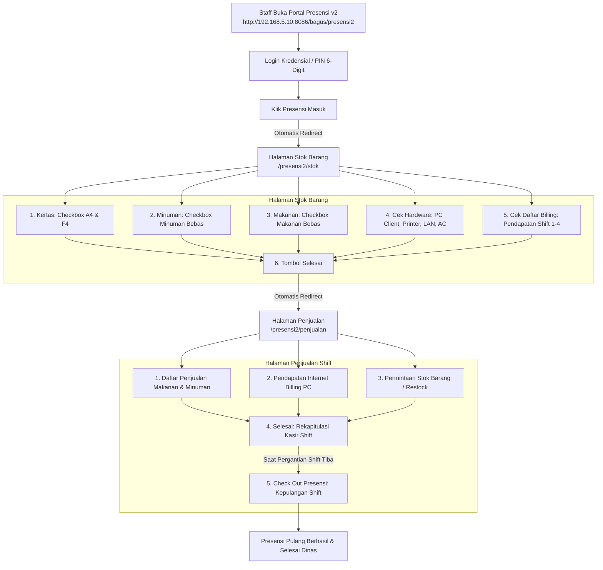

# 📋 Panduan & Spesifikasi: Alur Stok Barang dan Halaman Penjualan Presensi

**Organisasi:** Maya Graha Kencana (MGK)  
**Portal Presensi:** `http://192.168.5.10:8086/bagus/presensi2`  
**Modul:** Checklist Serah Terima Stok Barang & Halaman Kasir Penjualan Shift  
**Tanggal:** 17 Oktober 2026  
**Status:** `Production Ready (Fase Ekstensi Operasional Selesai)`  

---

## 🧭 Ringkasan Eksekutif & Kronologi Alur Kerja

Sistem ini mengintegrasikan presensi karyawan dengan alur checklist stok awal shift dan operasional kasir harian agar seluruh barang habis pakai, aset hardware, dan pendapatan kas internet/F&B tercatat akurat dan dapat dipertanggungjawabkan saat pergantian shift.

---

## 📦 1. Halaman Stok Barang (`/presensi2/stok`)

Halaman ini dibuka secara otomatis ketika staff melakukan presensi masuk (clock-in) atau diakses manual via menu navigasi. Bertujuan memastikan serah terima inventaris antara shift sebelumnya dan shift aktif.

### Rincian Komponen:
1. **Tabel Informasi Stok (Perbandingan Shift Sebelumnya vs Penjualan Hari Ini - Tanpa Ceklis Tambah/Kurang)**:
   - **1 Stok Kertas Print**:
     - Tabel informasi ketersediaan **Kertas HVS A4** dan **Kertas HVS F4**.
     - Kolom: `Jenis Kertas`, `Stok Shift Sebelumnya`, `Penjualan / Terpakai Hari Ini`, `Sisa Stok Saat Ini`, `Keterangan (Rim)`.
     - Bersifat murni tabel informasi (read-only), tidak ada checkbox untuk manipulasi stok lembar.
   - **2 Stok Minuman**:
     - Badge penempatan: Showcase Kulkas.
     - Tabel informasi menu minuman (Es Kopi Susu Aren, Es Teh Jumbo, Le Minerale, Good Day Freeze, Extra Joss Susu, Kopi Tubruk).
     - Kolom: `Nama Minuman`, `Stok Shift Sebelumnya`, `Penjualan Hari Ini`, `Sisa Stok Saat Ini`, `Status (Aman / Menipis)`.
     - Murni tabel informasi audit tanpa tombol tambah/kurang atau checkbox item.
   - **3 Stok Makanan & Snack**:
     - Badge penempatan: Etalase Kasir.
     - Tabel informasi menu makanan/snack (Indomie Goreng, Indomie Dok-Dok, Nasi Magelangan, Nasi Ayam Geprek, Roti Bakar, Chitato, Cireng).
     - Kolom: `Nama Makanan / Snack`, `Stok Shift Sebelumnya`, `Penjualan Hari Ini`, `Sisa Stok Saat Ini`, `Status (Aman / Menipis)`.
     - Murni tabel informasi audit tanpa tombol tambah/kurang atau checkbox item.
2. **Cek Kelayakan Hardware**:
   - Status toggle: Normal Semua / Ada Kendala Ringan / Perlu Maintenance Segera.
   - Checklist komponen penting:
     - 15 Unit PC Client (Monitor, CPU, Keyboard, Mouse, Headset)
     - Komputer Server Billing & Kasir Utama
     - Printer Kasir Thermal EPSON
     - Printer HVS Epson L3210 (A4 & F4)
     - Kabel LAN, Switch Gigabit & WiFi Router
     - CCTV 8-Channel & AC Kasir
   - Field catatan kendala hardware.
3. **5. Cek Daftar Billing Internet Shift Sebelumnya**:
   - Menampilkan data **Billing Shift Sebelumnya** (bukan shift sekarang yang baru mulai).
   - Memuat:
     - Nama Shift Sebelumnya & Jam Operasional (cth: Shift 1 Pagi 07:00 - 15:00)
     - Tanggal & Nama Operator yang Menyerahkan Kas
     - Total Pendapatan Kas Billing Shift Sebelumnya (cth: Rp 85.000)
     - Catatan Serah Terima dari shift sebelumnya
   - Checkbox konfirmasi verifikasi bahwa fisik kas serah terima di laci cocok dengan catatan billing shift sebelumnya.
4. **Tombol "Selesai"**:
   - Tombol utama: *"6. Selesai & Lanjut ke Halaman Penjualan"*.
   - Menyimpan seluruh checklist ke basis data tabel `shift_handover_checklists`.
   - **Langsung mengarahkan staff ke Halaman Penjualan (`/presensi2/penjualan`)**.
   - *Catatan Penting:* Check Out kepulangan nanti dilakukan di Halaman Penjualan saat waktu pergantian shift telah tiba.

---

## 🛒 2. Halaman Penjualan (`/presensi2/penjualan`)

Halaman ini berfungsi sebagai pusat kasir dan pencatatan pendapatan selama shift berlangsung hingga saat pergantian shift.

### Rincian Komponen:
1. **Daftar Penjualan Makanan dan Minuman**:
   - Form Quick POS Penjualan F&B: Pilih menu, tentukan qty, pilih metode bayar (Tunai, QRIS, Transfer), dan simpan.
   - Tabel realtime daftar item F&B yang terjual pada shift berjalan beserta subtotal dan jam transaksi.
   - Otomatis memotong stok inventaris etalase kasir (`stock_inventories`).
2. **Pendapatan Internet (100% Otomatis - Tanpa Input Manual)**:
   - **Sistem Sinkronisasi Billing Otomatis**: Kasir/staff **tidak perlu menginput manual** pendapatan internet. Sistem secara berkala dan realtime menarik data dari server billing PC client (`pc_stations` dan `cafe_sales`).
   - **Live Monitoring 15 PC Station**: Memantau status seluruh unit (PC-01 s/d PC-15) secara visual (Sedang Digunakan vs Kosong), nama user yang aktif bermain, jam mulai, durasi menit berjalan, dan nominal argo billing yang terus berjalan.
   - **Kalkulasi Akumulasi Dinamis**: Total pendapatan internet dihitung otomatis dari akumulasi transaksi billing selesai + argo billing aktif yang sedang berjalan.
   - **Tombol Sinkronisasi Realtime**: Tersedia tombol *"🔄 Refresh Billing Realtime"* untuk menarik data detil PC terkini kapan saja.
   - **Integrasi Rekap Shift**: Saat kasir menekan tombol "Selesai (Tutup Shift)", total pendapatan internet langsung terisi otomatis ke laporan rekap kasir tanpa perlu dihitung ulang secara manual.
3. **Audit Perbandingan Stok Shift (Sebelumnya vs Terjual vs Sesudahnya)**:
   - **Kertas Print (A4 & F4)**:
     - *Stok Sebelumnya*: Lembar di tray printer + stok rim di loker kasir.
     - *Terpakai*: Jumlah lembar print tugas, struk billing & order kasir.
     - *Stok Sesudahnya*: Sisa lembar kertas yang siap dipakai shift berikutnya.
   - **Makanan & Snack (Pcs / Porsi)**:
     - *Stok Sebelumnya*: Jumlah pcs/porsi makanan saat serah terima awal shift.
     - *Terjual*: Jumlah pcs yang dibeli pelanggan via kasir POS shift ini.
     - *Stok Sesudahnya*: Sisa fisik realtime (`Sebelumnya - Terjual`).
   - **Minuman Dingin & Kopi (Pcs / Botol / Cup)**:
     - *Stok Sebelumnya*: Jumlah botol/cup minuman saat serah terima awal shift.
     - *Terjual*: Jumlah botol/cup yang terjual via kasir POS shift ini.
     - *Stok Sesudahnya*: Sisa fisik realtime (`Sebelumnya - Terjual`).
   - Dilengkapi tab interaktif: **🖨️ Kertas Print**, **🍜 Makanan**, dan **🥤 Minuman**.
4. **Permintaan Stok Barang (Restock Request)**:
   - Form pengajuan permintaan stok jika kertas A4/F4, makanan, minuman, atau perlengkapan habis.
   - Pilihan kategori: Kertas Percetakan, Minuman, Makanan, Hardware/Perlengkapan.
   - Input Qty, Satuan (Rim, Dus, Pack, Botol), dan Tingkat Urgensi (Normal / Mendesak).
   - Tabel riwayat permintaan stok shift ini dengan status pelacakan (`pending`, `fulfilled`).
5. **Tombol "Selesai" (Rekap Tutup Shift)**:
   - Modal rekapitulasi penjualan seluruh shift (Total Omset F&B + Total Billing Internet).
   - Ringkasan sisa stok fisik sesudahnya untuk diserahterimakan ke operator shift berikutnya.
   - Input jumlah kas fisik di laci kasir dan catatan serah terima ke operator shift selanjutnya.
   - Menyimpan seluruh rekapan finansial dan audit stok ke tabel `shift_sales_summaries` (kolom `stock_audit`).
6. **Tombol "Check Out Presensi"**:
   - Tombol kepulangan resmi: *"Check Out Presensi (Selesai Dinas Shift)"*.
   - Ketika waktu pergantian shift tiba, staff mengonfirmasi kepulangan untuk menyelesaikan presensi clock-out hari ini.

---

## 🗄️ 3. Skema Basis Data Terkait

### Tabel `shift_handover_checklists`
Menyimpan pemeriksaan awal shift kertas, minuman/makanan bebas, hardware, dan billing:
- `id`, `employee_id`, `branch_id`, `shift_id`, `attendance_record_id`, `check_date`
- `paper_a4` (bool), `paper_a4_qty` (int)
- `paper_f4` (bool), `paper_f4_qty` (int)
- `drink_free_checked` (bool), `drink_items` (json), `drink_notes` (text)
- `food_free_checked` (bool), `food_items` (json), `food_notes` (text)
- `hardware_status` (string), `hardware_checklist` (json), `hardware_notes` (text)
- `billing_shift_income` (decimal), `billing_verified` (bool), `billing_details` (json)
- `status`, `completed_at`, `timestamps`

### Tabel `shift_stock_requests`
Menyimpan permintaan stok dari kasir ke gudang/logistik:
- `id`, `request_number`, `employee_id`, `branch_id`, `shift_id`
- `item_category` (kertas, minuman, makanan, hardware)
- `item_name`, `qty_requested`, `unit`, `urgency` (normal/urgent), `notes`
- `status` (pending/approved/fulfilled), `fulfilled_at`, `timestamps`

### Tabel `shift_sales_summaries`
Menyimpan rekapitulasi kasir akhir shift:
- `id`, `employee_id`, `branch_id`, `shift_id`, `attendance_record_id`, `work_date`
- `total_fnb_sales`, `total_internet_sales`, `total_revenue`, `cash_in_drawer`
- `handover_notes`, `status` (open/closed), `closed_at`, `timestamps`

### Tabel `system_menus` (Database Navicat)
Tabel master navigasi & routing sistem yang dapat dilihat dan dikelola langsung melalui Navicat:
- `id` (bigint, PK)
- `group` (string, default: `presensi2`)
- `code` (string, unique: `presensi2_beranda`, `presensi2_stok`, `presensi2_penjualan`, `presensi2_riwayat`)
- `name` (string: Nama menu yang tampil di antarmuka sistem)
- `url` (string: Full URL sistem, e.g. `http://192.168.5.10:8086/bagus/presensi2/...`)
- `route_name` (string: Route name Laravel)
- `icon` (string: Emoji/icon tampilan)
- `sort_order` (int: Urutan tombol navigasi)
- `is_active` (bool: Status aktif/nonaktif)
- `description` (text: Keterangan modul sistem)

---

## 🌐 4. Endpoint & Routing URL (Terdaftar di Database Navicat `system_menus`)

| ID Navicat | URL Lengkap | Nama Route | Label Menu | Icon | Fungsi |
|---|---|---|---|---|---|
| 1 | `http://192.168.5.10:8086/bagus/presensi2` | `presensi2.index` | Beranda Presensi | 🏠 | Beranda Utama Dashboard Presensi v2 |
| 2 | `http://192.168.5.10:8086/bagus/presensi2/stok` | `presensi2.stok` | Stok Barang & Serah Terima | 📦 | Audit Stok Kertas, Minuman, Makanan, Hardware & Billing Shift Sebelumnya |
| 3 | `http://192.168.5.10:8086/bagus/presensi2/penjualan` | `presensi2.penjualan` | Penjualan & Billing Shift | 🛒 | Kasir Penjualan F&B, Billing Otomatis Internet & Permintaan Stok |
| 4 | `http://192.168.5.10:8086/bagus/presensi2/riwayat` | `presensi2.riwayat` | Riwayat Presensi | 📅 | Riwayat Log Presensi Masuk, Pulang, Geofencing & Rekap Shift |
| 5 | `http://192.168.5.10:8086/bagus/presensi2/login` | `presensi2.login` | Login Presensi & Admin | 🔐 | Portal Autentikasi Karyawan & Admin (Pilihan Nama Karyawan, PIN 6-Digit & Password) |

---

## 🔒 5. Catatan Kepatuhan & SOP Operator

1. Setiap operator yang memulai dinas shift **wajib** memeriksa fisik stok kertas (A4 & F4) dan tidak boleh melompati checklist hardware.
2. Seluruh tabel stok kertas (1), minuman (2), dan makanan (3) bersifat **tabel informasi murni** yang membandingkan stok shift sebelumnya vs penjualan hari ini tanpa ada tombol manual penambahan/pengurangan stok di form awal.
3. Kasir memverifikasi serah terima kas billing dari shift sebelumnya pada bagian 5 sebelum masuk ke Halaman Penjualan.
4. Check Out presensi kepulangan hanya dilakukan saat operator pengganti telah tiba di meja kasir dan serah terima saldo fisik telah dicocokkan.

---

## 🖥️ 6. Dashboard Admin Terpadu (`http://192.168.5.10:8086/bagus/admin/`)

Dashboard Admin ERP telah direvisi sesuai struktur operasional 5 menu utama:

1. **1. Data**:
   - **Profil & CRUD Karyawan (`#data-profil`):** 
     - Profil pimpinan Manager Operasional: **Bagus** (NIK: EMP-043, Email: bagusbudi1308@gmail.com, Telp: 031-3981811).
     - **Manajemen Karyawan (CRUD Lengkap):** Terletak tepat di bawah kartu Profil untuk mempermudah pendaftaran karyawan baru (Tambah Karyawan), pengeditan data staff/jabatan/cabang, dan penghapusan (Delete) karyawan langsung dari halaman profil. Redirection otomatis kembali ke `#data-profil`.
   - **Jadwal Shift Karyawan:** Alokasi Shift 1-4, jam kerja, toleransi keterlambatan & daftar penugasan staff.
   - **Data Billing Setiap Shift:** Rekapitulasi omset billing internet warnet per shift (Shift 1 s/d 4) beserta nama operator & status serah terima kas.
   - **Jumlah Presensi Karyawan:** Ringkasan kehadiran harian (Total staff, Tepat waktu, Terlambat, Izin/Cuti, Alpa) dan log presensi realtime.
   - **Jam Kerja Karyawan:** Monitoring durasi jam kerja, jam clock-in/clock-out, lembur, dan status pemenuhan target kontrak harian (8 jam).
   - **Standard Operating Procedure (SOP):** Panduan resmi operasional MGK (SOP-01 s/d SOP-05) yang mencakup presensi, serah terima kas, inventaris, dan hardware.
2. **2. Penerimaan Stok Distribusi**:
   - Rekapitulasi transfer barang masuk dari gudang pusat (`stock_transfer_dispatches`) dengan tombol aksi konfirmasi tanda terima.
   - Monitoring permohonan permintaan stok dari kasir shift (`shift_stock_requests`).
3. **3. Stok (Ketersediaan Produk)**:
   - Ketersediaan stok fisik seluruh SKU (Kertas A4/F4, Minuman Showcase, Makanan Etalase, Hardware) lengkap dengan status Aman, Menipis, dan Habis.
4. **4. Laporan**:
   - Ringkasan omset F&B, pendapatan billing warnet, serah terima saldo laci kasir, serta tombol Cetak / PDF Laporan.
5. **5. Keluar**:
   - Dialog konfirmasi keluar dan tombol logout aman dari sesi admin.
