# 🚀 Pipeline Arsitektur & Eksekusi: Sistem Presensi Karyawan
**Organisasi:** Maya Graha Kencana (MGK)  
**Metodologi:** Pipeline-Driven Development & Pragmatic Domain-Driven Design (DDD)  
**Status Eksekusi:** ✅ `100% Selesai & Production Ready (13/13 Quality Gates Passed)`  
**Dokumen Terkait:** [rencana_implemantasi_karyawan.md](file:///var/www/laravel_apps/bagus/docs/rencana_implemantasi_karyawan.md) | [tahapan_eksekusi_presensi.md](file:///var/www/laravel_apps/bagus/docs/tahapan_eksekusi_presensi.md) | [roadmap_presensi.md](file:///var/www/laravel_apps/bagus/docs/roadmap_presensi.md)

---

## 🧭 1. Diagram Pipeline Eksekusi (13 Stage)

Setiap tahapan (*Stage*) dalam pipeline memiliki gerbang pengujian (*Quality Gate*). Tahap berikutnya baru boleh dieksekusi setelah quality gate pada tahap sebelumnya lulus 100% tanpa regresi.

```mermaid
graph TD
    P1["Stage 1: Skema Database & Master Enums"] --> QG1{"Quality Gate 1"}
    QG1 -->|Passed| P2["Stage 2: Core Domain Logic & Geofencing"]
    P2 --> QG2{"Quality Gate 2"}
    QG2 -->|Passed| P3["Stage 3: Anti-Fraud & File Handling"]
    P3 --> QG3{"Quality Gate 3"}
    QG3 -->|Passed| P4["Stage 4: HTTP API Layer (V1) & Tests"]
    P4 --> QG4{"Quality Gate 4"}
    QG4 -->|Passed| P5["Stage 5: Autentikasi Karyawan & Multi-Guard"]
    P5 --> QG5{"Quality Gate 5"}
    QG5 -->|Passed| P6["Stage 6: UI Portal Karyawan (Mobile-First / PWA)"]
    P6 --> QG6{"Quality Gate 6"}
    QG6 -->|Passed| P7["Stage 7: UI Dashboard Monitoring Admin Web"]
    P7 --> QG7{"Quality Gate 7"}
    QG7 -->|Passed| P8["Stage 8: Final QA, UAT & Production Readiness"]
    P8 --> QG8{"Quality Gate 8"}
    QG8 -->|Passed| P9["Stage 9: Manajemen Master Data Karyawan (Admin CRUD)"]
    P9 --> QG9{"Quality Gate 9"}
    QG9 -->|Passed| P10["Stage 10: GRC Hardening (Audit Trail, SoD/RBAC, ISO 27001)"]
    P10 --> QG10{"Quality Gate 10"}
    QG10 -->|Passed| P11["Stage 11: Arsitektur Hybrid Roster ERP & Cost Center"]
    P11 --> QG11{"Quality Gate 11"}
    QG11 -->|Passed| P12["Stage 12: Tata Kelola Lembur Desain & Dual-Role"]
    P12 --> QG12{"Quality Gate 12"}
    QG12 -->|Passed| P13["Stage 13: Dynamic Settings Engine & Hardening"]
    P13 --> QG13{"Quality Gate 13"}
    QG13 -->|Passed| PROD["🚀 System Operational & Production Ready"]
```



---

## 📦 2. Rincian Eksekusi Per-Stage Pipeline

### 🔹 Stage 1: Fondasi Skema Database & Master Enums
* **Fokus:** Menyiapkan struktur basis data PostgreSQL, relasi foreign key, constraint integritas, dan type-safety Enums PHP 8.4.
* **Komponen Kunci:**
  - Enums: [AttendanceStatus](file:///var/www/laravel_apps/bagus/app/Domains/Attendance/Enums/AttendanceStatus.php), [VerificationMethod](file:///var/www/laravel_apps/bagus/app/Domains/Attendance/Enums/VerificationMethod.php), [ApprovalStatus](file:///var/www/laravel_apps/bagus/app/Domains/Attendance/Enums/ApprovalStatus.php), [LeaveType](file:///var/www/laravel_apps/bagus/app/Domains/Leave/Enums/LeaveType.php).
  - Migrasi: `branches` (geofencing), `employees`, `shifts`, `attendance_records`, `leave_requests`.
  - Seeder: [AttendanceMasterSeeder.php](file:///var/www/laravel_apps/bagus/database/seeders/AttendanceMasterSeeder.php) (Shift 1 s/d 4, BO, Cabang MGK).
* **Target Verifikasi:** `php artisan test --filter=AttendanceDomainModelTest` (5 tests pass).

---

### 🔹 Stage 2: Core Domain Logic & Validasi Geofencing
* **Fokus:** Aturan bisnis murni terisolasi dari HTTP: kalkulasi jarak Haversine, resolver shift malam (*overnight shift*), evaluasi keterlambatan & toleransi (*grace period*).
* **Komponen Kunci:**
  - Value Object: [Coordinate.php](file:///var/www/laravel_apps/bagus/app/Domains/Attendance/ValueObjects/Coordinate.php).
  - Services: [GeoValidationService.php](file:///var/www/laravel_apps/bagus/app/Domains/Attendance/Services/GeoValidationService.php), [ShiftResolverService.php](file:///var/www/laravel_apps/bagus/app/Domains/Attendance/Services/ShiftResolverService.php).
  - DTOs: [ClockInDTO.php](file:///var/www/laravel_apps/bagus/app/Domains/Attendance/DataTransferObjects/ClockInDTO.php), [ClockOutDTO.php](file:///var/www/laravel_apps/bagus/app/Domains/Attendance/DataTransferObjects/ClockOutDTO.php).
  - Actions: [ClockInAction.php](file:///var/www/laravel_apps/bagus/app/Domains/Attendance/Actions/ClockInAction.php), [ClockOutAction.php](file:///var/www/laravel_apps/bagus/app/Domains/Attendance/Actions/ClockOutAction.php).
* **Target Verifikasi:** `php artisan test --filter="AttendanceDomainLogicTest|AttendanceActionsTest"` (13 tests pass).

---

### 🔹 Stage 3: Anti-Fraud & File Handling (Selfie)
* **Fokus:** Keaslian data presensi melalui pengamanan foto kamera canvas/selfie, proteksi fake GPS, dan pencegahan anomali teleportasi.
* **Komponen Kunci:**
  - Storage: Disk khusus `attendance_photos` di [config/filesystems.php](file:///var/www/laravel_apps/bagus/config/filesystems.php).
  - Service Foto: [AttendancePhotoService.php](file:///var/www/laravel_apps/bagus/app/Domains/Attendance/Services/AttendancePhotoService.php) / [SelfieStorageService.php](file:///var/www/laravel_apps/bagus/app/Domains/Attendance/Services/SelfieStorageService.php).
  - Anti-Fraud: [AntiFraudService.php](file:///var/www/laravel_apps/bagus/app/Domains/Attendance/Services/AntiFraudService.php) (deteksi mock location, deteksi kecepatan tidak realistis >350 km/jam, sanitasi audit perangkat).
* **Target Verifikasi:** `php artisan test --filter=AntiFraudAndSelfieTest` (6 tests pass).

---

### 🔹 Stage 4: HTTP API Layer (V1) & Feature Tests
* **Fokus:** Menyediakan RESTful API terstandar untuk integrasi mobile atau kiosk luar.
* **Komponen Kunci:**
  - Form Requests: `ClockInRequest`, `ClockOutRequest`, `StoreLeaveRequest`.
  - API Resources: `AttendanceResource`, `LeaveResource`.
  - Controllers: [AttendanceController.php](file:///var/www/laravel_apps/bagus/app/Http/Controllers/Api/V1/AttendanceController.php), `LeaveController`, `ShiftController`.
  - Rute: `routes/api.php` (`/api/v1/*`).
* **Target Verifikasi:** `php artisan test --filter=AttendanceApiTest` (5 tests, 38 assertions pass).

---

### 🔹 Stage 5: Autentikasi Karyawan & Multi-Guard Setup
* **Fokus:** Pemisahan login admin ERP dan portal karyawan mandiri.
* **Komponen Kunci:**
  - Auth Config: Guard `employee` berbasis session pada [config/auth.php](file:///var/www/laravel_apps/bagus/config/auth.php).
  - Model: [Employee.php](file:///var/www/laravel_apps/bagus/Modules/MasterData/Domain/Models/Employee.php) (`Authenticatable`).
  - Controller: [EmployeeAuthController.php](file:///var/www/laravel_apps/bagus/app/Http/Controllers/Presensi/EmployeeAuthController.php).
  - Middleware: `auth:employee` redirect ke login presensi.
* **Target Verifikasi:** `php artisan test --filter=EmployeeAuthTest` (6 tests pass).

---

### 🔹 Stage 6: UI Portal Karyawan (Mobile-First / PWA)
* **Fokus:** Antarmuka web smartphone untuk absensi mandiri, live camera capture, dan radar GPS real-time.
* **Komponen Kunci:**
  - Layout & PWA: [layouts/presensi.blade.php](file:///var/www/laravel_apps/bagus/resources/views/layouts/presensi.blade.php), `manifest.json`, `sw.js`.
  - Views: `login.blade.php`, `index.blade.php`, `scan.blade.php`, `izin.blade.php`, `riwayat.blade.php`.
* **Target Verifikasi:** `php artisan test --filter=AttendanceWebTest` (4 tests, 17 assertions pass).

---

### 🔹 Stage 7: UI Dashboard Monitoring Admin Web
* **Fokus:** Panel manajemen dan HRD untuk mengawasi absensi seluruh cabang secara real-time.
* **Komponen Kunci:**
  - Controller: [AttendanceAdminController.php](file:///var/www/laravel_apps/bagus/app/Http/Controllers/Admin/AttendanceAdminController.php).
  - Views Admin: Monitoring harian (`index.blade.php`), rekap bulanan & ekspor CSV (`rekap.blade.php`), panel approval cuti (`approval.blade.php`).
* **Target Verifikasi:** `php artisan test --filter=AttendanceAdminTest` (4 tests, 12 assertions pass).

---

### 🔹 Stage 8: Final QA, Pint Formatting, & Production Readiness
* **Fokus:** Kualitas kode PSR-12, audit keamanan, dan kesiapan produksi.
* **Komponen Kunci:**
  - Formatting: `vendor/bin/pint --format agent` (Clean).
  - Full Test Suite: `php artisan test` (100% Green).
* **Target Verifikasi:** Full suite passing (38 tests, 121 assertions).

---

### 🔹 Stage 9: Manajemen Master Data Karyawan (Admin Web CRUD)
* **Fokus:** Manajemen data karyawan mandiri oleh Admin Web (Create, Read, Update, Toggle Status, Reset Kredensial).
* **Komponen Kunci:**
  - Controller: [EmployeeAdminController.php](file:///var/www/laravel_apps/bagus/app/Http/Controllers/Admin/EmployeeAdminController.php).
  - Form Requests: `StoreEmployeeRequest`, `UpdateEmployeeRequest`.
  - Views: `admin/karyawan/index.blade.php`, `create.blade.php`, `edit.blade.php`.
  - Proteksi: Pencegahan hapus fisik karyawan jika memiliki transaksi riwayat presensi.
* **Target Verifikasi:** `php artisan test --filter=EmployeeAdminTest` (9 tests pass).

---

### 🔹 Stage 10: GRC Hardening (Audit Trail, SoD/RBAC, ISO 27001)
* **Fokus:** Tata kelola data kepatuhan ISO 27001:2022, audit trail forensik, dan pemisahan wewenang cabang.
* **Komponen Kunci:**
  - Tabel: `audit_logs` (perekaman mutasi old vs new values dengan sanitasi password/PIN).
  - RBAC / SoD: Role `SuperAdmin`, `BranchAdmin` (terisolasi per-cabang), `Auditor` (read-only).
  - Rate Limiting: `throttle:10,1` untuk scan presensi dan `throttle:5,1` untuk login.
* **Target Verifikasi:** `php artisan test --filter=AuditLogAndRbacTest` (10 tests pass).

---

### 🔹 Stage 11: Arsitektur Hybrid Roster ERP & Cost Center Akuntansi
* **Fokus:** Integrasi 2 model kerja berbeda: Operasional Shift (HPP Pabrik/Warnet) vs Fleksibel Desain (OPEX).
* **Komponen Kunci:**
  - Skema: `roster_jadwals` dan penambahan kolom `cost_center`, `work_type`, `effective_minutes`.
  - Service: [RosterResolverService.php](file:///var/www/laravel_apps/bagus/app/Domains/Attendance/Services/RosterResolverService.php).
  - Akun Biaya: `5-1001` (Beban Tenaga Kerja Langsung / HPP) & `5-1002` (Beban Gaji Kreatif / OPEX).
  - UI Adaptif: Widget Stopwatch interaktif di portal karyawan fleksibel.
* **Target Verifikasi:** `php artisan test --filter=HybridRosterAttendanceTest` (6 tests pass).

---

### 🔹 Stage 12: Tata Kelola Lembur Desain & Karyawan Dual-Role
* **Fokus:** Kontrol anggaran lembur (*Pre-Approved Overtime*), proteksi kuota jam kontrak, serta dukungan sesi kerja ganda (*Dual-Role*).
* **Komponen Kunci:**
  - Skema: Kolom `overtime_status`, `overtime_approved_minutes`, `overtime_reason`.
  - Enforcement: Penguncian clock-out di bawah kuota kontrak jam kerja.
  - Sesi Ganda: Karyawan dapat menjalankan shift warnet dan sesi desain di hari yang sama dengan pemisahan akun akuntansi.
* **Target Verifikasi:** `php artisan test --filter=OvertimeGovernanceAndDualRoleTest` (6 tests pass).

---

### 🔹 Stage 13: Dynamic Settings Engine & Error Mitigation Hardening
* **Fokus:** Mesin pengaturan dinamis (*Configurable Enterprise Settings*), perbaikan 14 risiko teknis (RSK-01 s/d RSK-14), dan proteksi WORM audit trail.
* **Komponen Kunci:**
  - Tabel & Cache: `attendance_settings` dengan in-memory cache `rememberForever`.
  - UI Admin: Panel Pengaturan Presensi di `/admin/presensi/pengaturan`.
  - WORM Immutability Guard: Model `AuditLog` menolak mutasi update/delete saat guard aktif.
  - Anti-Overlapping Cuti: Custom validation `NoOverlappingLeaveRule`.
* **Target Verifikasi:** `php artisan test --filter=AttendanceSettingsAndMitigationTest` (7 tests pass).

---

## 📊 3. Matriks Quality Gate & Status Eksekusi

| Pipeline Stage | Nama Tahapan | Total Task | Status Quality Gate | Command Verifikasi Utama |
|---|---|:---:|:---:|---|
| **Stage 1** | Skema Database & Master Enums | 7 | ✅ `PASSED` | `php artisan test --filter=AttendanceDomainModelTest` |
| **Stage 2** | Core Domain Logic & Geofencing | 6 | ✅ `PASSED` | `php artisan test --filter=AttendanceDomainLogicTest` |
| **Stage 3** | Anti-Fraud & File Handling | 3 | ✅ `PASSED` | `php artisan test --filter=AntiFraudAndSelfieTest` |
| **Stage 4** | HTTP API Layer (V1) & Tests | 5 | ✅ `PASSED` | `php artisan test --filter=AttendanceApiTest` |
| **Stage 5** | Autentikasi Karyawan & Multi-Guard | 4 | ✅ `PASSED` | `php artisan test --filter=EmployeeAuthTest` |
| **Stage 6** | UI Portal Karyawan (Mobile/PWA) | 6 | ✅ `PASSED` | `php artisan test --filter=AttendanceWebTest` |
| **Stage 7** | UI Dashboard Monitoring Admin | 4 | ✅ `PASSED` | `php artisan test --filter=AttendanceAdminTest` |
| **Stage 8** | Final QA & Production Readiness | 4 | ✅ `PASSED` | `vendor/bin/pint --format agent && php artisan test` |
| **Stage 9** | Manajemen Master Data Karyawan | 5 | ✅ `PASSED` | `php artisan test --filter=EmployeeAdminTest` |
| **Stage 10** | GRC Hardening & Forensik ISO 27001 | 4 | ✅ `PASSED` | `php artisan test --filter=AuditLogAndRbacTest` |
| **Stage 11** | Hybrid Roster ERP & Cost Center | 6 | ✅ `PASSED` | `php artisan test --filter=HybridRosterAttendanceTest` |
| **Stage 12** | Tata Kelola Lembur & Dual-Role | 6 | ✅ `PASSED` | `php artisan test --filter=OvertimeGovernanceAndDualRoleTest` |
| **Stage 13** | Dynamic Settings & Error Mitigation | 11 | ✅ `PASSED` | `php artisan test --filter=AttendanceSettingsAndMitigationTest` |
| **Ekstensi** | Portal Presensi v2 (Credential-Based) | 5 | ✅ `PASSED` | `php artisan test --filter=AttendanceWebV2PortalTest` |
| **TOTAL** | **Full Application Test Suite** | **76 Task** | ✅ `100% GREEN` | **213 tests, 864 assertions (0 failures)** |

---

## 🛠️ 4. Cara Menjalankan Verifikasi Pipeline

Untuk memvalidasi ulang seluruh pipeline secara instan di terminal server:
```bash
# 1. Menjalankan seluruh test suite
php artisan test --compact

# 2. Menjalankan formatting audit standar Laravel Boost / Pint
vendor/bin/pint --format agent
```
