# 🚀 Rencana Implementasi Sistem Presensi Karyawan
**Organisasi:** Maya Graha Kencana (MGK)  
**Dokumen Referensi:** [doc/roadmap_presensi.md](file:///var/www/laravel_apps/bagus/doc/roadmap_presensi.md)  
**Pendekatan:** Pipeline-Driven Development & Pragmatic Domain-Driven Design (DDD)  
**Status:** ✅ 100% Selesai (Semua Quality Gate Passed)  

---

## 🧭 Diagram Pipeline Eksekusi

Setiap stage di dalam pipeline memiliki kriteria pengujian (*Quality Gate*). Tahap berikutnya baru boleh dieksekusi setelah quality gate pada tahap sebelumnya terpenuhi 100%.

```mermaid
graph TD
    P1["Stage 1: Skema Database & Master Enums"] --> QG1{"Quality Gate 1"}
    QG1 -->|Passed| P2["Stage 2: Core Domain Logic & Geofencing"]
    P2 --> QG2{"Quality Gate 2"}
    QG2 -->|Passed| P3["Stage 3: Anti-Fraud & File Handling"]
    P3 --> QG3{"Quality Gate 3"}
    QG3 -->|Passed| P4["Stage 4: HTTP API Layer (V1) & Tests"]
    P4 --> QG4{"Quality Gate 4"}
    QG4 -->|Passed| P5["Stage 5: Autentikasi Karyawan & Multi-Guard"]
    P5 --> QG5{"Quality Gate 5"}
    QG5 -->|Passed| P6["Stage 6: UI Portal Karyawan (Mobile-First / PWA)"]
    P6 --> QG6{"Quality Gate 6"}
    QG6 -->|Passed| P7["Stage 7: UI Dashboard Monitoring Admin Web"]
    P7 --> QG7{"Quality Gate 7"}
    QG7 -->|Passed| P8["Stage 8: Final QA, UAT & Production Readiness"]
    P8 --> QG8{"Quality Gate 8"}
    QG8 -->|Passed| P9["Stage 9: Manajemen Master Data Karyawan (Admin CRUD)"]
    P9 --> QG9{"Quality Gate 9"}
    QG9 -->|Passed| P10["Stage 10: GRC Hardening (Audit Trail, SoD/RBAC, SoT & Security)"]
    P10 --> QG10{"Quality Gate 10"}
    QG10 -->|Passed| P11["Stage 11: Arsitektur Hybrid Roster ERP & Cost Center Akuntansi"]
    P11 --> QG11{"Quality Gate 11"}
    QG11 -->|Passed| P12["Stage 12: Tata Kelola Lembur Desain & Karyawan Dual-Role"]
    P12 --> QG12{"Quality Gate 12"}
    QG12 -->|Passed| P13["Stage 13: Dynamic Settings Engine, Error Mitigation & 12 Pipeline Hardening"]
```

---

## 📦 PIPELINE STAGE 1: Fondasi Skema Database & Master Enums
> **Tujuan:** Menyiapkan seluruh tabel PostgreSQL, relasi foreign key, constraint, seeder data master, dan enum PHP 8.4 yang dibutuhkan domain presensi.

### Task Breakdown:
- [x] **TASK-1.1: Pembuatan Enums PHP 8.4**
  - File: `app/Domains/Attendance/Enums/AttendanceStatus.php` (`Present`, `Late`, `Absent`, `HalfDay`, `OnLeave`)
  - File: `app/Domains/Attendance/Enums/VerificationMethod.php` (`GpsSelfie`, `Biometric`, `AdminManual`)
  - File: `app/Domains/Attendance/Enums/ApprovalStatus.php` (`Pending`, `Approved`, `Rejected`)
  - File: `app/Domains/Leave/Enums/LeaveType.php` (`Annual`, `Sick`, `Permission`, `Emergency`)
- [x] **TASK-1.2: Migrasi Master Cabang (`branches`)**
  - Membuat tabel `branches` lengkap dengan koordinat GPS (`latitude`, `longitude`, `radius_meters`, `code`, `name`, `address`).
- [x] **TASK-1.3: Migrasi Master Karyawan (`employees`)**
  - Membuat tabel `employees` (relasi ke `branches`, NIK, nama, email, no HP, PIN/password, `is_active`, `remember_token`).
- [x] **TASK-1.4: Migrasi Master Shift (`shifts`)**
  - Membuat tabel `shifts` (`code`, `name`, `start_time`, `end_time`, `is_overnight`, `grace_period_minutes`, `is_active`).
- [x] **TASK-1.5: Migrasi Transaksi Presensi (`attendance_records`)**
  - Membuat tabel `attendance_records` (foreign key `employee_id`, `branch_id`, `shift_id`, `work_date`, data clock in/out, GPS, selfie, `status`, `late_minutes`, device info JSONB, mock flag, unique constraint).
- [x] **TASK-1.6: Migrasi Izin & Cuti (`leave_requests`)**
  - Membuat tabel `leave_requests` (foreign key `employee_id`, `leave_type`, `start_date`, `end_date`, `reason`, `attachment_path`, status approval).
- [x] **TASK-1.7: Database Seeder Master MGK**
  - File: `database/seeders/PresensiMasterSeeder.php`
  - Seeder Cabang MGK (Kantor Pusat, Cabang Warnet).
  - Seeder Template Shift: Shift 1 (01:00-07:00), Shift 2 (07:00-13:00), Shift 3 (13:00-19:00), Shift 4 Overnight (19:00-01:00), BO (08:30-17:30).
  - Seeder Akun Karyawan Uji Coba.

🔍 **Quality Gate 1:** ✅ **PASSED**  
`php artisan migrate --seed` berjalan sukses tanpa error; 5 tabel baru dan data seed PostgreSQL terverifikasi lengkap.

---

## 🧠 PIPELINE STAGE 2: Core Domain Logic & Validasi Geofencing
> **Tujuan:** Mengimplementasikan aturan bisnis murni (DDD) yang terisolasi dari framework HTTP: perhitungan jarak Haversine, deteksi shift lintas hari, dan kalkulasi keterlambatan.

### Task Breakdown:
- [x] **TASK-2.1: Value Object `Coordinate`**
  - File: `app/Domains/Attendance/ValueObjects/Coordinate.php`
  - Validasi batas latitude (-90 s/d 90) dan longitude (-180 s/d 180).
  - Metode `distanceTo(Coordinate $destination): float` berbasis formula Haversine (menghasilkan jarak dalam meter).
- [x] **TASK-2.2: Domain Exceptions**
  - File: `app/Domains/Attendance/Exceptions/OutsideGeofenceException.php`
  - File: `app/Domains/Attendance/Exceptions/AlreadyClockedInException.php`
  - File: `app/Domains/Attendance/Exceptions/NotClockedInException.php`
  - File: `app/Domains/Attendance/Exceptions/ShiftNotAssignedException.php`
  - File: `app/Domains/Attendance/Exceptions/MockLocationDetectedException.php`
- [x] **TASK-2.3: Domain Service `GeoValidationService`**
  - File: `app/Domains/Attendance/Services/GeoValidationService.php`
  - Mengevaluasi jarak koordinat karyawan terhadap radius cabang (`branch.radius_meters`). Melempar `OutsideGeofenceException` jika di luar batas.
- [x] **TASK-2.4: Domain Service `ShiftResolverService`**
  - File: `app/Domains/Attendance/Services/ShiftResolverService.php`
  - Mengatasi shift normal maupun *Overnight Shift* (Shift 4). Menentukan `work_date` yang tepat agar absensi pulang jam 01:10 pagi tetap terikat ke shift malam hari sebelumnya.
- [x] **TASK-2.5: DTOs (Data Transfer Objects)**
  - File: `app/Domains/Attendance/DataTransferObjects/ClockInDTO.php`
  - File: `app/Domains/Attendance/DataTransferObjects/ClockOutDTO.php`
- [x] **TASK-2.6: Domain Actions**
  - File: `app/Domains/Attendance/Actions/ClockInAction.php` (Menyimpan log masuk, menghitung menit telat berdasarkan grace period).
  - File: `app/Domains/Attendance/Actions/ClockOutAction.php` (Menyimpan log pulang, menghitung durasi kerja total).
  - File: `app/Domains/Attendance/Actions/CalculateOvertimeAction.php` (Menghitung menit lembur otomatis).

🔍 **Quality Gate 2:** ✅ **PASSED**  
Unit Test untuk `CoordinateTest`, `ShiftResolverTest`, dan `GeoValidationTest` lulus 100% (10 tests, 12 assertions pass).

---

## 🛡️ PIPELINE STAGE 3: Anti-Fraud & File Handling (Selfie)
> **Tujuan:** Menjaga keabsahan data presensi dengan pengamanan foto selfie, deteksi manipulasi lokasi, dan audit trail perangkat.

### Task Breakdown:
- [x] **TASK-3.1: Konfigurasi Storage Presensi**
  - Konfigurasi disk storage khusus `attendance_photos` di `config/filesystems.php`.
- [x] **TASK-3.2: Service Kompresi & Penyimpanan Selfie**
  - File: `app/Domains/Attendance/Services/AttendancePhotoService.php`
  - Validasi mime-type gambar, konversi aman ke WebP/JPEG, penamaan file unik terenkripsi, dan penyimpanan ke storage.
- [x] **TASK-3.3: Integrasi Anti-Mock GPS & Device Audit Trail**
  - Ekstraksi dan sanitasi payload `device_info` (User Agent, platform HP, flag mock provider).
  - Logging alamat IP jaringan (apakah terhubung ke WiFi cabang MGK).

🔍 **Quality Gate 3:** ✅ **PASSED**  
Sistem berhasil menyimpan file foto (UploadedFile & base64) ke storage disk serta memblokir request saat mock location terdeteksi.

---

## 📡 PIPELINE STAGE 4: HTTP API Layer (V1) & Feature Tests
> **Tujuan:** Membangun RESTful API V1 yang terstandar untuk dikonsumsi oleh aplikasi mobile / PWA.

### Task Breakdown:
- [x] **TASK-4.1: HTTP Form Requests (Validasi Payload)**
  - File: `app/Http/Requests/Api/V1/ClockInRequest.php`
  - File: `app/Http/Requests/Api/V1/ClockOutRequest.php`
  - File: `app/Http/Requests/Api/V1/StoreLeaveRequest.php`
- [x] **TASK-4.2: Eloquent API Resources (Format Respons Seragam)**
  - File: `app/Http/Resources/Api/V1/AttendanceResource.php`
  - File: `app/Http/Resources/Api/V1/LeaveResource.php`
- [x] **TASK-4.3: API Controllers**
  - File: `app/Http/Controllers/Api/V1/AttendanceController.php` (`clockIn`, `clockOut`, `today`, `history`)
  - File: `app/Http/Controllers/Api/V1/LeaveController.php` (`requestLeave`, `history`)
  - File: `app/Http/Controllers/Api/V1/ShiftController.php` (`index`)
- [x] **TASK-4.4: Pendaftaran Rute API**
  - Registrasi endpoint di `routes/api.php` dan aktivasi di `bootstrap/app.php`.
- [x] **TASK-4.5: Feature Tests API**
  - File: `tests/Feature/Api/AttendanceApiTest.php` (5 tests, 38 assertions pass).

🔍 **Quality Gate 4:** ✅ **PASSED**  
Semua endpoint REST API merespons dengan status HTTP yang tepat (`201 Created`, `422 Geofence`, `403 Mock Location`, `200 OK`).

---

## 🔑 PIPELINE STAGE 5: Autentikasi Karyawan & Multi-Guard Setup
> **Tujuan:** Memisahkan login administrator dengan login karyawan mandiri secara aman.

### Task Breakdown:
- [x] **TASK-5.1: Konfigurasi Multi-Guard Laravel**
  - Update `config/auth.php`: Menambahkan guard `employee` dengan driver `session` dan provider `employees` (model `App\Domains\Employee\Models\Employee`).
- [x] **TASK-5.2: Pembaruan Model `Employee`**
  - Mengimplementasikan `Illuminate\Foundation\Auth\User as Authenticatable`.
  - Relasi ke `Branch`, `AttendanceRecord`, dan `LeaveRequest`.
- [x] **TASK-5.3: Controller Autentikasi Karyawan**
  - File: `app/Http/Controllers/Presensi/EmployeeAuthController.php`
  - Method `showLoginForm()` (`/presensi/login`).
  - Method `login()` dengan validasi NIK & password/PIN + proteksi Remember Me.
  - Method `logout()` (`/presensi/logout`).
- [x] **TASK-5.4: Middleware Proteksi Presensi**
  - Route group `/presensi` dilindungi oleh middleware `auth:employee` dan redirect otomatis ke `route('presensi.login')`.

🔍 **Quality Gate 5:** ✅ **PASSED**  
Feature test `EmployeeAuthTest` lulus 100% (6 tests pass). Karyawan dapat login dengan NIK + password/PIN, sesi tersimpan, dan tamu teralihkan ke login presensi.

---

## 📱 PIPELINE STAGE 6: UI Portal Karyawan (Mobile-First / PWA)
> **Tujuan:** Menyusun antarmuka visual responsif khusus layar smartphone untuk absensi mandiri, kamera selfie, dan pengajuan izin.

### Task Breakdown:
- [x] **TASK-6.1: Layout Mobile & Dukungan PWA**
  - File: `resources/views/layouts/presensi.blade.php` (CSS Modern Mobile-First, bottom navigation bar, floating scan CTA, Google Fonts Plus Jakarta Sans).
  - File: `public/manifest.json` & `public/sw.js` (PWA support & Service Worker).
- [x] **TASK-6.2: Layar Login Karyawan**
  - File: `resources/views/presensi/login.blade.php` (Form NIK & Password/PIN, remember me, error visual).
- [x] **TASK-6.3: Dasbor Utama Karyawan**
  - File: `resources/views/presensi/index.blade.php`
  - Header profil karyawan & nama cabang penempatan.
  - Kartu jam kerja real-time & shift aktif.
  - Kartu status kehadiran hari ini (Jam masuk, jam pulang, durasi kerja).
  - Quick action CTA ke Scan Masuk/Pulang, Izin, Riwayat.
- [x] **TASK-6.4: Layar Absensi: Kamera Live Selfie & Geofencing Radar**
  - File: `resources/views/presensi/scan.blade.php`
  - Akses kamera depan `getUserMedia` tanpa upload galeri file picker.
  - Kompresi canvas foto di browser ke data URI JPEG.
  - Radar Geofencing GPS real-time (Haversine formula JS): Indikator hijau (diizinkan dalam radius) vs merah (di luar radius kantor).
- [x] **TASK-6.5: Layar Pengajuan Cuti & Izin Mandiri**
  - File: `resources/views/presensi/izin.blade.php` (Form jenis izin, rentang tanggal, upload surat dokter/bukti, daftar riwayat).
- [x] **TASK-6.6: Layar Riwayat Presensi Pribadi**
  - File: `resources/views/presensi/riwayat.blade.php` (Filter bulan/tahun, detail log jam kerja, pop-up preview selfie SweetAlert2).

🔍 **Quality Gate 6:** ✅ **PASSED**  
Feature test `AttendanceWebTest` lulus 100% (4 tests, 17 assertions). Alur Clock In dan Clock Out via web kamera & geofence berfungsi lancar.

---

## 💻 PIPELINE STAGE 7: UI Dashboard Monitoring Admin Web
> **Tujuan:** Memberikan antarmuka bagi manajemen/HRD untuk mengawasi kehadiran seluruh cabang secara real-time.

### Task Breakdown:
- [x] **TASK-7.1: Controller Admin Presensi**
  - File: `app/Http/Controllers/Admin/AttendanceAdminController.php`
  - Method `index()` (Monitoring real-time harian).
  - Method `rekap()` (Rekap bulanan per karyawan).
  - Method `exportRekap()` (Ekspor berkas CSV stream).
  - Method `approval()` & `updateApproval()` (Persetujuan/penolakan cuti).
- [x] **TASK-7.2: Layar Monitoring Kehadiran Harian**
  - File: `resources/views/admin/presensi/index.blade.php` (Filter tanggal & cabang, 5 kartu statistik, tabel log real-time dengan selfie preview).
- [x] **TASK-7.3: Layar Rekapitulasi & Ekspor Laporan**
  - File: `resources/views/admin/presensi/rekap.blade.php` (Tabel rekap bulanan karyawan: total hadir, terlambat, total menit telat, lembur, cuti, serta tombol Ekspor CSV).
- [x] **TASK-7.4: Panel Approval Cuti & Izin**
  - File: `resources/views/admin/presensi/approval.blade.php` (Review bukti surat dokter, tombol konfirmasi Setujui/Tolak dengan SweetAlert2 dan catatan admin).

🔍 **Quality Gate 7:** ✅ **PASSED**  
Feature test `AttendanceAdminTest` lulus 100% (4 tests, 12 assertions). Rute `/admin/presensi/*` terproteksi auth admin.

---

## 🏁 PIPELINE STAGE 8: Final QA, Pint Formatting, & Production Readiness
> **Tujuan:** Memastikan kualitas kode, keamanan, dan kestabilan performa sebelum dirilis.

### Task Breakdown:
- [x] **TASK-8.1: Laravel Pint Code Formatting**
  - Eksekusi `vendor/bin/pint --format agent` merapikan seluruh codebase PHP sesuai standar PSR-12 / Laravel Boost.
- [x] **TASK-8.2: Automated Full Test Suite**
  - Eksekusi `php artisan test`: 38 tests, 121 assertions **100% PASS**.
- [x] **TASK-8.3: Integrasi Navigasi Admin & Karyawan**
  - Tautan portal presensi karyawan & dashboard monitoring presensi disematkan pada header utama `resources/views/test.blade.php`.
- [x] **TASK-8.4: UAT & Dokumentasi Deployment**
  - Verifikasi menyeluruh seluruh rute web dan API siap operasional di PHP 8.4 & PostgreSQL.

🔍 **Quality Gate 8:** ✅ **PASSED**  
Pint clean, 38 tests & 121 assertions lulus 100%.

---

## 👥 PIPELINE STAGE 9: Manajemen Master Data Karyawan (Admin Web CRUD)
> **Tujuan:** Menyediakan antarmuka web bagi Administrator untuk mengelola data master karyawan secara mandiri (Create, Read, Update, Delete/Status, Reset PIN & Password, Penempatan Cabang) tanpa perlu akses langsung ke database.

### Task Breakdown:
- [x] **TASK-9.1: Form Requests Validasi Karyawan**
  - File: `app/Http/Requests/Admin/StoreEmployeeRequest.php`
    - Validasi: `nik` unik di tabel `employees`, `name` minimal 3 karakter, `branch_id` exists di tabel `branches`, `email` format email unik (nullable), `phone` nullable, `pin` wajib tepat 6 digit angka numerik, `password` minimal 6 karakter.
  - File: `app/Http/Requests/Admin/UpdateEmployeeRequest.php`
    - Validasi: `nik` unik dengan mengabaikan ID karyawan yang sedang diedit, `email` unik dengan mengabaikan ID, `password` & `pin` opsional jika tidak ingin diubah.
- [x] **TASK-9.2: Controller Admin Master Karyawan (`EmployeeAdminController`)**
  - File: `app/Http/Controllers/Admin/EmployeeAdminController.php`
  - Method `index(Request $request)`: Pencarian berbasis NIK/Nama/Email, filter per Cabang (`branch_id`), filter status aktif (`is_active`), pagination 10 baris.
  - Method `create()`: Menampilkan form tambah karyawan (memuat daftar `Branch` aktif).
  - Method `store(StoreEmployeeRequest $request)`: Hashing password & PIN via `Hash::make()`, simpan record karyawan baru dengan status `is_active = true`.
  - Method `edit($id)`: Menampilkan form edit profil & cabang penempatan karyawan.
  - Method `update(UpdateEmployeeRequest $request, $id)`: Memperbarui data profil, mutasi cabang, dan me-reset Password/PIN baru jika diisi.
  - Method `toggleStatus($id)`: Toggle status `is_active` (aktif $\leftrightarrow$ nonaktif) secara instan.
  - Method `destroy($id)`: Menolak penghapusan fisik jika karyawan memiliki rekam jejak presensi/izin (menjamin integritas data audit trail), atau menghapus record jika belum ada relasi transaksi.
- [x] **TASK-9.3: Blade Views Admin Master Karyawan**
  - File: `resources/views/admin/karyawan/index.blade.php`:
    - Header breadcrumb & tombol tambah karyawan baru.
    - Filter pencarian teks & dropdown cabang penempatan.
    - Tabel data karyawan: NIK, Nama, Cabang, Kontak, Status (badge Aktif/Nonaktif), Tombol Aksi (Edit, Toggle Status, Hapus).
    - Integrasi konfirmasi SweetAlert2 untuk aksi toggle status & hapus.
  - File: `resources/views/admin/karyawan/create.blade.php`:
    - Formulir pendaftaran karyawan baru yang modern, responsif, dan rapi.
    - Field NIK, Nama, Cabang, Email, No HP, Password, PIN 6-digit.
  - File: `resources/views/admin/karyawan/edit.blade.php`:
    - Formulir edit data profil & penempatan cabang.
    - Bagian khusus Reset Kata Sandi & Reset PIN 6-digit opsional.
- [x] **TASK-9.4: Integrasi Rute & Navigasi Admin**
  - File: `routes/web.php`: Mendaftarkan rute resource `/admin/presensi/karyawan` dan `/toggle-status` dalam grup middleware `auth`.
  - File: `resources/views/layouts/admin_presensi.blade.php`: Menambahkan menu navigasi "👥 Master Karyawan".
  - File: `resources/views/test.blade.php`: Menambahkan tombol jalan pintas ke Master Karyawan.
- [x] **TASK-9.5: Automated Feature Tests Master Karyawan**
  - File: `tests/Feature/Admin/EmployeeAdminTest.php`:
    - Uji hak akses: Tamu dicegah mengakses rute master karyawan (redirect login).
    - Uji admin dapat melihat daftar karyawan dengan filter cabang.
    - Uji admin dapat mendaftarkan karyawan baru dengan Bcrypt hashing.
    - Uji validasi penolakan duplikasi NIK.
    - Uji admin dapat mengedit profil & me-reset password/PIN.
    - Uji admin dapat mengubah status keaktifan akun.
    - Uji proteksi integritas: Karyawan dengan riwayat absensi tidak dapat dihapus sembarangan.

🔍 **Quality Gate 9:** ✅ **PASSED**  
- Seluruh 47 test suite (165 assertions) lulus 100%.
- Validasi form ketat (Bcrypt hashing, PIN 6-digit numerik, NIK unik).
- Format kode lolos audit Laravel Pint (`vendor/bin/pint --format agent`).
- Tidak ada regresi pada modul presensi sebelumnya.

---

## 📦 PIPELINE STAGE 10: GRC Hardening (Audit Trail, SoD/RBAC, SoT, & Security)
> **Tujuan:** Meningkatkan tata kelola data, kepatuhan ISO/IEC 27001:2022, jejak forensik mutasi data (*Audit Trail*), pemisahan peran admin per cabang (*Segregation of Duties*), integritas waktu (*Single Source of Truth*), serta proteksi brute-force.

### Task Breakdown:
- [x] **TASK-10.1: Implementasi Dedicated Audit Trail Table (`audit_logs`)**
  - Membuat migrasi tabel `audit_logs` (`id`, `user_id`, `auditable_type`, `auditable_id`, `action`, `old_values` JSONB, `new_values` JSONB, `ip_address`, `user_agent`, `created_at`).
  - Menerapkan Service `AuditLogService` dan sanitasi data kredensial untuk mencatat mutasi status, reset password, dan perubahan approval presensi oleh admin.
  - Membuat antarmuka pemantauan log audit admin pada portal web (`/admin/presensi/audit-logs`) dengan diff viewer old vs new values.
- [x] **TASK-10.2: Implementasi Granular RBAC & SoD Matrix di Layer Admin**
  - Menambahkan kolom `role` (Enum `AdminRole`: `SuperAdmin`, `BranchAdmin`, `Auditor`) dan `assigned_branch_id` pada tabel `users`.
  - Menerapkan *Query Scoping* dan Policy Authorization: Supervisor Cabang hanya dapat memantau dan menyetujui izin di cabang yang ditugaskan (*Principle of Least Privilege*).
  - Pembatasan Auditor: Akses *read-only* murni (aksi mutasi diblokir dengan 403 Forbidden).
- [x] **TASK-10.3: Rate Limiting & Proteksi Brute-Force (ISO 27001 A.8.5)**
  - Menambahkan middleware `throttle:10,1` pada rute `POST /presensi/scan` untuk mencegah eksploitasi tebak PIN/password presensi.
  - Menambahkan `throttle:5,1` pada rute otentikasi login admin dan login karyawan.
- [x] **TASK-10.4: Production Hardening & Sinkronisasi NTP Clock Server (ISO 27001 A.8.17 & A.8.28)**
  - Menghubungkan container/server dengan pool NTP Indonesia (`id.pool.ntp.org`) guna menjamin akurasi stempel waktu hukum ketenagakerjaan.
  - Mempersiapkan konfigurasi produksi standar (`APP_DEBUG=false`, `APP_ENV=production`, `php artisan config:cache && route:cache`).
  - Pembuatan automated feature tests (`AuditLogAndRbacTest.php`) dengan hasil 100% lulus.

🔍 **Quality Gate 10:** ✅ **PASSED**  
- Seluruh mutasi entitas krusial tercatat lengkap dalam `audit_logs` (old vs new values) dengan sanitasi password/PIN.
- Admin Cabang terisolasi secara ketat dari cabang lain (*SoD compliance*).
- Auditor dibatasi hanya izin baca (*read-only*).
- Rate limiter scan presensi aktif (`throttle:10,1`).
- Seluruh 57 test suite (218 assertions) lulus 100%.

---

## 📦 PIPELINE STAGE 11: Arsitektur Hybrid Roster & Integrasi Akuntansi ERP (Pendekatan B)
> **Tujuan:** Mengintegrasikan model kerja hybrid (Operasional Shift/Warnet vs Desain/Kreatif Fleksibel) dengan standar ERP (pemisahan 3 atom: Waktu, Konteks Roster, dan Biaya Keuangan), di### Task Breakdown:
- [x] **TASK-11.1: Migrasi Skema Roster ERP (`roster_jadwals`) & Master Kontrak Karyawan**
  - Menambahkan kolom `default_work_type` (`shift`, `flexible`), `default_contract_hours` (nullable int), dan `default_cost_center` pada tabel `employees`.
  - Membuat tabel `roster_jadwals` (`id`, `employee_id`, `work_date`, `work_type`, `shift_id`, `contract_hours`, `cost_center`, `notes`, unique `[employee_id, work_date, work_type]`).
  - Menambahkan kolom `effective_minutes`, `cost_center`, `work_type`, dan `roster_id` pada tabel `attendance_records`.
- [x] **TASK-11.2: Pragmatic Auto-Roster Engine (`RosterResolverService`)**
  - Membuat service penentu jadwal harian karyawan: membaca penugasan khusus di `roster_jadwals`, dengan *auto-fallback* ke profil default karyawan (`default_work_type`, `default_contract_hours`, `default_cost_center`) jika belum dijadwalkan khusus oleh admin.
- [x] **TASK-11.3: Ekstensi Strategy Pattern pada Domain `ClockInAction` & `ClockOutAction`**
  - **Jalur Shift (Warnet/Pabrik):** Tetap mematuhi shift kaku, grace period keterlambatan, single-slot cabang (Solusi A), dan geofencing. Cost center: `cogs_direct_labor` (Akun `5-1001`).
  - **Jalur Fleksibel (Desain):** Mematikan penalti keterlambatan (`late_minutes = 0`), mematikan lockout slot shift (bebas kolaborasi), dan menghitung durasi kerja efektif serta kelebihan lembur (*stopwatch accumulation & prorata*). Cost center: `creative_operational` (Akun `5-1002`).
- [x] **TASK-11.4: Tampilan UI Adaptif Portal Karyawan**
  - Di portal karyawan (`/presensi`): Tampilan otomatis berubah menjadi **Widget Stopwatch Interaktif** (hitung mundur sisa kewajiban jam kerja & penghitung lembur aktif) jika karyawan berada dalam moda Fleksibel (Desain).
  - Tombol presensi pulang bebas diakses kapan saja tanpa pembatasan 1 jam sebelum shift selesai.
- [x] **TASK-11.5: Rekapitulasi Alokasi Biaya Akuntansi / Cost Center (HPP vs OPEX)**
  - Menambahkan laporan terpilah pada menu Rekap Bulanan Admin:
    - Akun `5-1001` Beban Tenaga Kerja Langsung (HPP Pabrik / Cabang).
    - Akun `5-1002` Beban Gaji Divisi Kreatif / Desain (OPEX).
    - Total Jam Efektif & Jam Lembur terpisah.
  - Ekspor CSV akuntansi yang siap diimpor ke modul General Ledger / ERP.
- [x] **TASK-11.6: Automated Feature Tests Stage 11**
  - Menulis feature tests komprehensif (`HybridRosterAttendanceTest.php`): Uji presensi shift pabrik, uji presensi stopwatch design, uji prorata under-contract, uji lembur over-contract, uji live widget portal, dan uji akurasi rekap & CSV cost center.
  - Seluruh 63 test suite (264 assertions) lulus 100% dan kode terformat bersih via Laravel Pint.

🔍 **Quality Gate 11:** ✅ **PASSED**  
- Roster jadwal harian berfungsi sebagai jembatan penentu logika komputasi presensi (Pemisahan 3 atom: Waktu, Konteks Roster, Keuangan).
- Karyawan shift dan karyawan desain dapat menggunakan satu portal yang sama secara adaptif.
- Rekapitulasi jam kerja teralokasi presisi ke pos akun HPP (`5-1001`) dan OPEX (`5-1002`).
- Seluruh 63 test suite lulus 100% tanpa regresi.

---

## 📦 PIPELINE STAGE 12: Tata Kelola Lembur Desain, Proteksi Kuota & Karyawan Dual-Role
> **Tujuan:** Menerapkan kontrol anggaran lembur (*Pre-Approved Overtime*), proteksi pemenuhan jam kontrak desain (penguncian clock out < 8 jam & izin pulang awal), serta fleksibilitas karyawan multi-peran (Shift + Desain) dengan isolasi akuntansi.

### Task Breakdown:
- [x] **TASK-12.1: Migrasi Skema Pengendalian Lembur (`overtime_approval`) pada `attendance_records`**
  - Menambahkan kolom `overtime_status` (`pending`, `approved`, `rejected`), `overtime_requested_minutes`, `overtime_approved_minutes`, `overtime_reason`, `overtime_requested_at`, `overtime_approved_at`, `overtime_approved_by`, `overtime_admin_note`.
  - Menambahkan relasi dan helper method pada model `AttendanceRecord` (`isOvertimeApproved()`, `isOvertimePending()`, `isOvertimeRejected()`).
- [x] **TASK-12.2: Penegakan Aturan Kuota Kontrak & Lembur pada `ClockOutAction`**
  - Pada moda fleksibel: jika `duration_minutes < target_minutes` dan belum ada approval izin pulang awal, lemparkan exception `TooEarlyForClockOutException`.
  - Pada moda fleksibel: jika `duration_minutes >= target_minutes`, lembur hanya dicatat jika `overtime_status === ApprovalStatus::Approved`. Tanpa persetujuan, `overtime_minutes = 0` dan jam efektif dibatasi maksimal durasi kontrak.
- [x] **TASK-12.3: Alur Pengajuan Izin Lembur & Pulang Awal di Portal Karyawan**
  - Di portal `/presensi`: jika durasi < kontrak, tombol Clock Out terkunci dan menampilkan modal "Ajukan Izin Pulang Awal".
  - Di portal `/presensi`: jika durasi memenuhi kontrak, sediakan modal SweetAlert "Ajukan Izin Lembur (Overtime Request)" lengkap dengan durasi menit dan justifikasi tugas.
- [x] **TASK-12.4: Panel Approval Lembur & Izin di Dashboard Admin**
  - Menambahkan tab "Permohonan Lembur (Overtime)" di controller `AttendanceAdminController` dan view admin presensi.
  - Aksi interaktif: Approve (dengan konfirmasi durasi menit disetujui & catatan admin) atau Reject.
  - Pencatatan forensik ke tabel `audit_logs`.
- [x] **TASK-12.5: Dukungan Sesi Kerja Multi-Peran (Dual-Role Shift & Desain)**
  - Mendukung penugasan bergantian atau multi-sesi di hari yang sama melalui parameter `preferredWorkType` di `RosterResolverService`.
  - Menyediakan switcher peran/moda di portal karyawan `/presensi`.
  - Memisahkan jurnal biaya akuntansi ke `5-1001` (Shift) dan `5-1002` (Desain).
- [x] **TASK-12.6: Automated Feature Tests Stage 12 & Quality Gate**
  - Menulis feature tests komprehensif (`OvertimeGovernanceAndDualRoleTest.php` dan pembaruan `HybridRosterAttendanceTest.php`).
  - Mencakup pengujian exception clock out < kuota, bypass setelah izin disetujui, proteksi lembur tanpa izin, kalkulasi lembur setelah disetujui, dan pengujian karyawan multi-peran dengan 2 sesi presensi di hari yang sama.

🔍 **Quality Gate 12:** ✅ **PASSED**  
- Penguncian Clock Out di bawah jam kontrak berjalan presisi dan terkendali.
- Lembur tim desain terproteksi sistem *pre-approval* (anggaran lembur aman dari kecurangan).
- Karyawan multi-peran dapat menjalankan sesi shift dan desain di hari yang sama secara terisolasi.
- Zero regression pada seluruh fitur presensi terdahulu.

---

## 📦 PIPELINE STAGE 13: Dynamic Settings Engine, Error Mitigation & 12 Pipeline Hardening
> **Tujuan:** Mengimplementasikan mesin pengaturan dinamis (*Configurable Enterprise Settings*), menyelesaikan seluruh 14 temuan risiko teknis [NO] dari review 12 pipeline, menyelaraskan integritas relasi foreign key, mengamankan RESTful API, dan menerapkan WORM Anti-Tamper pada audit trail.

### Task Breakdown:
- [x] **TASK-13.1: Skema Database & Caching Engine `attendance_settings`**
  - Membuat migrasi `create_attendance_settings_table.php` (`key`, `value`, `type`, `group`, `label`, `description`, `options`).
  - Membuat seeder `database/seeders/AttendanceSettingsSeeder.php` yang memuat seluruh nilai default parameter dari 12 pipeline.
  - Membuat model `App\Domains\Attendance\Models\AttendanceSetting.php` dan service layer `App\Domains\Attendance\Services\AttendanceSettingService.php` dengan in-memory cache permanen (`Cache::rememberForever`) dan metode invalidasi otomatis saat update.
- [x] **TASK-13.2: Panel UI Pengaturan Presensi di Dashboard Admin (`/admin/presensi/pengaturan`)**
  - Membuat controller dan view tab pengaturan terpadu (Kategori: Autentikasi, Shift & Slot, Geofencing, Kontrak & Lembur, Cuti & Izin, Rekapitulasi, Master Data, Audit Forensik, RESTful API).
  - Tampilan form interaktif dengan toggle switch, input angka berbatas, dan dropdown opsi dinamis.
  - Perekaman setiap mutasi pengaturan ke `AuditLogService`.
- [x] **TASK-13.3: Perbaikan Validasi Unggah Berkas & Anti-Overlapping Cuti (RSK-01 & RSK-02)**
  - Sinkronisasi `StoreLeaveRequest`: Mengubah batas unggahan berkas menjadi `max:4096` (4MB) sesuai teks UI.
  - Membuat custom rule `NoOverlappingLeaveRule` di `StoreLeaveRequest` untuk memblokir permohonan izin baru jika bertabrakan dengan rentang tanggal izin aktif/pending sebelumnya.
- [x] **TASK-13.4: Integrasi Kuota Cuti Dinamis & Kebijakan Surat Dokter (RSK-03 & PL-06)**
  - Mengintegrasikan pengecekan saldo hak cuti tahunan dengan setting `attendance.leave.quota_exhausted_policy` (`strict_block` vs `admin_discretion`).
  - Mengintegrasikan aturan wajib lampiran surat dokter dengan setting `attendance.leave.sick_attachment_policy` (`strict_always`, `grace_1_day`, `fully_optional`).
- [x] **TASK-13.5: Penyelarasan Relasi Foreign Key `approved_by` & Wajib Catatan Tolak (RSK-04 & RSK-08)**
  - Membuat migrasi penyesuaian pada tabel `leave_requests`: Menyelaraskan foreign key `approved_by` agar mengacu ke tabel `users` (Admin/Pengelola) dan menambahkan kolom `approved_by_name`.
  - Memperbarui `AttendanceAdminController::updateApproval` agar mencatat ID admin penyetujui secara presisi.
  - Menegakkan validasi kondisional `admin_note` wajib diisi saat penolakan (`rejected`) jika setting `attendance.approval.rejection_note_mandatory` aktif.
- [x] **TASK-13.6: Optimasi Performa Rekapitulasi Presensi & UTF-8 BOM CSV (RSK-05, RSK-06, RSK-07)**
  - Refactoring `AttendanceAdminController::rekap`: Mengeliminasi query N+1 dengan agregasi terindeks / eager loading.
  - Memperbaiki filter cuti lintas bulan agar memperhitungkan hari izin yang beririsan dengan bulan laporan.
  - Menyisipkan byte order mark UTF-8 (`\xEF\xBB\xBF`) pada `exportRekap` CSV untuk kenyamanan pembacaan di Excel Windows.
- [x] **TASK-13.7: Integritas Format NIK & Filter Label Audit (RSK-09 & RSK-10)**
  - Menambahkan sanitasi otomatis `strtoupper()` pada `StoreEmployeeRequest` dan `UpdateEmployeeRequest` jika setting `employee.nik.standardization_mode` aktif.
  - Mendaftarkan key `'overtime_approval_updated' => 'Persetujuan Lembur'` ke array `$actionLabels` di `AuditLogAdminController`.
- [x] **TASK-13.8: Penegakan WORM Immutability Guard pada Audit Trail (RSK-11)**
  - Menambahkan proteksi penolakan mutasi (WORM) pada event Eloquent `updating` dan `deleting` di model `AuditLog` jika setting `audit.immutability_worm_guard` aktif (melempar `\BadMethodCallException`).
- [x] **TASK-13.9: Pengamanan RESTful API & Penanganan Exception (RSK-12 & RSK-13)**
  - Melindungi jalur `/api/v1/*` di `routes/api.php` dengan dynamic rate limiting `throttle:api` yang terhubung dengan `api.rate_limit_per_minute`.
  - Menambahkan blok catch untuk `ShiftSlotAlreadyOccupiedException` (HTTP 409), `TooEarlyForClockInException` (HTTP 422), `ShiftNotAssignedException` (HTTP 422), `TooEarlyForClockOutException` (HTTP 422), dan generic fallback 500 JSON pada `Api/V1/AttendanceController`.
- [x] **TASK-13.10: Pembersihan Kode Warisan (Dead Code Cleanup - RSK-14)**
  - Menandai class `EmployeeAuthController` dengan atribut `@deprecated` terisolasi demi menjamin zero ambiguity.
- [x] **TASK-13.11: Automated Test Suite Stage 13 & Quality Gate**
  - Membuat test suite `tests/Feature/Presensi/AttendanceSettingsAndMitigationTest.php` (7 tests, 27 assertions 100% green).
  - Memastikan 100% tes lulus tanpa regresi.

🔍 **Quality Gate 13:** ✅ **PASSED**  
- Seluruh 14 risiko teknis (RSK-01 s/d RSK-14) teratasi 100%.
- Mesin pengaturan dinamis `attendance_settings` terpasang dan dapat diubah tanpa edit source code.
- API endpoints terlindungi rate limit dan exception ter-mapping ke format JSON terstandarisasi.
- Zero regression pada seluruh fitur presensi terdahulu.

---

## 📌 Matriks Checklist Progres Eksekusi

| Stage | Nama Tahapan | Estimasi Task | Status | Target Verifikasi |
|---|---|:---:|:---:|---|
| **Stage 1** | Skema Database & Master Enums | 7 Task | ✅ `PASSED (7/7)` | `migrate --seed` sukses, model & enum unit tests pass |
| **Stage 2** | Core Domain Logic & Geofencing | 6 Task | ✅ `PASSED (6/6)` | Coordinate, ShiftResolver & GeoValidation tests pass |
| **Stage 3** | Anti-Fraud & File Handling | 3 Task | ✅ `PASSED (3/3)` | AntiFraud mock location & selfie storage tests pass |
| **Stage 4** | HTTP API Layer (V1) & Tests | 5 Task | ✅ `PASSED (5/5)` | RESTful API endpoints & Feature tests pass |
| **Stage 5** | Autentikasi Karyawan & Multi-Guard | 4 Task | ✅ `PASSED (4/4)` | Employee guard & session login tests pass |
| **Stage 6** | UI Portal Karyawan (Mobile/PWA) | 6 Task | ✅ `PASSED (6/6)` | Mobile scan camera, radar geofence & PWA tests pass |
| **Stage 7** | UI Dashboard Monitoring Admin | 4 Task | ✅ `PASSED (4/4)` | Real-time monitoring, rekap CSV & approval tests pass |
| **Stage 8** | Final QA & Production Readiness | 4 Task | ✅ `PASSED (4/4)` | Laravel Pint formatting clean & 100% full test suite pass |
| **Stage 9** | Manajemen Master Data Karyawan | 5 Task | ✅ `PASSED (5/5)` | Admin CRUD karyawan, bcrypt reset & integrity guard pass |
| **Stage 10** | GRC Hardening & Forensik ISO 27001 | 4 Task | ✅ `PASSED (4/4)` | Audit logs diff viewer, RBAC SoD & rate limit tests pass |
| **Stage 11** | Arsitektur Hybrid Roster ERP & Cost Center | 6 Task | ✅ `PASSED (6/6)` | Shift (5-1001) vs Design (5-1002) cost center tests pass |
| **Stage 12** | Tata Kelola Lembur & Karyawan Dual-Role | 6 Task | ✅ `PASSED (6/6)` | Pre-approval lembur & dual-role sessions tests pass |
| **Stage 13** | Dynamic Settings Engine & Error Mitigation | 11 Task | ✅ `PASSED (11/11)` | Settings engine, mitigasi 14 risiko & WORM audit pass |

