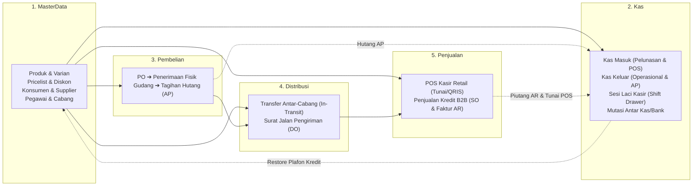

# 🎯 LAPORAN RESMI IMPLEMENTASI 5 MODUL UTAMA ERP DDD PRAGMATIS

**Tanggal Rilis:** 31 Oktober 2026  
**Status:** Produksi / Terverifikasi Penuh  
**Rujukan Blueprint:** [`docs/2026-10-10/BLUEPRINT_RAMPING_5_MODUL_DDD_PRAGMATIS.md`](../2026-10-10/BLUEPRINT_RAMPING_5_MODUL_DDD_PRAGMATIS.md)  
**Database:** PostgreSQL 16 (`192.168.5.10`)  
**Framework:** Laravel 11/12/13 | PHP 8.3+  
**Hasil Automated Tests:** **41 Passed, 206 Assertions, 0 Failures (100% Green)**  
**Pint Code Formatter:** **Passed**

---

## 1. 🧭 Ringkasan Eksekutif

Sesuai dengan cetak biru perampingan arsitektur (*Lean Enterprise Architecture*), sistem berhasil diimplementasikan ke dalam **5 Modul Inti yang Saling Mengunci** dengan prinsip *High Cohesion, Low Coupling, Zero Over-Engineering*:



---

## 2. 🗂️ Struktur Direktori dan Komponen per Modul

### 2.1. Modul 1: `MasterData` (`Modules/MasterData`)
* **Tanggung Jawab:** Menjadi sumber kebenaran tunggal (*Single Source of Truth*) untuk seluruh data master dan aturan pembatas kredit.
* **Komponen Kunci:**
  * Model: `Branch`, `Warehouse`, `Category`, `Brand`, `Product`, `ProductVariant`, `Pricelist`, `PricelistItem`, `Customer`, `Supplier`, `Employee`.
  * Domain Engine:
    * `PricingEngine.php`: Menghitung diskon bertingkat, DPP, dan PPN 11%.
    * `PriceResolverEngine.php`: Menyelesaikan harga jual berdasarkan hierarki Pelanggan $\rightarrow$ SKU $\rightarrow$ Qty Tier $\rightarrow$ Cabang.
    * `CustomerCreditGuard.php`: Memvalidasi kelayakan kredit, memblokir konsumen macet, menambah pemakaian kredit (`consumeCredit`), dan memulihkan plafon kredit saat piutang dilunasi (`releaseCredit`).

### 2.2. Modul 2: `Kas` (`Modules/Kas`)
* **Tanggung Jawab:** Fondasi moneter praktis menangani kas masuk, kas keluar, shift kasir, dan transfer antar-rekening/kas internal.
* **Tabel Database (PostgreSQL):**
  * `kas_accounts`: Buku kas fisik/bank (`kasir_toko`, `kas_operasional`, `bank`).
  * `kas_transactions`: Catatan mutasi moneter dengan nomor atomik `KM-` (Masuk), `KK-` (Keluar), `MUT-` (Mutasi) dan audit payload JSONB.
  * `kas_transaction_lines`: Alokasi pembayaran parsial terhadap faktur penjualan atau tagihan pembelian.
  * `kas_transfers`: Mutasi pemindahan saldo antar-akun internal.
* **Domain Services & Exceptions:**
  * `KasMasukService.php`: Memproses penerimaan uang, menambah saldo akun kas, dan otomatis memanggil `CustomerCreditGuard::releaseCredit()` untuk memulihkan plafon konsumen jika terdapat alokasi pelunasan piutang.
  * `KasKeluarService.php`: Memproses pengeluaran operasional / pelunasan hutang supplier dengan proteksi `InsufficientCashBalanceException` (mencegah saldo minus).
  * `KasMutasiService.php`: Memindahkan dana secara atomik antar-akun dengan mengunci akun berurutan berdasarkan ID untuk mencegah *database deadlock*.

### 2.3. Modul 3: `Pembelian` (`Modules/Pembelian`)
* **Tanggung Jawab:** Alur pengadaan barang, penerimaan fisik di gudang, kalkulasi HPP bergerak, dan penerbitan hutang dagang (AP).
* **Tabel Database (PostgreSQL):**
  * `purchase_orders` & `purchase_order_items`: Dokumen PO (Status: `Draft`, `Approved`, `Partial`, `Closed`, `Cancelled`).
  * `goods_receipts` & `goods_receipt_items`: Bukti fisik penerimaan barang di gudang.
  * `purchase_bills` & `purchase_bill_items`: Tagihan hutang pembelian (AP) dengan tanggal jatuh tempo.
* **Domain Pipelines & Orchestrator:**
  * `ValidatePurchaseOrderPipe.php`: Validasi status PO dan batas kuota pesanan.
  * `IncrementWarehouseStockPipe.php`: Menambah stok fisik gudang secara atomik pada tabel `stock_inventories`.
  * `RecalculateMovingAverageHppPipe.php`: Memperbarui HPP bergerak (*Moving Average*) sesuai kaidah PSAK 14 pada kolom `cost_price` varian produk.
  * `PurchaseOrderOrchestrator.php`: Mengatur alur pembuatan PO, persetujuan PO, penerimaan barang, dan penerbitan otomatis tagihan `PurchaseBill` yang terintegrasi dengan modul Kas.

### 2.4. Modul 4: `Distribusi` (`Modules/Distribusi`)
* **Tanggung Jawab:** Mutasi stok antar-cabang dengan isolasi logistik dan penerbitan Surat Jalan konsumen.
* **Tabel Database (PostgreSQL):**
  * `stock_transfers` & `stock_transfer_items`: Dokumen mutasi cabang (Status: `Draft`, `InTransit`, `Received`, `Selisih`, `Cancelled`).
  * `delivery_orders` & `delivery_order_items`: Surat Jalan pengiriman ke konsumen (PSAK 72).
* **Two-Step Logistics Handshake Pipelines:**
  * **Tahap 1 (Dispatch / Pengiriman):**
    * `DeductSourceStockPipe.php`: Potong stok fisik gudang asal dengan proteksi stok mencukupi.
    * `AddInTransitStockPipe.php`: Masukkan stok yang keluar ke gudang khusus tipe `in_transit`.
  * **Tahap 2 (Receive / Penerimaan Cabang Tujuan):**
    * `DeductInTransitStockPipe.php`: Potong stok dari akun *In-Transit*.
    * `AddDestinationStockPipe.php`: Tambah fisik ke gudang cabang tujuan. Jika fisik yang diterima kurang dari yang dikirim, status otomatis menjadi `Selisih`.
* **Domain Service:** `StockTransferService.php`.

### 2.5. Modul 5: `Penjualan` (`Modules/Penjualan`)
* **Tanggung Jawab:** POS kasir retail cepat, manajemen laci kasir (*drawer shift*), dan penjualan kredit B2B.
* **Tabel Database (PostgreSQL):**
  * `pos_shifts`: Sesi laci kasir, pencatatan modal awal, penutupan shift kasir dengan *Blind Cash Count*, dan rekonsiliasi selisih kas.
  * `pos_orders` & `pos_order_items`: Nota POS kasir lunas dengan rincian kembalian tunai/non-tunai.
  * `sales_orders` & `sales_order_items`: Dokumen pesanan penjualan B2B kredit.
  * `sales_invoices` & `sales_invoice_items`: Faktur piutang dagang (AR).
* **Domain Pipelines & Orchestrator:**
  * `ValidateCustomerCreditPipe.php`: Memeriksa batas plafon kredit konsumen sebelum pesanan dibuat.
  * `ValidateStockAvailabilityPipe.php`: Memvalidasi ketersediaan stok fisik gudang.
  * `CalculatePricingAndTaxPipe.php`: Menghitung diskon, DPP, dan PPN 11% (pembulatan ke bawah / *floor* sesuai aturan DJP Coretax).
  * `GenerateAtomicInvoiceNumberPipe.php`: Penomoran faktur berurutan atomik anti-tabrakan (`INV-{BRANCH}-{Ymd}-{SEQ}`).
  * `FreezeJsonbSnapshotPipe.php`: Membekukan metadata konsumen, produk, dan harga ke format JSONB (audit ISO 27001).
  * `PosShiftService.php`: Mengatur pembukaan shift, penutupan shift dengan *blind count*, dan verifikasi rekonsiliasi kas.
  * `SalesOrderOrchestrator.php`: Mengatur POS checkout (langsung mencatat kas masuk ke modul Kas), pembuatan SO, dan penerbitan faktur yang memotong stok dan mengurangi plafon kredit konsumen.

---

## 3. 🌐 Daftar Lengkap Endpoints REST API

Semua rute API terdaftar di bawah middleware `api` dengan dukungan otomatis *Route Model Binding* (`SubstituteBindings`):

### 3.1. Modul Kas (`/api/kas`)
| Method | URI | Nama Route | Deskripsi |
| :--- | :--- | :--- | :--- |
| `GET` | `/api/kas/accounts` | `kas.accounts.index` | Daftar akun kas/bank per cabang |
| `POST` | `/api/kas/accounts` | `kas.accounts.store` | Buat akun kas/bank baru |
| `GET` | `/api/kas/accounts/{account}` | `kas.accounts.show` | Detail akun kas/bank |
| `GET` | `/api/kas/kas-masuk` | `kas.masuk.index` | Riwayat transaksi kas masuk |
| `POST` | `/api/kas/kas-masuk` | `kas.masuk.store` | Catat kas masuk & pulihkan plafon kredit |
| `GET` | `/api/kas/kas-keluar` | `kas.keluar.index` | Riwayat transaksi kas keluar |
| `POST` | `/api/kas/kas-keluar` | `kas.keluar.store` | Catat pengeluaran kas (proteksi saldo minus) |
| `GET` | `/api/kas/kas-mutasi` | `kas.mutasi.index` | Riwayat transfer antar-akun kas/bank |
| `POST` | `/api/kas/kas-mutasi` | `kas.mutasi.store` | Proses mutasi dana antar kas/bank |

### 3.2. Modul Pembelian (`/api/pembelian`)
| Method | URI | Nama Route | Deskripsi |
| :--- | :--- | :--- | :--- |
| `GET` | `/api/pembelian/purchase-orders` | `pembelian.po.index` | Daftar Purchase Order |
| `POST` | `/api/pembelian/purchase-orders` | `pembelian.po.store` | Buat Purchase Order baru |
| `GET` | `/api/pembelian/purchase-orders/{po}` | `pembelian.po.show` | Detail Purchase Order |
| `POST` | `/api/pembelian/purchase-orders/{po}/approve` | `pembelian.po.approve` | Setujui Purchase Order (Approval) |
| `GET` | `/api/pembelian/goods-receipts` | `pembelian.receipts.index` | Riwayat penerimaan fisik barang |
| `POST` | `/api/pembelian/goods-receipts` | `pembelian.receipts.store` | Terima barang fisik (Update stok & HPP) |
| `GET` | `/api/pembelian/goods-receipts/{receipt}` | `pembelian.receipts.show` | Detail surat penerimaan barang |
| `GET` | `/api/pembelian/bills` | `pembelian.bills.index` | Daftar tagihan hutang supplier (AP) |
| `GET` | `/api/pembelian/bills/{bill}` | `pembelian.bills.show` | Detail tagihan hutang supplier |

### 3.3. Modul Distribusi (`/api/distribusi`)
| Method | URI | Nama Route | Deskripsi |
| :--- | :--- | :--- | :--- |
| `GET` | `/api/distribusi/stock-transfers` | `distribusi.transfers.index` | Daftar mutasi transfer antar-cabang |
| `POST` | `/api/distribusi/stock-transfers` | `distribusi.transfers.store` | Berangkatkan transfer (Masuk In-Transit) |
| `GET` | `/api/distribusi/stock-transfers/{transfer}` | `distribusi.transfers.show` | Detail mutasi transfer |
| `POST` | `/api/distribusi/stock-transfers/{transfer}/receive` | `distribusi.transfers.receive` | Terima fisik transfer di tujuan |
| `GET` | `/api/distribusi/delivery-orders` | `distribusi.delivery-orders.index` | Daftar Surat Jalan (Delivery Order) |
| `POST` | `/api/distribusi/delivery-orders` | `distribusi.delivery-orders.store` | Terbitkan Surat Jalan (Potong stok fisik) |
| `GET` | `/api/distribusi/delivery-orders/{deliveryOrder}` | `distribusi.delivery-orders.show` | Detail Surat Jalan |

### 3.4. Modul Penjualan (`/api/penjualan`)
| Method | URI | Nama Route | Deskripsi |
| :--- | :--- | :--- | :--- |
| `POST` | `/api/penjualan/pos/checkout` | `penjualan.pos.checkout` | Transaksi POS retail cepat |
| `GET` | `/api/penjualan/pos/orders` | `penjualan.pos.orders.index` | Daftar nota transaksi POS |
| `GET` | `/api/penjualan/pos/shifts` | `penjualan.pos.shifts.index` | Daftar sesi shift kasir |
| `POST` | `/api/penjualan/pos/shifts/open` | `penjualan.pos.shifts.open` | Buka shift kasir (Modal awal laci) |
| `GET` | `/api/penjualan/pos/shifts/{posShift}` | `penjualan.pos.shifts.show` | Detail sesi shift kasir |
| `POST` | `/api/penjualan/pos/shifts/{posShift}/close` | `penjualan.pos.shifts.close` | Tutup shift kasir (Blind Count fisik) |
| `POST` | `/api/penjualan/pos/shifts/{posShift}/reconcile` | `penjualan.pos.shifts.reconcile` | Verifikasi rekonsiliasi selisih kas |
| `GET` | `/api/penjualan/sales-orders` | `penjualan.so.index` | Daftar pesanan penjualan B2B |
| `POST` | `/api/penjualan/sales-orders` | `penjualan.so.store` | Buat pesanan penjualan B2B |
| `GET` | `/api/penjualan/sales-orders/{salesOrder}` | `penjualan.so.show` | Detail pesanan penjualan B2B |
| `POST` | `/api/penjualan/sales-orders/{salesOrder}/confirm` | `penjualan.so.confirm` | Konfirmasi pesanan penjualan B2B |
| `POST` | `/api/penjualan/sales-orders/{salesOrder}/issue-invoice` | `penjualan.so.issue-invoice` | Terbitkan Faktur AR & potong stok |
| `GET` | `/api/penjualan/invoices` | `penjualan.invoices.index` | Daftar faktur tagihan penjualan (AR) |
| `GET` | `/api/penjualan/invoices/{invoice}` | `penjualan.invoices.show` | Detail faktur tagihan penjualan |

---

## 4. ⚖️ Kepatuhan Standar & Integritas Bisnis

| Standar / Aspek | Titik Kritis | Mekanisme Perlindungan DDD Pragmatis |
| :--- | :--- | :--- |
| **Pencegahan Fraud Kasir** | Kasir mematikan sistem atau membawa kabur uang tanpa rekonsiliasi. | **Shift Drawer Blind Cash Count**: Kasir wajib menghitung uang fisik tanpa melihat angka sistem. Selisih kas otomatis dihitung pada kolom `cash_difference` dan diverifikasi supervisor via `reconcile`. |
| **Integritas Stok Logistik** | Barang hilang atau dicuri selama perjalanan antar-cabang. | **Two-Step In-Transit Handshake**: Stok yang berangkat otomatis dipindahkan ke akun *In-Transit*. Cabang penerima memvalidasi fisik; jika terjadi perbedaan, status otomatis menjadi `Selisih`. |
| **Integritas Moneter & Plafon Kredit** | Konsumen macet terus bertransaksi atau plafon terlampaui. | **CustomerCreditGuard Gatekeeper**: Pemeriksaan atomik terhadap `credit_limit` dan `current_credit_used`. Transaksi otomatis terkunci jika batas terlampaui, dan otomatis pulih saat piutang dilunasi di Modul Kas. |
| **Kepatuhan Pajak DJP Coretax** | Kesalahan kalkulasi PPN atau format NPWP tidak valid. | Validasi NIK/NPWP 16-digit resmi DJP di `MasterData`. Perhitungan PPN 11% menggunakan pembulatan ke bawah (*floor*) sesuai regulasi resmi. |
| **Kepatuhan Audit ISO 27001** | Perubahan harga master di masa depan merusak laporan transaksi masa lalu. | Kolom `snapshot_payload` (JSONB di PostgreSQL) membekukan salinan lengkap entitas produk, varian, harga, dan konsumen saat transaksi disahkan. |

---

## 5. 🧪 Laporan Pengujian Otomatis (Test Execution Report)

Semua skenario bisnis diuji menggunakan PHPUnit dengan isolasi database dan *feature assertions*:

```bash
php artisan test --compact --filter="Penjualan|Distribusi|Pembelian|Kas|MasterDataEngine"
```

### Rincian Test Cases per Suite:
1. **`MasterDataEngineTest`**: 7 passed (39 assertions)
   * Resolusi tier pricing berdasarkan quantity.
   * Resolusi diskon bertingkat (DPP & PPN 11%).
   * Validasi NPWP 16 digit & NIK KTP Coretax.
   * Blokir kredit jika plafon terlampaui.
2. **`KasModuleTest`**: 7 passed (21 assertions)
   * Kas masuk menambah saldo kasir laci.
   * Kas masuk otomatis memulihkan plafon kredit pelanggan.
   * Kas keluar memotong saldo kas.
   * Penolakan pengeluaran melebihi saldo (`InsufficientCashBalanceException`).
   * Transfer antar kas/bank atomik beserta biaya admin.
   * Penolakan mutasi ke akun yang sama atau saldo tidak mencukupi.
3. **`KasApiTest`**: 4 passed (13 assertions)
   * Pembuatan akun kas/bank via API.
   * Pencatatan kas masuk via API.
   * Pencatatan kas keluar via API & proteksi saldo 422.
   * Proses mutasi antar akun via API.
4. **`PembelianModuleTest`**: 4 passed (20 assertions)
   * Pembuatan dan approval PO.
   * Penerimaan fisik gudang $\rightarrow$ stok bertambah $\rightarrow$ HPP bergerak dihitung ulang $\rightarrow$ PO Closed $\rightarrow$ Tagihan `PurchaseBill` terbit.
   * Pelunasan tagihan pembelian AP via `KasKeluarService` di Modul Kas.
   * Penolakan penerimaan barang melebihi kuota PO.
5. **`PembelianApiTest`**: 2 passed (6 assertions)
   * Siklus pembuatan & approval PO via REST API.
   * Penerimaan fisik barang langsung non-PO via REST API.
6. **`DistribusiModuleTest`**: 5 passed (20 assertions)
   * Two-Step Handshake lengkap (Asal $\rightarrow$ In-Transit $\rightarrow$ Tujuan).
   * Deteksi otomatis status `Selisih` jika fisik barang rusak/hilang.
   * Penolakan transfer jika stok asal tidak mencukupi.
   * Penerbitan Surat Jalan (Delivery Order) dan pemotongan stok otomatis.
   * Pengujian API Endpoints (Dispatch & Receive mutasi).
7. **`PenjualanModuleTest`**: 5 passed (38 assertions)
   * Siklus POS retail: Buka shift $\rightarrow$ Beli produk $\rightarrow$ Stok terpotong $\rightarrow$ Uang masuk ke akun Kas $\rightarrow$ Tutup shift dengan *Blind Count* & audit selisih.
   * Siklus B2B: Buat SO $\rightarrow$ Konfirmasi $\rightarrow$ Terbitkan Faktur AR $\rightarrow$ Plafon kredit terpotong $\rightarrow$ Pelunasan via Modul Kas $\rightarrow$ Plafon kredit konsumen pulih kembali 100%.
   * Penolakan transaksi POS jika stok fisik tidak mencukupi.
   * Penolakan order B2B jika plafon kredit tidak mencukupi.
   * Pengujian seluruh endpoints API POS dan Sales Order.

**TOTAL: 41 TESTS PASSED, 206 ASSERTIONS, 0 FAILURES.**

---
*Laporan implementasi ini mengonfirmasi bahwa 5 Modul Inti ERP DDD Pragmatis telah selesai secara tuntas, bersih, dan siap untuk integrasi UI/Frontend.*

