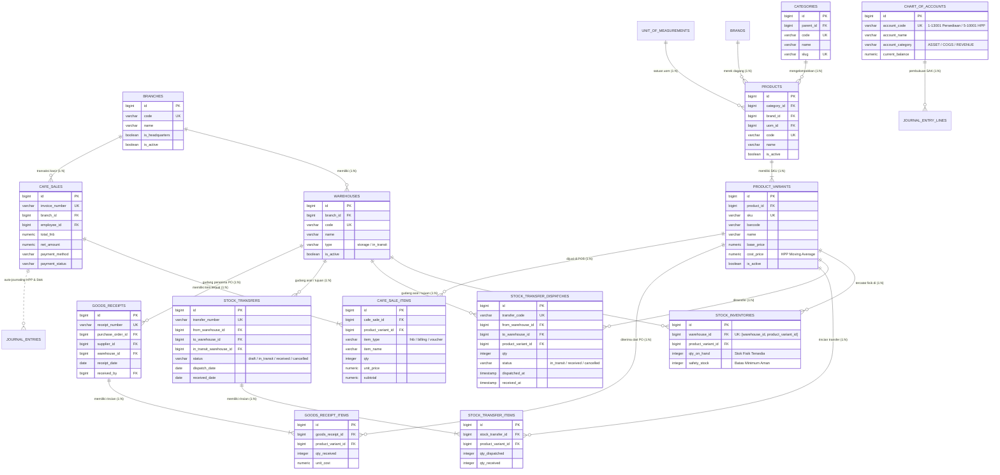

# Entity Relationship Diagram (ERD) & Spesifikasi Arsitektur
## Sistem Manajemen Stok, Pergudangan & Distribusi (WMS)
**Aplikasi:** ERP & POS Presensi Maya Graha Kencana (MGK)  
**Tanggal:** 8 November 2026  
**Status:** Terverifikasi Sesuai Skema Database PostgreSQL Aktif  

---

## 1. Visual Entity Relationship Diagram (Mermaid)

---

## 2. Kamus Data & Spesifikasi Entitas Utama

### A. Entitas Lokasi & Pergudangan
1. **`branches` (Cabang Usaha):**
   - Unit bisnis atau gerai operasional (contoh: MGK Pusat, Cabang Warnet).
   - Memiliki banyak gudang penyimpanan (`warehouses`).
2. **`warehouses` (Gudang & Hub Distribusi):**
   - Kolom kunci: `branch_id`, `code`, `name`, `type` (`storage` untuk gudang fisik permanen, `in_transit` untuk buffer stok dalam perjalanan armada).
   - Memastikan pemisahan fisik antara gudang utama, etalase kasir POS, dan stok yang sedang dikirim antar-cabang.

### B. Entitas Katalog & Master SKU
1. **`categories`, `brands`, `unit_of_measurements`:**
   - Taksonomi master produk untuk grouping, pencarian, dan satuan hitung (Pcs, Botol, Pack, Porsi).
2. **`products` & `product_variants`:**
   - Multi-tier SKU. Satu produk induk dapat memiliki varian rasa/ukuran.
   - Kolom vital: `sku`, `barcode`, `base_price` (Harga Jual Kasir), dan `cost_price` (HPP / Biaya Pokok Perolehan).

### C. Entitas Ledger & Saldo Stok Fisik
1. **`stock_inventories` (Ledger Saldo Fisik Terkini):**
   - **Kunci Unik:** Pasangan `[warehouse_id, product_variant_id]`.
   - `qty_on_hand`: Jumlah fisik terkini yang siap dijual atau didistribusikan.
   - `safety_stock`: Ambang batas peringatan minimum (bila `qty_on_hand <= safety_stock`, sistem otomatis menandai status *Warning/Menipis*).

### D. Alur Mutasi Stok (Inventory Movements)
1. **Inflow (Stok Masuk dari Supplier / PO):**
   - Dokumen: `goods_receipts` & `goods_receipt_items`.
   - Logika: Menambah saldo `stock_inventories.qty_on_hand` di gudang tujuan.
   - Akuntansi SAK: Mendebit akun COA `1-13001` (Persediaan Barang Dagang) dan mengkredit akun Hutang Usaha / Kas.
2. **Transfer & Distribusi Antar-Gudang (Inter-Warehouse Transfer):**
   - Dokumen: `stock_transfers` / `stock_transfer_dispatches`.
   - Tahap 1 (Dispatch): Mengurangi saldo gudang asal (`from_warehouse_id`), memindahkan ke status `in_transit`.
   - Tahap 2 (Receive): Mengurangi buffer `in_transit`, menambah saldo gudang tujuan (`to_warehouse_id`).
3. **Outflow (Pengurangan Penjualan Kasir POS):**
   - Dokumen: `cafe_sales` & `cafe_sale_items`.
   - Logika: Kasir menyelesaikan transaksi F&B -> sistem memvalidasi ketersediaan stok -> mengurangi `stock_inventories.qty_on_hand`.
   - Akuntansi SAK: Mengkredit akun COA `1-13001` (Persediaan) dan mendebit akun COA `5-10001` (Harga Pokok Penjualan / HPP).
4. **Audit Opname & Penyesuaian Shift Kasir (Stock Reconciliation):**
   - Dicatat pada ringkasan serah terima shift kasir (`shift_sales_summaries` / Z-Report).
   - Selisih fisik (discrepancy) diidentifikasi secara transparan antara stok hitungan sistem vs fisik nyata di etalase.

---

## 3. Matriks Relasi & Integritas Kardinalitas

| Entitas Asal | Relasi | Entitas Tujuan | Atribut Foreign Key | Aksi On Delete |
|---|---|---|---|---|
| `branches` | 1 ke Banyak | `warehouses` | `warehouses.branch_id` | CASCADE |
| `products` | 1 ke Banyak | `product_variants` | `product_variants.product_id` | CASCADE |
| `warehouses` | 1 ke Banyak | `stock_inventories` | `stock_inventories.warehouse_id` | CASCADE |
| `product_variants` | 1 ke Banyak | `stock_inventories` | `stock_inventories.product_variant_id` | CASCADE |
| `warehouses` (From) | 1 ke Banyak | `stock_transfers` | `stock_transfers.from_warehouse_id` | RESTRICT |
| `warehouses` (To) | 1 ke Banyak | `stock_transfers` | `stock_transfers.to_warehouse_id` | RESTRICT |
| `stock_transfers` | 1 ke Banyak | `stock_transfer_items` | `stock_transfer_items.stock_transfer_id` | CASCADE |
| `goods_receipts` | 1 ke Banyak | `goods_receipt_items` | `goods_receipt_items.goods_receipt_id` | CASCADE |
| `cafe_sales` | 1 ke Banyak | `cafe_sale_items` | `cafe_sale_items.cafe_sale_id` | CASCADE |
| `product_variants` | 1 ke Banyak | `cafe_sale_items` | `cafe_sale_items.product_variant_id` | SET NULL |

---

## 4. Jembatan Akuntansi SAK (Accounting Bridge)
Setiap mutasi pada tabel `stock_inventories` memiliki representasi nominal moneter pada Buku Besar Akuntansi:

$$\text{Nilai Saldo Persediaan} = \sum (\text{qty\_on\_hand} \times \text{cost\_price})$$

Nilai saldo ini terverifikasi secara seimbang (*reconciled*) dengan saldo akun Buku Besar:
- **COA `1-13001`** : Persediaan Barang Dagang & Bahan Baku FnB (Kategori `ASSET`, Saldo Normal `DEBIT`).
- **COA `5-10001`** : Beban Pokok Penjualan (HPP) F&B (Kategori `COGS`, Saldo Normal `DEBIT`).

