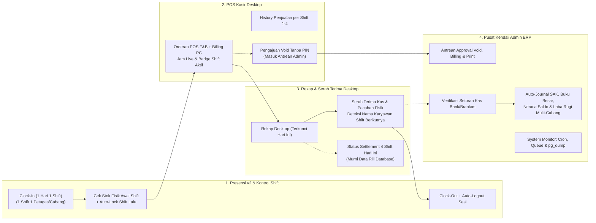
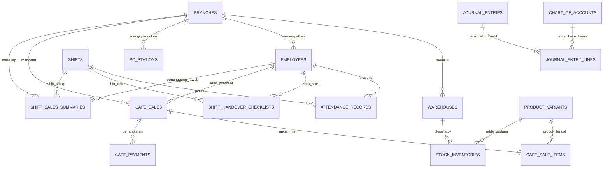

# 🎯 BLUEPRINT MASTER v3.0 (EDISI LENGKAP): ARSITEKTUR TERPADU ERP, POS KASIR DESKTOP, AKUNTANSI SAK, & PRESENSI v2
## PT Maya Graha Kencana (MGK) — Dokumen Spesifikasi Acuan Tunggal (21 November 2026)

**Versi Blueprint:** `3.0.0-ENTERPRISE-COMPLETE` (Konsolidasi Penuh Blueprint v1.0, v2.0, & Seluruh Pembaruan November 2026)  
**Tanggal Rilis:** Sabtu, 21 November 2026  
**Stack Teknologi:** Laravel 12+ | PHP 8.5 | PostgreSQL 16 (`192.168.5.10:5432`, DB: `bagus`)  
**Standar Tata Kelola:** Single Source of Truth (SoT), Segregation of Duties (SoD), WORM Audit Trail ISO/IEC 27001:2022, & Akuntansi SAK Double-Entry  

---

## 1. 🧭 ARSITEKTUR EKOSISTEM TERPADU (END-TO-END FLOW)

Sistem ERP PT Maya Graha Kencana mengintegrasikan **5 Modul Domain-Driven Design (`Modules/`)**, **Domain Presensi & HR (`app/Domains/Attendance/`)**, **Operasional Kasir POS Desktop 4 Shift 24 Jam**, serta **Pusat Kendali Admin ERP (`/admin/ERP`)**:



---

## 2. 🗂️ POHON STRUKTUR DIREKTORI LENGKAP (FULL DIRECTORY TREE)

```text
/var/www/laravel_apps/bagus/
├── Modules/                                         <-- 5 Modul Utama DDD Pragmatis
│   ├── MasterData/
│   │   └── app/Domain/
│   │       ├── Enums/ (CustomerType, EmployeeRole, TaxIdType)
│   │       ├── Models/
│   │       │   ├── Branch.php                       <-- Cabang HQ, DC, & Store Outlet
│   │       │   ├── Warehouse.php                    <-- Gudang Penyimpanan & In-Transit
│   │       │   ├── Category.php & Brand.php         <-- Klasifikasi Produk
│   │       │   ├── Product.php & ProductVariant.php <-- Katalog Produk & SKU Fisik
│   │       │   ├── Pricelist.php & PricelistItem.php<-- Matriks Tiering Harga & Zonasi
│   │       │   ├── Customer.php & Supplier.php      <-- Member Warnet/Cafe & Vendor
│   │       │   ├── Employee.php                     <-- Master Karyawan, PIN, & Role
│   │       │   ├── PcStation.php                    <-- Boks/PC Billing Warnet per Cabang
│   │       │   ├── StockInventory.php               <-- Saldo Stok Fisik per Gudang & Rak
│   │       │   ├── CafeSale.php                     <-- Header Transaksi POS & Status Antrean Void
│   │       │   ├── CafeSaleItem.php                 <-- Rincian Item Nota POS
│   │       │   └── CafePayment.php                  <-- Ledger Pembayaran Tunai/QRIS/Refund
│   │       └── Services/ (CafeCheckoutService, PriceResolverEngine, PricingEngine)
│   ├── Pembelian/                                   <-- Purchase Order, GRN, & Tagihan AP Supplier
│   ├── Distribusi/                                  <-- Transfer Stok DC-ke-Cabang (In-Transit)
│   ├── Penjualan/                                   <-- Layanan Penjualan & Invoicing B2B/Retail
│   └── Kas/
│       └── app/Domain/
│           ├── Models/ (ChartOfAccount, JournalEntry, JournalEntryLine)
│           └── Services/
│               └── AutoJournalService.php           <-- Mesin Jurnal Otomatis SAK Double-Entry
│
├── app/
│   ├── Console/Commands/
│   │   ├── BackupDatabaseCommand.php                <-- Command `db:backup` (pg_dump + SHA-256 + Retensi)
│   │   ├── CloseDailyAttendanceCommand.php          <-- Auto-close presensi harian (23:59 WIB)
│   │   └── PruneExpiredRegistrationsCommand.php     <-- Pembersihan antrean registrasi kedaluwarsa
│   ├── Domains/
│   │   ├── Attendance/
│   │   │   ├── Actions/
│   │   │   │   ├── ClockInAction.php                <-- Validasi Geofence, 1-Hari-1-Shift, 1-Shift-1-Petugas
│   │   │   │   └── ClockOutAction.php               <-- Hitung Durasi Kerja, Lembur, & Cost Center
│   │   │   ├── DataTransferObjects/ (ClockInDTO, ClockOutDTO)
│   │   │   ├── Enums/ (AdminRole, AttendanceStatus, VerificationMethod)
│   │   │   ├── Exceptions/ (AlreadyClockedInException, MockLocationDetectedException, OutsideGeofenceException)
│   │   │   ├── Models/ (AttendanceRecord, AttendanceCorrection, AuditLog, LeaveRequest, OvertimeClaim, ShiftSwapRequest)
│   │   │   └── Services/ (AntiFraudService, GeoValidationService, RosterResolverService, ShiftResolverService)
│   │   └── Employee/Models/Shift.php                <-- Master 4 Shift Operasional (Shift 1 s/d Shift 4)
│   ├── Http/Controllers/
│   │   ├── AttendanceWebV2Controller.php            <-- Controller Utama Presensi v2, POS, Rekap & Serah Terima
│   │   └── Admin/
│   │       ├── AdminErpHubController.php            <-- Pusat Kendali ERP 6 Pilar & Badge Triage Antrean
│   │       ├── AdminDashboardController.php         <-- Dashboard Utama Admin, Z-Report & Distribusi Stok
│   │       ├── AdminSaleController.php              <-- Manajemen Penjualan, Antrean Void, Billing & Print
│   │       ├── AdminAccountingController.php        <-- COA, Jurnal Umum, Buku Besar, Neraca Saldo & Laba Rugi
│   │       ├── AdminAttendanceController.php        <-- Audit Presensi, Approval Cuti/Tukar Shift & Ekspor CSV
│   │       ├── AdminSystemMonitorController.php     <-- Monitoring Cron Heartbeat, Queue & Backup Database
│   │       └── AdminRolePermissionController.php    <-- Manajemen Matriks RBAC Granular per Jabatan
│   ├── Jobs/RunDatabaseBackupJob.php                <-- Background Job Backup Database
│   ├── Models/
│   │   ├── ShiftSalesSummary.php                    <-- Rekapitulasi Kasir, Blind Count, Handover & Setor Bank
│   │   ├── ShiftHandoverChecklist.php               <-- Cek Stok Fisik Awal Shift, Kertas & Hardware
│   │   ├── ShiftStockRequest.php                    <-- Permintaan Restock Barang dari Kasir ke Gudang/DC
│   │   ├── PrinterPrintJob.php                      <-- Counter Cetak Hardware Printer Canon USB
│   │   ├── DatabaseBackup.php & CronHeartbeat.php   <-- Model Monitoring Infrastruktur
│   │   └── RolePermission.php                       <-- Model Matriks Hak Akses RBAC
│   └── Services/ (DatabaseBackupService, SystemMonitoringService)
│
└── resources/views/
    ├── presensi2/                                   <-- Antarmuka Kasir & Karyawan (Full Desktop POS/Rekap/Serah-Terima)
    │   ├── pos_desktop.blade.php                    <-- Layar Utama Orderan POS Desktop (3 Kolom + Jam Live + Filter Shift)
    │   ├── rekap_desktop.blade.php                  <-- Layar Rekapitulasi Penjualan & Shift (Terkunci Hari Ini + Sidebar Drawer)
    │   ├── serah_terima_desktop.blade.php           <-- Layar Serah Terima Kas, Pecahan Fisik & Slip Summary Sinkron DB
    │   ├── stok.blade.php & stok_selesai.blade.php  <-- Cek Stok Fisik Awal Shift & Status Settlement 4 Shift
    │   ├── scan.blade.php & login.blade.php         <-- Presensi Selfie/GPS & Login Kredensial
    │   └── partials/modal_shift_history_and_settlement.blade.php
    └── admin/                                       <-- Panel Manajemen ERP, Keuangan SAK, Penjualan & System Monitor
```

---

## 3. 🗄️ ENTITY-RELATIONSHIP DIAGRAM (ERD) & KAMUS SKEMA DATABASE



### Kamus Tabel Inti PostgreSQL
| Kelompok | Nama Tabel | Kolom Kunci & Fungsi Audit |
| :--- | :--- | :--- |
| **Organisasi & MDM** | `branches`, `warehouses`, `products`, `product_variants`, `categories`, `brands`, `pricelists`, `customers`, `suppliers` | Arsitektur *Hub-and-Spoke* (HQ, DC, Store), koordinat geofence cabang (`latitude`, `longitude`, `radius_meters`), SKU, HPP (`cost_price`), dan harga jual (`base_price`). |
| **Presensi & SDM** | `employees`, `shifts`, `attendance_records`, `leave_requests`, `shift_swap_requests`, `attendance_corrections`, `overtime_claims` | Menyimpan `work_date`, `shift_id`, `clock_in_at`, `clock_out_at`, `work_type` (`shift`/`flexible`), `cost_center` (`5-1001` HPP / `5-1002` OPEX), `liveness_score`, dan foto selfie. |
| **POS & Antrean Void** | `cafe_sales`, `cafe_sale_items`, `cafe_payments`, `pc_stations`, `printer_print_jobs` | Menyimpan `invoice_number`, `total_fnb`, `total_billing`, `net_amount`, `payment_method`, `payment_status` (`paid`/`pending`/`cancelled`), `is_locked`, serta kolom antrean Void: `void_status` (`pending_approval`/`approved`/`rejected`), `void_requested_by`, `void_requested_at`, `void_reviewed_by`, `void_reviewed_at`, `void_rejected_reason`. |
| **Rekap & Estafet Shift** | `shift_sales_summaries`, `shift_handover_checklists`, `shift_stock_requests` | Menyimpan `system_expected_cash`, `blind_cash_count`, `cash_difference`, `cash_denominations`, `handover_amount`, `retained_drawer_cash`, `handover_by`, `handover_recipient` (nama shift + nama karyawan shift sesudahnya), `is_sales_locked`, `is_billing_locked`, `is_print_locked`, `deposit_status`, `deposit_proof`. |
| **Akuntansi SAK** | `chart_of_accounts`, `journal_entries`, `journal_entry_lines` | Sistem pembukuan berpasangan (*Double-Entry*), kode akun SAK (`1-1001` s/d `5-xxxx`), referensi transaksi otomatis (`reference_type`, `reference_id`), dan saldo berjalan (`current_balance`). |
| **Keamanan & Sistem** | `audit_logs`, `role_permissions`, `database_backups`, `cron_heartbeats` | Jejak audit WORM ISO 27001 (`old_values`, `new_values`, `ip_address`), matriks RBAC granular per jabatan, riwayat backup `.sql.gz` ber-checksum SHA-256, dan status scheduler. |

---

## 4. 🏛️ KATALOG 6 PILAR & 27 MODUL PUSAT KENDALI ERP (`/admin/ERP`)

| Pilar ERP | Kode | Nama Modul | Route / Endpoint Utama | Role Akses |
| :--- | :---: | :--- | :--- | :--- |
| **1. Master Data & Katalog** | `M-BRN` | Jaringan Cabang & DC | `/admin/cabang` | Super Admin, Auditor |
| | `M-SPOKE` | Lokalisasi Rak & ROP Cabang | `/admin/cabang/produk` | Super Admin, Branch Admin, Logistik |
| | `M-ZONE` | Zonasi Harga & HPP Multi-Cabang | `/admin/cabang/zonasi-harga` | Super Admin, Finance |
| | `M-PRD` | Produk & Varian SKU | `/admin/produk` | Super Admin, Branch Admin, Auditor |
| | `M-CAT` | Kategori Produk | `/admin/kategori` | Super Admin, Branch Admin |
| | `M-BRD` | Merek / Brand | `/admin/merk` | Super Admin, Branch Admin |
| | `M-SUP` | Supplier / Rekanan Vendor | `/admin/supplier` | Super Admin, Branch Admin |
| | `M-CUST` | Konsumen & Member Warnet/Cafe | `/admin/konsumen` | Super Admin, Branch Admin |
| | `M-PRC` | Daftar Harga & Tiering | `/admin/harga` | Super Admin, Branch Admin |
| **2. Operasional Kasir & POS** | `P-POS` | POS Desktop Kasir & Billing | `/pos` (`/presensi2/pos-desktop`) | Kasir, Supervisor, Admin |
| | `P-HIST` | Audit Riwayat Penjualan | `/admin/penjualan` | Super Admin, Branch Admin, Auditor |
| | `P-ADJ` | Antrean Persetujuan Void, Billing & Print | `/admin/penjualan/penyesuaian-billing` | Super Admin, Supervisor |
| | `P-CHK` | Checklist & Opname Kasir Shift | `/presensi2/stok` | Kasir, Supervisor |
| | `P-RKP` | Rekapitulasi & Serah Terima Desktop | `/presensi2/rekap-desktop`, `/presensi2/serah-terima-desktop` | Kasir, Supervisor, Admin |
| **3. Persediaan & Distribusi** | `S-INV` | Gudang, Stok & Konsinyasi | `/admin/stok` | Super Admin, Logistik, Branch Admin |
| | `S-TRF` | Distribusi & Surat Jalan Antar-Cabang | `/admin/distribusi` | Super Admin, Logistik, Branch Admin |
| **4. Pembelian (Procurement)** | `B-PO` | Purchase Order & Penerimaan Barang | `/admin/pembelian` | Super Admin, Logistik, Finance |
| **5. Keuangan & Akuntansi SAK** | `F-KAS` | Kas, Bank & Verifikasi Setoran Shift | `/admin/keuangan` | Super Admin, Finance, Auditor |
| | `F-JRN` | Jurnal Umum SAK (Double-Entry) | `/admin/akuntansi/jurnal` | Super Admin, Finance, Auditor |
| | `F-LED` | Buku Besar (General Ledger) | `/admin/akuntansi/buku-besar` | Super Admin, Finance, Auditor |
| | `F-TRB` | Neraca Saldo (Trial Balance) | `/admin/akuntansi/neraca-saldo` | Super Admin, Finance, Auditor |
| | `F-PL` | Laba Rugi Multi-Cabang & Ekspor CSV | `/admin/akuntansi/laba-rugi` | Super Admin, Finance, Auditor |
| | `F-BS` | Neraca Keuangan (Balance Sheet) | `/admin/akuntansi/neraca` | Super Admin, Finance, Auditor |
| **6. SDM, Presensi & Keamanan** | `H-ATT` | Audit Presensi & Rekap Jam Kerja | `/admin/presensi`, `/admin/presensi/rekap` | Super Admin, HRD, Branch Admin |
| | `H-APP` | Persetujuan Cuti, Tukar Shift & Lembur | `/admin/presensi/approval` | Super Admin, HRD, Supervisor |
| | `H-EMP` | Master Karyawan & Otorisasi Registrasi | `/admin/karyawan` | Super Admin, HRD |
| | `S-RBAC` | Matriks Hak Akses RBAC Granular | `/admin/pengaturan/hak-akses` | Super Admin |
| | `S-MON` | System Monitor (Cron, Queue & Backup DB) | `/admin/ERP/system-monitor` | Super Admin, Auditor (Read-Only) |
| | `S-AUD` | WORM Audit Trail ISO 27001 | `/admin/presensi/audit-logs` | Super Admin, Auditor |

---

## 5. 🔐 MATRIKS HAK AKSES RBAC & SEGREGATION OF DUTIES (SoD)

| Role / Jabatan | Create | Read | Update | Delete | Approve | Batasan Khusus Segregation of Duties (SoD) |
| :--- | :---: | :---: | :---: | :---: | :---: | :--- |
| **Super Admin** | ✅ | ✅ | ✅ | ✅ | ✅ | Otoritas penuh seluruh cabang, konfigurasi RBAC, dan backup database. |
| **Branch Admin** | ✅ | ✅ | ✅ | ❌ | ✅ | Terisolasi hanya pada `assigned_branch_id` cabangnya sendiri. |
| **Finance / Akunting** | ✅ | ✅ | ✅ | ❌ | ✅ | Memverifikasi setoran kas cabang ke Bank/Brankas & mengelola laporan SAK. |
| **Logistik / Gudang** | ✅ | ✅ | ✅ | ❌ | ✅ | Mengelola stok gudang, pengiriman distribusi DC, dan pemenuhan restock. |
| **Supervisor** | ✅ | ✅ | ✅ | ❌ | ✅ | Menyetujui koreksi operasional, tukar shift, dan memantau serah terima. |
| **Kasir / Operator** | ✅ | ✅ | ❌ | ❌ | ❌ | Hanya dapat menginput penjualan shift aktif, mengajukan Void ke antrean (tidak bisa approve sendiri), tidak bisa mengubah tanggal rekap, dan terkunci otomatis saat shift berakhir. |
| **Auditor Internal** | ❌ | ✅ | ❌ | ❌ | ❌ | Dijaga oleh middleware `auditor.readonly`: menolak seluruh request `POST`/`PUT`/`PATCH`/`DELETE` serta memblokir unduhan dump database mentah. |

---

## 6. 📒 SKEMA PEMETAAN AUTO-JOURNAL AKUNTANSI SAK (`AutoJournalService`)

Setiap kejadian ekonomi di POS Kasir dan Verifikasi Admin otomatis menghasilkan jurnal berpasangan (*Double-Entry*) yang seimbang ($\sum \text{Debit} = \sum \text{Kredit}$):

| Kejadian Transaksi | Akun Debit (Kode & Nama COA) | Akun Kredit (Kode & Nama COA) | Keterangan Jurnal Otomatis |
| :--- | :--- | :--- | :--- |
| **1. Penjualan POS Tunai (F&B + Billing)** | `1-1001` Kas Laci Operasional Cabang | `4-1001` Pendapatan Penjualan F&B<br>`4-1002` Pendapatan Billing Warnet | Mencatat kas masuk ke laci kasir saat checkout POS (`paid`). |
| **2. Penjualan POS Non-Tunai (QRIS/Transfer)** | `1-1002` Bank BCA / Rekening Penampung | `4-1001` Pendapatan Penjualan F&B<br>`4-1002` Pendapatan Billing Warnet | Langsung masuk ke akun Bank (tidak menambah target uang fisik laci). |
| **3. Pengakuan HPP Barang Dagang (COGS)** | `5-1001` Beban Pokok Penjualan (HPP F&B) | `1-1301` Persediaan Barang Dagang | Dicatat otomatis sebesar `qty * cost_price` saat stok terpotong. |
| **4. Persetujuan Void Transaksi (`approveVoidRequest`)** | `4-1001` Pendapatan Penjualan F&B (Pembalik)<br>`1-1301` Persediaan Barang Dagang | `1-1001` Kas Laci / `1-1002` Bank<br>`5-1001` Beban Pokok Penjualan (HPP) | Hanya dieksekusi setelah Admin menekan **✅ Setujui Void** dari antrean. |
| **5. Verifikasi Setoran Kas Shift ke Bank Pusat** | `1-1002` Bank BCA Pusat / Brankas Utama | `1-1001` Kas Laci Operasional Cabang | Memindahkan saldo kas laci cabang ke rekening bank pusat saat diverifikasi Finance. |
| **6. Penyelesaian Selisih Kas Laci (Kurang/Lebih)** | `5-1009` Beban Selisih Kas / Piutang Karyawan | `1-1001` Kas Laci Operasional Cabang | Mencatat penyesuaian selisih fisik kas laci hasil *Blind Cash Count*. |

---

## 7. ⚙️ RINGKASAN ATURAN OPERASIONAL SIKLUS 4 SHIFT (SOP TEKNIS TERKUNCI)

1. **Presensi Masuk (`ClockInAction`):**
   - Wajib lolos validasi Geofence/WiFi BSSID & Anti-Fake GPS.
   - **1 Hari Maksimal 1 Shift per Karyawan** dan **1 Shift Maksimal 1 Petugas Jaga per Cabang** (`HTTP 409 Conflict` jika dilanggar).
2. **Cek Stok Awal Shift (`stokStore`):**
   - Memverifikasi fisik kertas A4/F4, minuman, makanan, checklist hardware, dan uang kas serah terima dari shift sebelumnya.
   - **Auto-Lock Shift Sebelumnya:** Begitu Cek Stok disimpan oleh kasir shift baru, seluruh penjualan & billing kasir shift sebelumnya otomatis dikunci (`is_sales_locked = true`, `is_billing_locked = true`) dan nama kasir shift baru otomatis terikat sebagai `handover_recipient` (Penerima Shift) pada rekap shift sebelumnya.
3. **Operasional POS Desktop (`/pos`):**
   - Menampilkan **Badge Shift Aktif** & **Jam Digital Live (`HH:MM:SS WIB`)** di header kanan.
   - Menampilkan **Badge & Filter Shift (`Shift 1` s/d `Shift 4`)** pada History Penjualan POS.
   - Pengajuan pembatalan nota (**Void**) tanpa PIN Supervisor langsung masuk ke **Antrean Persetujuan Admin (`pending_approval`)**.
4. **Rekapitulasi & Serah Terima Desktop (`/presensi2/rekap-desktop` & `/presensi2/serah-terima-desktop`):**
   - Dilengkapi **Sidebar Toggle (`☰ Menu Operasional`)** yang seragam.
   - Tanggal & Shift pada Rekap Desktop terkunci ke hari ini.
   - Slip **`🖨️ Bukti Serah Terima Kasir (Tabel Summary)`** dan **`Status Settlement 4 Shift Hari Ini`** 100% sinkron dengan database PostgreSQL (mencantumkan nama karyawan penyerah & nama karyawan penerima shift berikutnya).
5. **Presensi Keluar (`submitClockOut`):**
   - Setelah Rekap & Serah Terima selesai, kasir melakukan Check-Out pulang dan sistem otomatis melakukan **Auto-Logout & Redirect ke Halaman Login**.
