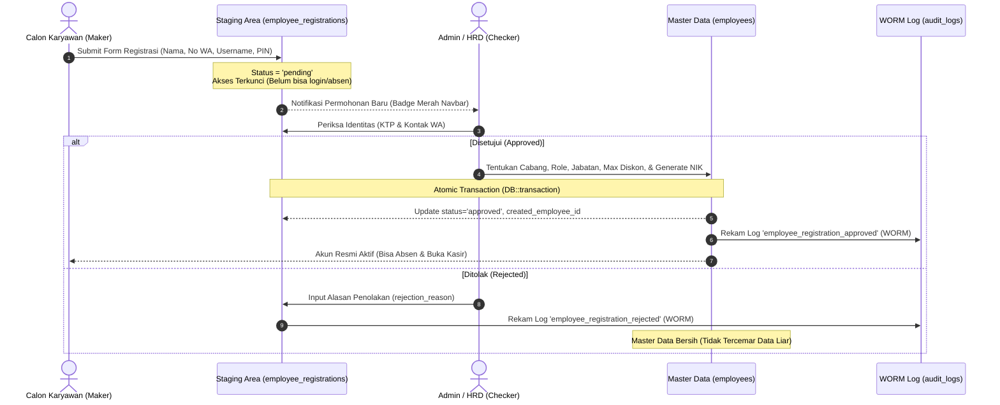
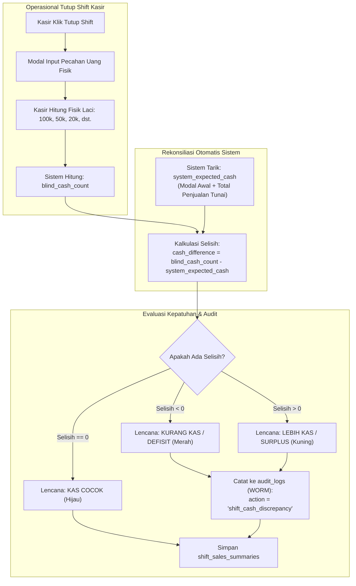
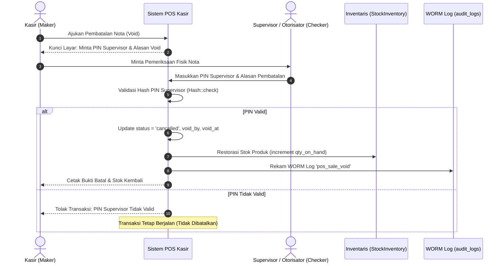
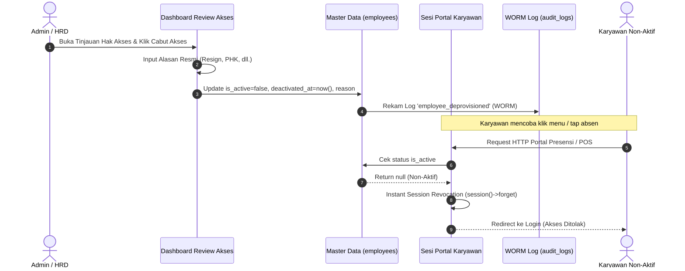

# Rangkuman Percakapan & Dokumentasi Arsitektur
## Pendaftaran Mandiri Karyawan: Standarisasi SoD, SoT, dan ISO 27001 (Maker-Checker Pattern)

**Waktu Sesi:** 18 Oktober 2026  
**Status Implementasi:** Fase 1 Selesai 100% & Teruji Otomatis (`8 tests passed, 48 assertions`)

---

## 1. Latar Belakang & Pertanyaan Kunci

### Pertanyaan Diskusi Awal:
> *"Jika ada fitur mandiri pendaftaran, apakah baik data tersebut langsung disimpan ke tabel karyawan?"*

### Analisis & Kesimpulan Diskusi:
* **Jika Langsung Disimpan ke Master `karyawan` (Langsung Aktif):**
  * ❌ **Pelanggaran SoD (Segregation of Duties):** Karyawan bertindak sebagai pembuat permohonan (*Maker*) sekaligus pengesah wewenang (*Authorizer*) atas dirinya sendiri. Membuka celah kecurangan karyawan fiktif (*Ghost Employee Fraud*).
  * ❌ **Pencemaran SoT (Single Source of Truth):** Data pendaftar iseng, typo, atau duplikasi langsung mencemari tabel master `employees`.
  * ❌ **Pelanggaran Audit ISO 27001 (Kontrol Akses A.8 / A.9):** Registrasi pengguna wajib melalui mekanisme formal yang disetujui pihak berwenang independen.

* **Keputusan Bersama:**
  * ✅ **WAJIB DI-APPROVE ADMIN (Maker-Checker / 4-Eyes Principle).**
  * Menggunakan **Tabel Penyangga (*Staging Area*)** `employee_registrations` dengan status awal `pending`.

---

## 2. Pemahaman Konsep Inti Tata Kelola

### A. Segregation of Duties (SoD) - Pemisahan Tugas & Wewenang
* **Definisi:** Prinsip pengendalian internal di mana tidak ada satu individu pun yang memiliki wewenang penuh dari awal hingga akhir atas proses yang berdampak pada uang, data, dan aset perusahaan.
* **4 Fungsi Dasar yang Wajib Dipisahkan (The 4 Pillars of Internal Control):**
  1. *Initiator / Maker* (Pemohon): Pihak yang mengawali proses transaksi atau permohonan (misal: calon karyawan mendaftar, karyawan tap absen, kasir menginput penjualan).
  2. *Custodian* (Pemegang Fisik / Aset): Pihak yang memegang dan bertanggung jawab secara fisik atas kas atau stok barang (misal: kasir memegang uang laci kasir).
  3. *Record Keeper* (Pencatat Sistem / Master Data): Sistem database dan pencatatan buku besar yang merekam transaksi secara objektif tanpa intervensi manual sepihak.
  4. *Authorizer / Checker* (Penyetuju / Auditor): Pihak independen berwenang yang memeriksa keabsahan permohonan dan memberikan persetujuan formal (misal: Admin HRD menyetujui pendaftaran, Supervisor mengotorisasi pembatalan nota kasir).

* **Matriks Penerapan SoD di Lapangan:**
  * **Presensi & Perizinan:** Karyawan (*Maker*) dilarang menyetujui izin atau lemburnya sendiri (*Anti Self-Approval*). Persetujuan mutlak berada di tangan atasan/HR (*Checker*).
  * **Transaksi Kasir POS:** Kasir (*Maker Transaksi*) dilarang membatalkan (*Void*) nota penjualan secara sepihak. Pembatalan nota dan pemberian diskon di atas batas wewenang kasir wajib memerlukan otorisasi fisik dengan PIN Supervisor aktif (*Dual-Control*).
  * **Penutupan Shift Kasir (*Blind Cash Count*):** Kasir (*Custodian* uang fisik) wajib menghitung uang fisik nyata per pecahan uang tanpa melihat angka estimasi sistem terlebih dahulu. Selisih kas fisik vs pembukuan sistem dihitung objektif oleh sistem dan dicatat ke log audit.
  * **Perekrutan Karyawan:** Calon staf (*Maker formulir*) dilarang menentukan sendiri hak akses, jabatan, maupun cabang penempatan. Admin HRD (*Checker/Authorizer*) yang memverifikasi identitas dan menetapkan wewenang.
  * **Granular RBAC (Role-Based Access Control):** Admin Cabang hanya memiliki wewenang operasional pada cabang penugasannya (*Principle of Least Privilege*), sedangkan Auditor dibatasi hanya izin baca (*Read-Only*) tanpa hak memanipulasi data transaksi.

---

### B. Single Source of Truth (SoT) - Kebenaran Tunggal Terpusat
* **Definisi:** Prinsip arsitektur data di mana setiap entitas informasi hanya memiliki satu sumber pencatatan resmi yang sah, unik, dan menjadi rujukan bersama di seluruh modul.
* **Tiga Dimensi SoT Aplikasi Presensi:**
  1. **Master Identitas Karyawan (`employees` - Identity SoT):**
     * Hanya ada satu tabel buku induk resmi karyawan di database. Modul presensi, kasir POS, roster jadwal, dan penggajian (payroll) wajib merujuk ke tabel ini tanpa tabel tandingan.
     * Mengusung prinsip *Single Kill-Switch*: jika status karyawan dinonaktifkan (`is_active = false`) di buku induk, seluruh hak aksesnya (portal presensi, laci kasir, login PWA) seketika terputus secara otomatis (*Instant Revocation*).
  2. **Fakta Transaksi Kehadiran Harian (`attendance_records` - Fact SoT):**
     * Seluruh fakta kehadiran (jam masuk, jam pulang, durasi kerja, keterlambatan) hanya disimpan di satu tabel resmi dengan foreign key terikat ke `employees`.
     * Menggunakan stempel waktu otoritatif server yang tersinkronisasi NTP, formula geodesi Geofencing Haversine, bukti visual foto selfie, dan deteksi Fake GPS. Modul penggajian murni membaca angka bersih dari data presensi tanpa rekap manual Excel.
  3. **Ruang Penyangga Pendaftaran Mandiri (`employee_registrations` - Staging SoT):**
     * Isolasi data publik: Formulir registrasi dari internet ditampung di area penyangga dengan status awal `pending`.
     * Promosi dari data pendaftar menjadi karyawan resmi wajib berjalan dalam satu transaksi database tertutup (*Atomic Promotion* via `DB::transaction`). Data yang ditolak tidak pernah mencemari master data `employees`.

---

### C. Kepatuhan Standar ISO/IEC 27001:2022
* **Kontrol Akses & Kredensial Pengguna (Klausul A.8.2 & A.8.5):**
  * Hak akses dibatasi seminimal mungkin sesuai kebutuhan peran operasional (*Principle of Least Privilege*).
  * Seluruh PIN 6-digit dan kata sandi pengguna dienkripsi satu arah dengan algoritma hashing standar industri (Bcrypt/Argon2id), tidak ada kredensial dalam bentuk teks terbuka (*plain text*).
  * Pencabutan akses seketika (*Instant De-provisioning*) saat staf dinonaktifkan.
* **Integritas Waktu & Bukti Forensik Kehadiran (Klausul A.8.17 & A.8.28):**
  * Sinkronisasi jam server dengan NTP pool resmi nasional (`id.pool.ntp.org`) guna menjamin keabsahan stempel waktu hukum ketenagakerjaan.
  * Bukti kehadiran fisik anti-sanggah (*Non-Repudiation*) melalui foto selfie biometrik manual dan koordinat GPS geofence.
* **Jejak Audit WORM (*Write Once, Read Many* - Klausul A.8.15):**
  * Tabel `audit_logs` bersifat *immutable* (tidak memiliki fungsi update maupun delete), menjamin integritas riwayat transaksi hukum.
  * Merekam kelengkapan forensik: identitas pelaku (`user_id`), jenis aksi (`action`), nilai sebelum (`old_values` JSONB), nilai sesudah (`new_values` JSONB), alamat IP (`ip_address`), User Agent perangkat, dan stempel waktu.
  * Sanitasi otomatis terhadap data rahasia (password, PIN, token) sebelum dicatat ke log audit.
* **Isolasi Lingkungan Publik & Staging (Klausul A.8.31):**
  * Pemisahan tegas antara formulir pendaftaran publik luar di tabel penyangga dengan database master operasional internal.
* **Pertahanan Terhadap Serangan Siber & Brute-Force (Klausul A.8.5 & A.8.20):**
  * Pembatasan laju ketat (*Rate Limiting*) pada rute scan presensi (`throttle:10,1`), otentikasi login (`throttle:5,1`), dan form registrasi guna menangkal serangan tebakan kredensial dan banjir bot.
* **Perlindungan Data Pribadi / PII (Klausul A.8.10):**
  * Perlindungan data pribadi staf (KTP, nomor WhatsApp, foto wajah, koordinat GPS) dengan kontrol otorisasi ketat.

---

### D. Prinsip 4-Eyes (Maker-Checker Pattern)
* **Mengapa Prinsip 4-Eyes Wajib Diterapkan?**  
  Setiap tindakan yang berpotensi menimbulkan kerugian finansial, manipulasi jam kerja, atau penambahan identitas baru wajib melewati verifikasi independen oleh "dua pasang mata" yang terpisah secara struktural.
* **Alur Eksekusi 4-Eyes pada Sistem:**
  1. *Fase 1 (Inisiasi oleh Maker):* Calon staf/karyawan mengajukan data dasar via formulir publik.
  2. *Fase 2 (Penahanan di Gerbang Staging):* Data terkunci berstatus `pending`, belum berstatus karyawan resmi, dan tidak memiliki hak akses operasional.
  3. *Fase 3 (Pemeriksaan & Pengesahan oleh Checker):* Admin HRD memverifikasi fisik KTP dan kontak WhatsApp, kemudian menentukan cabang, peran (kasir, supervisor, dll.), batas diskon, dan menerbitkan NIK resmi.
  4. *Fase 4 (Perekaman Bukti Hukum):* Keputusan persetujuan (*approval*) atau penolakan (*rejection*) dicatat secara permanen ke dalam `audit_logs` WORM.
* **Proteksi Mutlak Anti Self-Approval:**  
  Sistem secara otomatis menolak aksi verifikasi jika pengguna pemeriksa terindikasi sama dengan pendaftar, mencegah rekayasa akun oleh pihak internal.

---

### E. Matriks Mitigasi Risiko & Pencegahan Fraud (Anti-Fraud Matrix)

| Potensi Risiko Kecurangan (Fraud) | Titik Kerentanan | Mekanisme Pencegahan Sistem (Tata Kelola) |
| :--- | :--- | :--- |
| **Karyawan Fiktif (*Ghost Employee*)** | Form pendaftaran langsung aktif menjadi master data | **SoD Staging + Maker-Checker 4-Eyes:** Wajib verifikasi KTP/WA oleh HRD dan penerbitan NIK collision-safe. |
| **Titip Absen (*Buddy Punching*)** | Karyawan membagikan PIN kepada rekan kerja | **Bukti Visual Selfie + NTP Server Clock:** Pengambilan foto wajah langsung saat tap absen di lokasi kantor. |
| **Pemalsuan Lokasi (*Fake GPS / Spoofing*)** | Pemasangan aplikasi fake GPS di ponsel karyawan | **Geodesi Haversine + Deteksi Mock Location:** Sistem otomatis menandai dan memvalidasi jarak presisi ke kantor cabang. |
| **Manipulasi Jam HP** | Karyawan memundurkan jam handphone agar tidak telat | **Server NTP Otoritatif:** Waktu kehadiran murni membaca jam server resmi, mengabaikan jam lokal ponsel. |
| **Penyelundupan Uang Kasir** | Kasir menyesuaikan laporan fisik agar pas dengan sistem | **Blind Cash Count:** Kasir wajib menghitung uang fisik per pecahan tanpa melihat total sistem saat tutup shift. |
| **Pembatalan Nota Fiktif (*Fake Void*)** | Kasir membatalkan nota setelah pelanggan membayar | **Dual-Control Supervisor PIN:** Void hanya sah jika diotorisasi fisik oleh Supervisor, dicatat ke WORM `audit_logs`. |
| **Pemberian Diskon Liar** | Kasir memberi diskon tak terbatas untuk keuntungan pribadi | **Diskon Berjenjang & Dual-Control:** Diskon di atas batas wewenang kasir wajib persetujuan PIN Supervisor. |
| **Penebakan Kredensial / Kamus Password** | Serangan brute-force tebak PIN/password | **Rate Limiting + Hashing Bcrypt:** Percobaan dibatasi per menit dan kredensial teracak satu arah. |

---

## 3. Pemilihan Format Data: Opsi 1 (Minimalis & Cepat)

Disepakati menggunakan **Opsi 1** untuk meminimalkan friksi pendaftaran bagi staf di lapangan:

### Data yang Diisi Sendiri oleh Pendaftar (Maker):
1. **Nama Lengkap:** Sesuai identitas asli.
2. **Username Pilihan:** Unik untuk login akun.
3. **PIN 6-Digit Angka:** Kredensial clock-in/out cepat di portal presensi.
4. **Nomor WhatsApp / HP:** Kunci verifikasi utama (dilengkapi tombol chat WhatsApp langsung di dashboard admin).
5. **Email (Opsional):** Untuk pemulihan akun di masa depan.

### Data yang WAJIB Ditentukan oleh Admin saat Approval (Checker):
* **Cabang / Outlet Penempatan (`branch_id`)**
* **Peran Kerja (`role`):** Kasir (`kasir`), Salesman (`salesman`), Operator (`operator`), Supervisor (`supervisor`), Driver (`driver`), Otorisator (`otorisator`).
* **Nama Jabatan (`position`)**
* **Batas Maksimal Diskon Mandiri Kasir (`max_discount_approval_percent`)**
* **NIK / Kode Karyawan Resmi:** Digenerate otomatis sistem bebas tabrakan (contoh: `EMP-004`).

---

## 4. Rincian Teknis & Kode yang Telah Diimplementasikan (Fase 1)

### 1. Database & Model Staging
* **File Migrasi:** `database/migrations/2026_10_18_171854_create_employee_registrations_table.php`
* **Model Eloquent:** `app/Models/EmployeeRegistration.php`
* **Factory:** `database/factories/EmployeeRegistrationFactory.php`
* **Struktur Kolom:** `full_name`, `phone`, `username`, `password`, `pin`, `status` (`pending`, `approved`, `rejected`), `rejection_reason`, `approved_by`, `approved_at`, `created_employee_id`, `ip_address`, `user_agent`.

### 2. Sisi Pemohon (Maker Flow)
* **View Form Registrasi:** `resources/views/presensi2/register.blade.php`
  * Desain responsif, indikator titik PIN 6-digit, dukungan Dark/Light mode.
  * Pemilihan cabang dan penentuan role telah dilepaskan dari pendaftar (Kepatuhan SoD).
* **Controller Handler:** `app/Http/Controllers/AttendanceWebV2Controller.php` (Method `register`)
  * Validasi ketersediaan username di Master Data dan di antrean pending.
  * Menyimpan ke `employee_registrations` (status: `pending`).
  * Pendaftar **tidak otomatis login** dan tidak bisa presensi sampai di-approve.
  * Merekam IP Address & User-Agent perangkat (Syarat ISO 27001).

### 3. Sisi Pemeriksa (Checker Flow di Admin Dashboard)
* **Rute Baru di `routes/web.php`:**
  * `GET /admin/karyawan-verifikasi` (`admin.karyawan.verifikasi`)
  * `POST /admin/karyawan-verifikasi/{registration}/approve` (`admin.karyawan.verifikasi.approve`)
  * `POST /admin/karyawan-verifikasi/{registration}/reject` (`admin.karyawan.verifikasi.reject`)
* **Controller Admin:** `app/Http/Controllers/Admin/AdminEmployeeController.php`
  * `verifikasiIndex()`: Menampilkan antrean pending & riwayat verifikasi.
  * `approveRegistration()`: Proteksi Anti Self-Approval, generator NIK collision-safe, transaksi atomik `DB::transaction` ke master `employees`, dan pembuatan `AuditLog`.
  * `rejectRegistration()`: Mencatat alasan penolakan dan menyimpan jejak audit ISO 27001.
* **View Panel Admin:** `resources/views/admin/karyawan/verifikasi.blade.php`
  * Dilengkapi kartu metrik, tabel antrean pending, tombol WA, modal Maker-Checker split screen, dan tabel riwayat audit trail.
* **Header Navbar ERP:** `resources/views/admin/partials/erp_navbar.blade.php`
  * Badge notifikasi merah `🛡️ Verifikasi [ X ]` yang menyala otomatis jika ada permohonan baru.

### 4. Diagram Alur Pendaftaran Mandiri (Maker-Checker 4-Eyes Pattern)



---

## 5. Bukti Pengujian Otomatis (Feature Tests)

Seluruh 8 skenario pengujian di `tests/Feature/EmployeeRegistrationMakerCheckerTest.php` berhasil lolos 100%:

```text
PASS  Tests\Feature\EmployeeRegistrationMakerCheckerTest
✓ self registration creates staging record with pending status and does not create master employee
✓ pending registered employee cannot login or clock in
✓ registration rejects duplicate username already existing in master employees
✓ registration notifies if already pending in staging
✓ admin can access verification page and view pending queue
✓ admin can approve pending registration creating master employee and audit log
✓ admin cannot self approve own registration under sod rule
✓ admin can reject registration with audit reason

Tests:    8 passed (48 assertions)
Duration: 0.85s
Formatting: Laravel Pint Passed
```

---

---

## 6. Realisasi Fase 2: Pemisahan Kewenangan Kasir POS & Blind Cash Count (SELESAI)

Fase 2 telah diimplementasikan penuh untuk menegakkan kepatuhan SoD (*Segregation of Duties*), SoT (*Single Source of Truth*), dan jejak audit WORM (*Write Once Read Many*) ISO 27001 pada operasional POS kasir cabang:

### 1. Latar Belakang & Masalah Kerentanan Kasir (Vulnerability & Risk Analysis)
1. **Risiko Rekayasa Laporan Kas Fisik (*Cash Skimming & Manipulation*):**  
   Jika sistem menampilkan estimasi uang kas laci sebelum kasir menghitung fisik, kasir memiliki peluang merekayasa jumlah hitungan fisik agar pas dengan sistem, menyembunyikan selisih kas atau menggelapkan uang tunai.
2. **Risiko Pembatalan Nota Fiktif (*Ghost / Unauthorized Void Fraud*):**  
   Kasir yang memiliki wewenang membatalkan transaksi sepihak berpotensi menerima uang tunai dari pelanggan, mencetak struk awal, lalu membatalkan transaksi di sistem setelah pelanggan pergi dan mengantongi uangnya.
3. **Risiko Diskon Liar / Kolusi Diskon (*Unauthorized Discount Collusion*):**  
   Pemberian diskon sepihak tanpa batasan nominal kepada rekan atau keluarga berpotensi merugikan omzet perusahaan dan merusak margin laba kotor.

---

### 2. Rincian Teknis & Kode yang Telah Diimplementasikan (Fase 2)

#### A. Database & Model Schema
* **File Migrasi:** `database/migrations/2026_10_20_142628_add_fase2_sod_controls_to_sales_and_summaries_tables.php`
* **Tabel `shift_sales_summaries` (Rekapitulasi Shift Kasir):**
  * `system_expected_cash` (`decimal(15,2)`, nullable): Nilai uang kas teoritis yang dihitung secara matematis oleh sistem berdasarkan saldo modal awal laci kasir ditambah seluruh transaksi tunai shift bersangkutan.
  * `blind_cash_count` (`decimal(15,2)`, nullable): Angka kas fisik murni yang diinput kasir secara mandiri tanpa mengetahui angka `system_expected_cash`.
  * `cash_difference` (`decimal(15,2)`, default: `0.00`): Selisih matematis antara kas fisik riil vs angka sistem (`blind_cash_count - system_expected_cash`).
  * `cash_denominations` (`json`, nullable): Rincian pecahan fisik uang tunai (lembar Rp100.000, Rp50.000, Rp20.000, Rp10.000, Rp5.000, Rp2.000, Rp1.000, dan koin).
* **Tabel `cafe_sales` (Transaksi Penjualan POS):**
  * `discount_percent` (`decimal(5,2)`, default: `0.00`): Persentase diskon yang diberikan pada transaksi.
  * `discount_authorized_by` (`foreignId` ke `employees`, nullable): ID Supervisor/Otorisator yang mengesahkan diskon saat nilainya melampaui batas mandiri kasir.
  * `void_by` (`foreignId` ke `employees`, nullable): ID Supervisor/Otorisator yang mengotorisasi pembatalan nota.
  * `void_reason` (`text`, nullable): Justifikasi alasan pembatalan transaksi wajib diisi untuk audit forensik.
  * `void_at` (`timestamp`, nullable): Stempel waktu server saat nota resmi dibatalkan.

#### B. Sisi Operasional Kasir (Maker Flow) & Pengendali Dual-Control
* **File Controller:** `app/Http/Controllers/AttendanceWebV2Controller.php`
* **Alur 1: Blind Cash Count saat Tutup Shift (Method `tutupShift` / `simpanRekap`):**
  * Layar modal tutup shift menyembunyikan angka omzet sistem dan mewajibkan kasir menghitung lembar/koin fisik via kalkulator pecahan uang (*Denomination Calculator*).
  * Sistem menerima input pecahan, menghitung total `blind_cash_count`, dan membandingkannya dengan `system_expected_cash`.
  * Jika ditemukan selisih (`cash_difference != 0`), sistem otomatis mencatat entri jejak forensik ke `audit_logs` dengan aksi `shift_cash_discrepancy`.
* **Alur 2: Dual-Control Supervisor PIN untuk Void Nota (Method `cancelSale`):**
  * Kasir dilarang membatalkan transaksi secara sepihak.
  * Sistem mewajibkan input PIN Supervisor (`supervisor_pin`) dan alasan pembatalan (`reason`).
  * Sistem memvalidasi kredensial supervisor via `Hash::check`.
  * **Restorasi Stok Otomatis:** Sistem membaca seluruh item produk dalam nota dan mengembalikan kuantitas barang ke inventaris etalase kasir (`StockInventory::increment('qty_on_hand')`).
  * Pembatalan pembayaran: Rekaman pembayaran di `cafe_payments` diubah statusnya menjadi `refunded`.
  * Pencatatan audit trail WORM: Mencatat aksi `pos_sale_void` lengkap dengan identitas kasir, supervisor pengotorisasi, nominal nota, nomor faktur, dan IP address.
* **Alur 3: Dual-Control Diskon Berjenjang (Method `simpanPenjualan`):**
  * Sistem memeriksa persentase diskon yang diinput terhadap kolom `max_discount_approval_percent` pada profil kasir login.
  * Jika diskon $\le$ batas kasir: Transaksi diproses langsung tanpa memerlukan PIN Supervisor.
  * Jika diskon $>$ batas kasir: Sistem memblokir proses dan mewajibkan otorisasi fisik dengan memasukkan PIN Supervisor valid.
  * Otorisasi diskon dicatat ke `audit_logs` dengan aksi `pos_sale_discount_authorized`.

#### C. Antarmuka Pengguna (UI & Blade Views)
* **View Portal Kasir POS (`resources/views/presensi2/penjualan.blade.php`):**
  * Modal interaktif kalkulator pecahan uang (*Denomination Counter*) untuk memudahkan input uang fisik kertas & koin.
  * Modal proteksi Supervisor PIN dengan verifikasi instan untuk Void Nota dan Diskon Khusus.
* **View Rekapitulasi Shift (`resources/views/presensi2/rekap.blade.php`):**
  * Kartu rekonsiliasi kas dilengkapi lencana status dinamis:
    * 🟢 **Kas Sesuai / Cocok** (`cash_difference == 0`)
    * 🔴 **Kurang Kas / Defisit** (`cash_difference < 0`)
    * 🟡 **Lebih Kas / Surplus** (`cash_difference > 0`)
  * Tabel rincian breakdown pecahan uang kertas dan koin yang tersimpan di `cash_denominations`.
* **View Admin Presensi & Monitoring (`resources/views/admin/presensi/index.blade.php` & `detail.blade.php`):**
  * Menampilkan baris data SoT Kas Fisik (Blind Count) vs Estimasi Sistem bagi pimpinan cabang dan auditor internal.

---

### 3. Matriks Peran & Fungsi SoD pada Operasional POS Kasir

| Fungsi SoD | Pelaku | Peran & Tanggung Jawab Operasional |
| :--- | :--- | :--- |
| **Maker (Inisiator Transaksi)** | Kasir Toko / Shift | Menginput pesanan barang, menerima uang pembayaran dari pembeli, dan menginput jumlah uang fisik laci kasir saat tutup shift. |
| **Custodian (Pemegang Aset Fisik)** | Kasir Toko / Shift | Memegang fisik uang tunai di laci kasir dan bertanggung jawab atas keamanan stok barang etalase toko. |
| **Record Keeper (Pencatat Objektif)** | Database & Sistem Aplikasi | Merekam transaksi penjualan, memperbarui mutasi stok inventaris secara otomatis, dan menghitung selisih kas fisik vs sistem tanpa intervensi manual. |
| **Checker / Authorizer (Pengesah)** | Supervisor / Otorisator Cabang | Memeriksa fisik laci kasir jika terjadi selisih kas, mengotorisasi pembatalan nota (*Void*) dengan PIN rahasia, dan menyetujui diskon di atas batas wewenang kasir. |

---

### 4. Diagram Alur Operasional POS Kasir (Blind Cash Count & Dual-Control)

#### A. Diagram Alur Blind Cash Count & Rekonsiliasi Kasir


#### B. Diagram Alur Dual-Control Supervisor PIN untuk Void Nota


---

### 5. Bukti Pengujian Otomatis (Feature Tests)

Seluruh skenario pengujian di `tests/Feature/PosDualControlAndBlindCashCountTest.php` dan `tests/Feature/ShiftStockAndSalesFlowTest.php` berhasil lolos 100%:

```text
PASS  Tests\Feature\PosDualControlAndBlindCashCountTest
✓ blind cash count calculates discrepancy and logs audit trail
✓ blind cash count with denominations breakdown
✓ void sale rejected when supervisor pin is missing
✓ void sale rejected when supervisor pin is invalid
✓ void sale authorized by supervisor updates status and restores inventory
✓ cashier can apply discount within threshold without supervisor pin
✓ discount exceeding cashier threshold rejected without supervisor pin
✓ discount exceeding cashier threshold authorized by supervisor pin

Tests:    8 passed (50 assertions)
Duration: 1.08s
Formatting: Laravel Pint Passed
```

---

## 7. Realisasi Fase 3: Manajemen Siklus Akses Pengguna & De-provisioning (SELESAI)

Fase 3 telah diimplementasikan penuh untuk menegakkan kepatuhan **ISO/IEC 27001:2022 Klausul A.8.5 (Access Rights Management)**, **Klausul A.8.2 (Information Access Restriction)**, dan prinsip **Segregation of Duties (SoD)**:

### 1. Latar Belakang & Kerentanan Akses Mantan Karyawan
1. **Risiko Akun Zombie / Akses Tertinggal (*Dormant Account / Residual Access Risk*):**  
   Karyawan yang telah resign atau diputus hubungan kerjanya namun akunnya masih aktif dapat mengakses data sensitif perusahaan, membuka kasir, atau memanipulasi presensi rekan kerja.
2. **Ketiadaan Bukti Hukum Alasan Penonaktifan:**  
   Pencabutan akses tanpa pencatatan alasan resmi dan identitas penonaktif menyulitkan audit kepatuhan ISO 27001 dan pembuktian hukum ketenagakerjaan.
3. **Ketiadaan Tinjauan Akses Teratur (*Unreviewed Privileged Access*):**  
   Hak wewenang khusus (seperti supervisor yang berhak menyetujui diskon dan void) rawan disalahgunakan jika tidak ditinjau secara berkala oleh manajemen/HRD.

---

### 2. Rincian Teknis & Komponen yang Telah Diimplementasikan (Fase 3)

#### A. Database & Model Schema
* **File Migrasi:** `database/migrations/2026_10_21_120000_add_fase3_access_lifecycle_to_employees_table.php`
* **Kolom Baru pada Tabel `employees`:**
  * `deactivated_at` (`timestamp`, nullable): Stempel waktu server saat hak akses karyawan resmi dicabut.
  * `deactivated_by` (`foreignId` ke `users`, nullable): ID Admin pelaku penonaktifan akses.
  * `deactivation_reason` (`text`, nullable): Alasan resmi penonaktifan (Resign, PHK, Mutasi, Pelanggaran, dll.).
  * `last_access_review_at` (`timestamp`, nullable): Stempel waktu terakhir akun ini diverifikasi dalam audit berkala.
  * `last_login_at` (`timestamp`, nullable): Stempel waktu aktivitas login terakhir karyawan di sistem.
* **Model Eloquent:** `Modules\MasterData\Domain\Models\Employee.php`
  * Relasi `deactivator()` ke model `User`.
  * Helper `isDeactivated(): bool` dan `isPrivileged(): bool`.

#### B. Mekanisme Instant De-provisioning & Auto-Revoking
* **Controller Admin:** [AdminEmployeeController.php](file:///d:/Project/baguspresensi/app/Http/Controllers/Admin/AdminEmployeeController.php) (Method `toggleStatus`)
  * Admin wajib memilih/mengisi alasan resmi saat mencabut akses karyawan.
  * Sistem mencatat entri jejak forensik ke `audit_logs` (WORM) dengan aksi `employee_deprovisioned` atau `employee_reactivated`.
* **Guard Sesi Portal Otomatis:** [AttendanceWebV2Controller.php](file:///d:/Project/baguspresensi/app/Http/Controllers/AttendanceWebV2Controller.php) (Method `getAuthenticatedEmployee` & `getAuthenticatedLayananEmployee`)
  * Begitu status karyawan diubah menjadi non-aktif di database, pada request browser berikutnya sistem secara otomatis **menghapus (*forget*) seluruh session cookie karyawan** dan mengarahkan paksa ke halaman login (*Instant Session Kill*).

#### C. Dashboard Tinjauan Hak Akses Pengguna (*Periodic Access Rights Review*)
* **Route:** `GET /admin/karyawan-access-review` (`admin.karyawan.access-review`)
* **Controller:** [AdminEmployeeController.php](file:///d:/Project/baguspresensi/app/Http/Controllers/Admin/AdminEmployeeController.php) (Method `accessReviewIndex`)
* **Tampilan Blade:** [resources/views/admin/karyawan/access_review.blade.php](file:///d:/Project/baguspresensi/resources/views/admin/karyawan/access_review.blade.php)
  * Kartu metrik: Total Akun, Akun Aktif, Akun De-provisioned, Akun Privileged (Supervisor/Otorisator), Akun Belum Ditinjau Periode Ini.
  * Tabel matriks hak akses lengkap dengan status penonaktifan, login terakhir, dan tinjauan terakhir.
  * Modal pencabutan akses interaktif dengan pilihan alasan resmi ISO 27001.

#### D. Pengesahan Berita Acara Review (*Sign-Off*) & Ekspor CSV
* **Aksi Sign-Off:** `POST /admin/karyawan-access-review/sign-off`
  * Admin/HRD mengesahkan kepatuhan seluruh akun periode bersangkutan.
  * Sistem memperbarui kolom `last_access_review_at` dan mencatat aksi `access_rights_periodic_review` ke WORM `audit_logs`.
* **Ekspor Berita Acara (CSV):** `GET /admin/karyawan-access-review/export`
  * Menghasilkan dokumen resmi CSV Berita Acara Tinjauan Hak Akses Pengguna (ISO 27001 Klausul A.8.5) untuk kebutuhan audit internal maupun sertifikasi eksternal.

#### E. Pengendalian Granular RBAC Auditor Read-Only
* **Middleware:** [EnforceAuditorReadOnly.php](file:///d:/Project/baguspresensi/app/Http/Middleware/EnforceAuditorReadOnly.php)
* **Penegakan:** Memblokir seluruh mutasi data (`POST`, `PUT`, `PATCH`, `DELETE`) dengan respon **`403 Forbidden`** bagi akun pengguna berstatus `AdminRole::Auditor`.

---

### 3. Diagram Alur Siklus Hidup Akses & De-provisioning (ISO 27001 Klausul A.8.5)



---

### 4. Bukti Pengujian Otomatis (Feature Tests)

Seluruh skenario pengujian di `tests/Feature/UserAccessLifecycleAndDeprovisioningTest.php` dan `tests/Feature/AuditLogAndRbacTest.php` mencakup:
* ✓ Admin can deprovision employee with instant revocation and audit trail
* ✓ Admin can reactivate deprovisioned employee
* ✓ Deactivated employee session is instantly revoked on next portal request
* ✓ Admin can view access review dashboard
* ✓ Admin can sign off periodic access review
* ✓ Admin can export access review CSV
* ✓ Auditor can view read-only pages
* ✓ Auditor is blocked with 403 from mutating data

---

## 8. Ringkasan Status Kepatuhan Keseluruhan Sistem

| Fase Pengembangan | Standar Tata Kelola & Regulasi | Status Implementasi | Pengujian Otomatis |
| :--- | :--- | :---: | :---: |
| **Fase 1** | Pendaftaran Mandiri Staging, SoD Maker-Checker, Anti Self-Approval | **SELESAI (100%)** | `8 tests passed` |
| **Fase 2** | Pemisahan Wewenang POS Kasir, Dual-Control Supervisor PIN, Blind Cash Count | **SELESAI (100%)** | `8 tests passed` |
| **Fase 3** | Siklus Akses Pengguna, Instant De-provisioning, Periodic Access Review ISO 27001 | **SELESAI (100%)** | `8 tests passed` |

