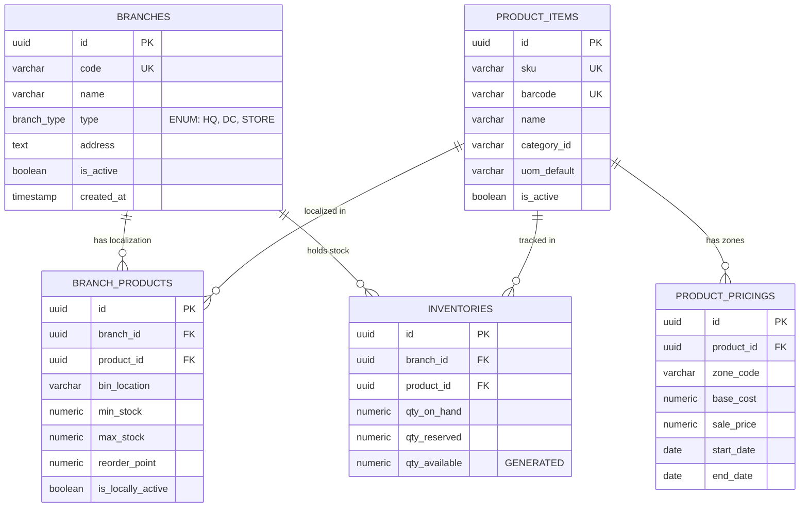

# Dokumentasi Arsitektur Database: ERP Multi-Cabang dengan Distribution Center (DC)

Dokumen ini menjelaskan rancangan struktur data induk (*Master Data Management*) berbasis PostgreSQL untuk sistem ERP yang mengelola entitas Kantor Pusat (HQ), Pusat Distribusi (DC), dan Jaringan Cabang/Toko Ritel dengan arsitektur **Hybrid Hub-and-Spoke**.

---

## 1. Entity Relationship Diagram (ERD) - Mermaid Syntax

Anda dapat menyalin kode di bawah ini ke editor visual seperti [Mermaid Live Editor](https://mermaid.live) atau ekstensi VS Code Markdown untuk merender diagram hubungan entitas secara grafis.



---

## 2. Kamus Data & Spesifikasi Tabel (PostgreSQL)

### A. Tabel `branches`
Menyimpan seluruh titik operasional dalam jaringan korporasi.
* **`id` (UUID, Primary Key):** Pengidentifikasi unik global. Menghindari bentrokan ID jika dilakukan replikasi data terdistribusi.
* **`code` (VARCHAR, Unique):** Kode unik human-readable untuk integrasi logistik (contoh: `DC-JKT01`, `BR-BDG02`).
* **`type` (ENUM):** Membedakan perilaku logika bisnis sistem. `HQ` untuk kontrol finansial/MDM, `DC` untuk manajemen rantai pasok masal, dan `STORE` untuk unit penjualan ritel akhir.

### B. Tabel `product_items` (The Hub)
Berfungsi sebagai database master tunggal untuk definisi produk secara nasional.
* Data dasar seperti nama barang, nomor SKU, barcode internasional, dan jenis satuan barang dikunci di tingkat ini dan hanya dapat diubah oleh tim tata kelola data kantor pusat.

### C. Tabel `branch_products` (The Spoke)
Tabel ekstensi yang mengizinkan parameter logistik bersifat dinamis menyesuaikan kebutuhan operasional riil di lapangan.
* **`bin_location`:** Posisi rak spesifik (contoh: Lorong A, Rak 04). Sangat krusial di level DC untuk optimalisasi rute *picking* barang, namun bisa disesuaikan secara mandiri oleh toko kecil.
* **`reorder_point` (ROP):** Batas minimal stok pemicu otomatisasi sistem untuk menerbitkan dokumen *Stock Transfer Order* (STO) guna meminta pasokan ulang dari DC ke cabang bersangkutan.

### D. Tabel `product_pricings` (Zonasi Harga)
Memisahkan data logistik fisik barang dengan strategi penetapan harga pasar.
* Menggunakan pendekatan `zone_code` (seperti `ZONE-JAVA`, `ZONE-BALI`) agar satu kebijakan harga dapat diterapkan langsung ke sekelompok cabang yang berada di kawasan geografis yang sama, guna menyeimbangkan variabel ongkos kirim kargo.

### E. Tabel `inventories` (Real-time Stock Tracker)
Menyimpan posisi kuantitas stok aktual saat ini.
* **`qty_on_hand`:** Total unit barang fisik yang berada di dalam bangunan gudang/toko.
* **`qty_reserved`:** Jumlah stok yang sudah terikat kontrak pesanan penjualan (*Sales Order*) pelanggan atau komitmen alokasi pengiriman namun fisiknya belum keluar pintu gudang.
* **`qty_available`:** Atribut kalkulasi otomatis (`qty_on_hand - qty_reserved`) yang menjadi acuan utama sistem *e-commerce* atau kasir POS untuk memastikan barang valid dapat dijual untuk menghindari *overselling*.

---

## 3. Skrip Inisialisasi Database (DDL SQL)

```sql
-- EKSTENSI UNTUK GENERASI UUID
CREATE EXTENSION IF NOT EXISTS "uuid-ossp";

-- 1. ENUM TYPE
CREATE TYPE branch_type AS ENUM ('HQ', 'DC', 'STORE');

-- 2. TABEL BRANCHES
CREATE TABLE branches (
    id UUID PRIMARY KEY DEFAULT uuid_generate_v4(),
    code VARCHAR(20) UNIQUE NOT NULL,
    name VARCHAR(100) NOT NULL,
    type branch_type NOT NULL,
    address TEXT,
    is_active BOOLEAN DEFAULT TRUE,
    created_at TIMESTAMP WITH TIME ZONE DEFAULT CURRENT_TIMESTAMP,
    updated_at TIMESTAMP WITH TIME ZONE DEFAULT CURRENT_TIMESTAMP
);

-- 3. TABEL PRODUCT ITEMS (HUB)
CREATE TABLE product_items (
    id UUID PRIMARY KEY DEFAULT uuid_generate_v4(),
    sku VARCHAR(50) UNIQUE NOT NULL,
    barcode VARCHAR(50) UNIQUE,
    name VARCHAR(150) NOT NULL,
    category_id VARCHAR(50),
    uom_default VARCHAR(20) NOT NULL,
    is_active BOOLEAN DEFAULT TRUE,
    created_at TIMESTAMP WITH TIME ZONE DEFAULT CURRENT_TIMESTAMP,
    updated_at TIMESTAMP WITH TIME ZONE DEFAULT CURRENT_TIMESTAMP
);

-- 4. TABEL BRANCH PRODUCTS (SPOKE)
CREATE TABLE branch_products (
    id UUID PRIMARY KEY DEFAULT uuid_generate_v4(),
    branch_id UUID REFERENCES branches(id) ON DELETE CASCADE,
    product_id UUID REFERENCES product_items(id) ON DELETE CASCADE,
    bin_location VARCHAR(50),
    min_stock NUMERIC(12,4) DEFAULT 0,
    max_stock NUMERIC(12,4) DEFAULT 0,
    reorder_point NUMERIC(12,4) DEFAULT 0,
    is_locally_active BOOLEAN DEFAULT TRUE,
    updated_at TIMESTAMP WITH TIME ZONE DEFAULT CURRENT_TIMESTAMP,
    CONSTRAINT unique_branch_product UNIQUE (branch_id, product_id)
);

-- 5. TABEL PRODUCT PRICINGS
CREATE TABLE product_pricings (
    id UUID PRIMARY KEY DEFAULT uuid_generate_v4(),
    product_id UUID REFERENCES product_items(id) ON DELETE CASCADE,
    zone_code VARCHAR(20) NOT NULL,
    base_cost NUMERIC(15,4) NOT NULL,
    sale_price NUMERIC(15,4) NOT NULL,
    start_date DATE NOT NULL,
    end_date DATE,
    CONSTRAINT unique_product_zone UNIQUE (product_id, zone_code, start_date)
);

-- 6. TABEL INVENTORIES
CREATE TABLE inventories (
    id UUID PRIMARY KEY DEFAULT uuid_generate_v4(),
    branch_id UUID REFERENCES branches(id) ON DELETE RESTRICT,
    product_id UUID REFERENCES product_items(id) ON DELETE RESTRICT,
    qty_on_hand NUMERIC(12,4) NOT NULL DEFAULT 0,
    qty_reserved NUMERIC(12,4) NOT NULL DEFAULT 0,
    qty_available NUMERIC(12,4) GENERATED ALWAYS AS (qty_on_hand - qty_reserved) STORED,
    CONSTRAINT unique_inventory UNIQUE (branch_id, product_id)
);

-- 7. KONTROL INDEKS PERFORMA
CREATE INDEX idx_branch_products_composite ON branch_products (branch_id, product_id);
CREATE INDEX idx_inventories_composite ON inventories (branch_id, product_id);
CREATE INDEX idx_pricing_composite ON product_pricings (product_id, zone_code);
```

---
*Dokumen ini dirancang untuk pemodelan arsitektur sistem ERP berkinerja tinggi guna mendukung konsistensi relasional data multi-cabang.*